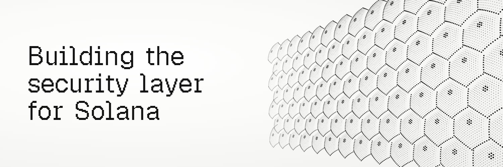
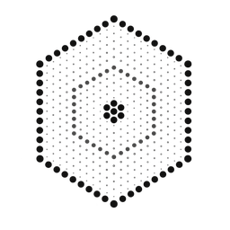
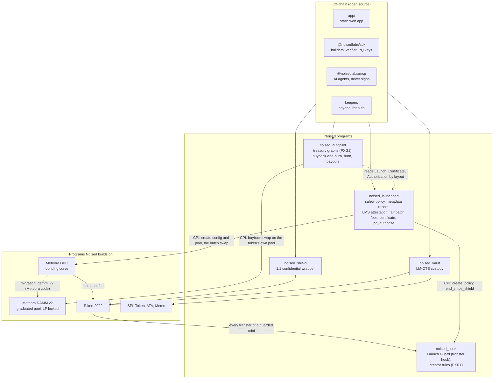
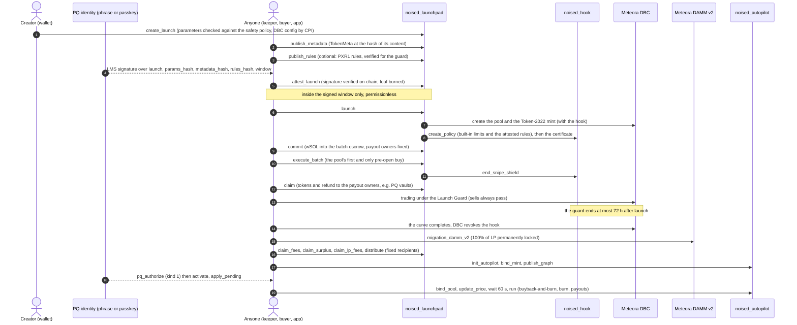

<p align="center">
  
</p>

<p align="center">
  <picture>
    <source media="(prefers-color-scheme: dark)" srcset="app/public/brand/noised-mark-white-256.png">
    
  </picture>
</p>

# Noised

<!-- repo-config:badges:start (generated by scripts/release/apply-repo-config.mjs from scripts/release/repo-config.json; do not edit by hand) -->
[](https://github.com/NoisedLabs/noised/actions/workflows/ci.yml) [](https://github.com/NoisedLabs/noised/blob/main/LICENSE) [](https://noised.fun) [](https://www.npmjs.com/package/@noisedlabs/sdk) [](https://www.npmjs.com/package/@noisedlabs/mcp) [](https://crates.io/crates/noised-lmots) [](https://crates.io/crates/noised-rules)
<!-- repo-config:badges:end -->

**The quantum security layer for Solana.** Website: [noised.fun](https://noised.fun).

Noised puts post-quantum signatures where they decide the most on Solana: whether a token is allowed to launch, and who can move what you keep in a Noised vault. A token launched with Noised can only go live after its creator's post-quantum key (a hash-based LMS signature, RFC 8554) has signed its exact settings, its on-chain name, symbol and icon, its optional launch rules and the time window in which it may open, and the Noised program checks that signature on-chain itself. The launch is also safe by construction: nobody, not even the creator, can mint more tokens, freeze holders, rename the token, pull the liquidity or block a sale, and nobody can buy before the fair opening batch. Everything runs on Solana's standard token program (Token-2022) and on [Meteora](https://meteora.ag)'s pools, and anyone can re-check every claim against the live chain with the open-source SDK, without trusting our website. It does not make Solana itself, or ordinary wallets, quantum-safe ([stated precisely](#post-quantum-and-privacy-stated-precisely)).

## Contents

- [What Noised is](#what-noised-is)
- [Why it is different](#why-it-is-different)
- [What is guaranteed, in plain words](#what-is-guaranteed-in-plain-words) and [what is not](#what-is-not-guaranteed)
- [Post-quantum and privacy, stated precisely](#post-quantum-and-privacy-stated-precisely)
- [Architecture](#architecture): the programs, the accounts, [the launch lifecycle](#the-launch-lifecycle)
- [QSL-1, the token standard](#qsl-1-the-token-standard)
- [For creators: what you can customize](#for-creators-what-you-can-customize)
- [Repository map](#repository-map) and [packages](#packages)
- [Program IDs (devnet)](#program-ids-devnet)
- [Quick start for developers](#quick-start-for-developers): install the SDK, verify a mint, plan a quick launch
- [Build and test from source](#build-and-test-from-source)
- [Releases and verifiable builds](#releases-and-verifiable-builds)
- [Security](#security): guarantees, limits, reviews, how to report
- [Roadmap](#roadmap)
- [Contributing](#contributing)
- [License](#license)

---

## What Noised is

Noised is five Solana programs, a TypeScript SDK, a web app and an MCP server for AI agents. In plain words, it gives you six things.

| Product | What it does for you | Where |
|---|---|---|
| **Launch** | Launch a token that **nobody can rug, not even its creator**. Every launch must be signed with its creator's post-quantum key before it can go live, and everyone who joins in the first minutes buys at the same fair price. Two ways in: **Quick launch** and **Custom launch** (below). | [`programs/noised-launchpad`](programs/noised-launchpad/), [`programs/noised-hook`](programs/noised-hook/) |
| **Autopilot** | Let a token's treasury run itself: buy back and burn, burn, or pay the people you named, on a schedule, within limits the chain enforces. Anyone can trigger a step that is due, for a small capped tip, so it keeps running without you. Optional. | [`programs/noised-autopilot`](programs/noised-autopilot/) |
| **Vault** | Keep tokens in a vault that only a post-quantum signature can open. Each one-time key signs exactly one withdrawal and is replaced in the same step. | [`programs/noised-vault`](programs/noised-vault/) |
| **Shield** | Hide your balances and transfer amounts (not who you deal with) by wrapping a token 1:1 into a private-balance version of itself. Optional and reversible. | [`programs/noised-shield`](programs/noised-shield/) |
| **Verify** | Check any Noised token yourself, against the live chain, without trusting our website: `verifyLaunch` and the QSL-1 checker in the SDK. | [`sdk/`](sdk/) |
| **AI agents** | An MCP server lets Claude, LangGraph or any MCP client read launches, check tokens, simulate rules and autopilots, and prepare **unsigned** autopilot transactions inside the on-chain limits. It never signs and never holds keys. | [`packages/noised-mcp`](packages/noised-mcp/) |

All of it is described by one open standard, **[QSL-1](docs/standard/QSL-1.md)**: a short, named set of safety rules that any wallet or app can check from a single account per token.

### Launch, in plain words

Every Noised launch:

- uses safe settings that nobody can change: no one can mint more tokens, freeze anyone or rename the token;
- stores the token's name, symbol, description and icon on-chain, not behind a link;
- must be signed by its creator's **post-quantum key** before it can go live, and the Noised program checks that signature itself. A future quantum computer that breaks ordinary wallet keys still could not launch a token in the creator's name, rename it, change its rules or choose when it opens;
- opens with a **fair batch**: everyone who joins in the first minutes buys at the same price, pro rata to what they put in, and nobody can buy earlier, not the creator, not a bot;
- locks **100% of its liquidity forever** when the token graduates from its bonding curve to a Meteora DAMM v2 pool;
- gets an **on-chain certificate** that anyone can re-check against the live chain.

The Noised programs hold every privileged role themselves, through program addresses that have no private key.

**Quick launch** is one short form: a name, a ticker, a logo, optional links, your trading fee (0.25% to 5% in the app; the SDK's `planQuickLaunch` accepts up to 8.33%, which keeps the fee plus its busy-market extra within the 10% ceiling) and where your share of the fees goes: to your wallet, back into the token (a daily buyback and burn run by the token's own Autopilot), or a split. Everything else uses the fair default settings. In the SDK it is one call, `planQuickLaunch`, which returns every step in order.

**Custom launch** is the full wizard: price curve, graduation threshold, fee schedule, batch caps, the launch guard, your own **launch rules** for the first hours (for example "no bot bundles in the first two minutes" or "no wallet-to-wallet transfers above 1,000 tokens") and an optional **Autopilot**. Both the rules and the Autopilot are signed with the same post-quantum key and enforced on-chain, and both are limited: rules can only refuse more buys or transfers, never a sale, and end with the launch guard (at most 72 hours); an Autopilot can only burn, buy back and burn, pay the recipients it names and tip whoever runs it. A launch with rules or an Autopilot is **programmable**, which is a feature you should read, not a safety level: a verifier shows its QSL-1 level with the tag **"programmable — read its rules"** and explains the rules in plain English, with warnings when they favour some wallets.

Guides for both are in the app's docs ([Launch a token](app/src/content/docs/pages/guides/launch-a-token.md)) and in the [SDK README](sdk/README.md).

### Autopilot

An Autopilot runs a token's treasury, which you fund by naming it as one of your fee recipients. Its steps (buy back and burn, burn, pay named recipients) run on a schedule, after another step, on graduation or on a price condition, each with a per-run cap, a budget per period and a run limit. Anyone can trigger a step that is due, for a small capped tip (at most 0.0001 SOL per run, a tenth of what the run moved, 0.005 SOL a day). You can hand some steps to an **operator**, such as an AI agent: it chooses only when and how much, inside the same limits, and your post-quantum key can remove it at any time. The treasury can never sell the token, and its money can only leave by those steps. Buybacks trade only on the token's own locked pool, within a price limit built from a slowly moving reference price and the lowest recently observed price. Changing an Autopilot needs your post-quantum key and takes effect only 72 hours later, so holders see every change coming; you can also freeze it forever. Details: [SPEC §9](docs/SPEC.md#9-autopilot-program-noised_autopilot).

### Vault and Shield

The **PQ vault** holds any SPL or Token-2022 token behind an LM-OTS one-time key (RFC 8554, `LMOTS_SHA256_N32_W4`). A withdrawal is signed by the vault's current key, reserves the payout and rotates the key in the same instruction; delivering the payout is a separate, permissionless step, so a signed withdrawal always goes through and a recipient can only delay its own payout. Launch participants can name their vaults as the receivers of their batch tokens and refunds, and creators can route fees into a vault. Details: [docs/POST_QUANTUM.md](docs/POST_QUANTUM.md), [SPEC §3](docs/SPEC.md#3-pq-vault-noised_vault--contract-for-clients).

The **Shield** wraps a token 1:1 into a Token-2022 confidential-balance "zToken" that hides balances and amounts. It does not hide who transacts with whom, and its encryption is not post-quantum. Details: [docs/PRIVACY.md](docs/PRIVACY.md).

### Verify and AI agents

`verifyLaunch(conn, mint)` re-reads the token, its pool, its certificate, its metadata record, its launch rules and its post-quantum signature from the chain and reports every check with a pass, warn or fail ([how to verify it yourself](docs/SECURITY_GUARANTEES.md#verify-it-yourself)). `checkQsl1(conn, mint)` runs the QSL-1 verification algorithm and `qslBadge(result)` turns the answer into the standard's plain-English badge.

[`@noisedlabs/mcp`](packages/noised-mcp/README.md) is a local MCP server (stdio) on top of the SDK. It gives AI agents eleven tools: read launches, rules and autopilots, check a token against QSL-1, simulate transfers and autopilots, and build **unsigned** autopilot transactions with a plain-English summary and a simulation. It never signs, holds no keys, refuses mainnet unless explicitly allowed, and marks every on-chain or RPC string as untrusted data. A LangGraph example wires it into an AI operator that waits for human approval, and a keeper with no model at all ([`examples/langgraph-operator`](packages/noised-mcp/examples/langgraph-operator/)).

## Why it is different

- **Post-quantum creator identity, verified on-chain.** Each creator has an LMS identity (`LMS_SHA256_M32_H10` over `LMOTS_SHA256_N32_W4`, 1,024 one-time leaves). The launchpad itself verifies its signature over the launch's parameters hash, the metadata record's hash, the launch rules' hash and the window (`attest_launch`: about 80k to 115k compute units measured, 170k projected for the worst case), records which leaf signed so that no leaf ever signs twice, and refuses to launch without it. The same identity signs every Autopilot change (`pq_authorize`). This is a real on-chain post-quantum check, not a promise in a database.
- **No wallet-derived post-quantum keys.** The identity and the vault keys come from a dedicated 24-word phrase or a passkey (WebAuthn PRF), **never from the wallet**. An Ed25519 signature is deterministic, so anything derived from a wallet signature can be recomputed by whoever recovers the wallet's private key, which is exactly what a quantum computer would do from the public address ([POST_QUANTUM.md §3.4](docs/POST_QUANTUM.md#34-why-the-identity-is-never-derived-from-the-wallet)).
- **No rugs by construction.** The safety rules are code paths, not settings: mint and freeze authorities are None and checked in the launch transaction, the metadata is immutable, the hook can never refuse a sale, fees follow recipients fixed at creation, and 100% of the liquidity is permanently locked at graduation in a position held by a program address with no instruction to withdraw it.
- **No admin keys.** No pause, no "update settings" instruction, no privileged withdrawal. The global configuration is written once and has no update path. After `create_launch` the creator's wallet has no powers at all: the identity attests, and anyone can open the launch inside its signed window.
- **A plan to become immutable.** Until finalization the upgrade authority is trusted for every guarantee, and we say so. The release checklist ends with `solana program set-upgrade-authority <id> --final` for all five programs after independent audits and verifiable builds ([OPERATIONS.md, Release and finalization](docs/OPERATIONS.md#release-and-finalization)). QSL-1 refuses to award any level to a token until its programs are final (condition C1.24): today every Noised token is at most a "candidate".
- **Checkable by anyone.** The SDK's verifier and QSL-1 checker read only live accounts (never a URL, never our server), and the [QSL-1 standard](docs/standard/QSL-1.md) writes the algorithm down so any wallet or indexer can implement it.

---

## What is guaranteed, in plain words

These hold for every launch that has a Noised certificate. Each one is enforced on-chain. None of them depends on the creator's goodwill or ours, except that, until the programs are finalized, whoever holds the upgrade authority could replace the code. The full table, with caveats and the tests that pin each row, is in [docs/SECURITY_GUARANTEES.md](docs/SECURITY_GUARANTEES.md).

| You can rely on | Why |
|---|---|
| **No one can mint more tokens.** | The mint authority is None. Token-2022 cannot undo that. Noised checks it in the launch transaction and aborts the launch if it fails. |
| **No one can freeze your tokens.** | The freeze authority is None, checked the same way. |
| **The name, symbol, description and icon are stored on-chain and can never change.** | They are an on-chain record at an address made from its own content, signed by the creator's post-quantum key. The launch gives the token exactly that name and symbol and checks the result. The metadata and metadata-pointer authorities are None. |
| **The creator's post-quantum key signed this exact launch.** | The program verifies a hash-based signature (LMS, RFC 8554) by the creator's identity over the launch's settings, its metadata, its launch rules and the time window in which it may open. Without it, or outside that window, the launch cannot go live. Inside the window anyone may open it, so no wallet key decides when. |
| **The token has no hidden powers.** | The token has exactly three extensions: metadata pointer, metadata and a transfer hook. The hook points to the Noised Launch Guard until graduation and to nothing afterwards. There is no permanent delegate, transfer fee, pause switch or default-frozen accounts. Extensions cannot be added after a mint is created. |
| **The creator gets no free tokens.** | There is no creator allocation and no vesting. A creator who wants tokens buys them in the opening batch, at the same price as everyone else. |
| **No one buys before the fair open, not even the creator.** | Buying from the pool is blocked until the opening batch has bought, even a buy so small that it receives nothing. The only purchase allowed before then is the batch's single purchase for all participants: the transfer hook recognizes it as the one buy made inside the launchpad's own batch instruction. The batch must also be the pool's first trade, so it always buys at the opening price. Everyone in the batch gets the same price, pro rata to what they committed, so splitting across wallets, or committing first, gives no advantage. If more is committed than the batch's cap, everyone's commitment is filled in the same proportion and the rest refunded. |
| **If the batch does not run, you get your SOL back.** | A batch that is not executed within its 10-minute window expires, and every commitment is refunded in full. That includes a batch that cannot run because someone traded the pool before it. |
| **Your share can go straight into post-quantum storage.** | When you join the batch, you can name your PQ vaults to receive the tokens and the refund. That choice is fixed at your first commitment, so nobody can redirect it later. Creator fees can go to a vault too, and the platform's own share always does. |
| **Selling is never blocked by Noised.** | The transfer hook allows every transfer into the pool (a sell) before applying any other rule, the creator's own rules included, and decides it before it even reads the rest of the launch's settings. Property tests check this over 200,000 random cases. |
| **Launch rules are temporary.** | Max-wallet, max-buy, the optional wallet-to-wallet pause and any rules the creator added end at a fixed time, at most 72 hours after launch. The hook is removed completely when the bonding curve completes. |
| **Creator rules are exactly what was signed.** | A creator's own launch rules are stored on-chain, signed with its post-quantum key, and installed byte for byte; the certificate records them. They can only refuse more buys or transfers, never a sale, a batch payout or anything after the guard, and they never apply to PQ vault withdrawals or Shield wraps and unwraps sent straight to those programs. |
| **An Autopilot only does what its plan says.** | Its treasury can only burn tokens, buy back and burn on the token's own pool, pay the recipients the plan names and pay capped tips. It never sells the token. Changes need the creator's post-quantum key and wait 72 hours; a frozen plan never changes. |
| **The liquidity cannot be pulled.** | At graduation, 100% of the liquidity goes into a Meteora DAMM v2 pool and is permanently locked. The position is held by a program address that has no instruction to withdraw it. There is no creator or partner migration fee; Meteora itself keeps a fixed 0.2% of the migrated liquidity, and 20% of any amount raised above the graduation threshold. |
| **Fees follow fixed rules.** | Fee recipients and their shares are fixed when the launch is created and can never change. The platform share is fixed per launch. Fees paid in the launched token are burned, never sold. |
| **There is no admin.** | No pause, no "update settings" instruction, no privileged withdrawal. The global configuration is written once and has no update path. |

## What is NOT guaranteed

Read this part as carefully as the part above.

- **Our own code, until it is finalized.** Until the programs' upgrade authority is set to None, whoever holds it could replace the code. Today that is the devnet deployer key.
- **An independent audit.** None has been done yet. The internal reviews listed under [Security](#security) are not one.
- **Price.** Noised stops creators from cheating. It does not stop a token from going to zero, and it does not stop early buyers from selling.
- **One person, one wallet.** Max-wallet and max-buy limits apply per token account and per transfer. Someone with many wallets can get around them. The opening batch is pro rata, so splitting wallets gains nothing there. The optional wallet-to-wallet pause stops tokens moving between wallets, and while the launch rules run, tokens can only go into token accounts that can never be handed to someone else. But control can change hands without any tokens moving, and nothing on Solana can see that: several people sharing one wallet, a smart wallet or program that gives control to someone new, a vault owner who signs the vault over to someone else's key, or someone allowed to spend another person's tokens.
- **Some routes wait for the launch rules to end.** While the rules run, tokens can only land in standard token accounts (the ones wallets create). A buy through an app that passes the tokens through an account of its own, or a vault payout to a hand-made account, fails until the rules end. Buying straight into your wallet always works, and selling is never blocked.
- **Creator rules can favour some wallets.** A creator's rules may, for example, let only wallets on its list buy until the guard ends (at most 72 hours), or do nothing at all while still looking like rules. Noised does not forbid this; it shows it. Read a launch's rules before you buy: the app and the SDK explain them in plain English and warn about such cases. Selling is never blocked.
- **Creator rules can be routed around.** They do not apply to PQ vault withdrawals or Shield wraps and unwraps, so someone can pass tokens around a creator's transfer rule through the Shield. The built-in limits (max-wallet, max-buy, the wallet-to-wallet pause) still apply to those routes.
- **An Autopilot needs someone to run it, and its buybacks are not perfectly priced.** Steps run only when someone triggers them (anyone can, for a tip). A buyback pays at most a small premium the plan sets over a slowly moving reference price, so a trader who sandwiches it can gain at most about that premium. Someone who keeps dumping the pool can delay buybacks. Someone who is the only one checking the price can lift the reference by at most about 5% an hour, or, after a drop nobody else noticed, make a buyback pay the old, higher price. Keepers check the price themselves before every buyback, and an independent price check every 10 minutes prevents both. An operator (for example an AI agent) acts only within the plan's limits, and its key is an ordinary wallet key.
- **Shared accounts can fill up.** While the launch rules run, the max-wallet limit also applies to accounts many people pay into, such as the privacy wrapper's pool for a token. Someone holding that much can fill it, and nobody can wrap that token until the rules end (at most 72 hours). Nothing is lost.
- **Meteora.** Noised runs on Meteora's programs, and Meteora can change them. On mainnet its programs can be upgraded by a 4-of-7 multisig with no timelock (on devnet, by a single key), and an upgrade can change what our finalized code relies on. A draft change (not deployed) would even let a single DBC operator remove a launch's transfer hook early, ending the snipe shield and the launch rules. Single-key DAMM v2 operators can disable a pool. They can raise a pool's base fee to as much as 10% and change its dynamic fee, within a 99% total cap. They can also close the configs that graduation needs. Locked liquidity cannot be withdrawn by anyone. In a disabled pool it also stops trading. Every graduated pool already carries Meteora's default dynamic fee for its tier, worth up to about a fifth of the tier on top of it (for example up to 7.2% on the 6% tier). See [who you still trust](docs/SECURITY_GUARANTEES.md#who-you-still-trust).
- **Token-2022 and Solana.** The token program and the associated-token-account program are controlled by classical keys (Token-2022 by a 4-of-6 multisig), validator feature gates can change the runtime, and Solana's consensus keys are not post-quantum.
- **Who goes first.** Block producers and the gateways in front of most of them see transactions before they land and can reorder, delay or drop them. Anyone willing to pay more priority can also crowd a launch's accounts for a while. The windows are long (at least a minute to commit, ten minutes for the batch) so this costs more the longer it lasts, but it is not impossible: crowding out the batch for its whole window cancels it (with full refunds), and inside a launch's opening window the first transaction to land opens it. Crowding out a launch's whole opening window keeps it closed for that window; the creator then signs a new opening time. If the creator had sent an earlier signature that never went through, whoever kept it could use it to open the launch at that earlier signed time instead, up to a week later; the SDK and the app make sure every signature already sent has landed or expired before signing a new time.
- **That the batch happens.** Besides the above, the fair open relies on every buy from Meteora's pool passing through the transfer hook, even a buy that receives nothing. Today it does, and tests against Meteora's mainnet program check it. If a Meteora upgrade ever let a buy slip past the hook before the batch, the batch would refuse to run and refund everyone in full rather than buy at a worse price, and the fair open would be lost ([details](docs/SECURITY_GUARANTEES.md#2-launch-fairness)).
- **Batch caps.** The per-wallet cap of the opening batch is per wallet, so it only limits naive concentration. Both caps have minimums (the batch's cap is at least a tenth of the graduation threshold), but a participant with more capital still gets a proportionally larger share.
- **One-time keys need their records.** Each one-time key (a vault key, or one of an identity's 1,024 leaves) may sign once, ever, and only the device that signed knows about a signature that has not landed yet. The SDK and the app keep durable records and refuse to sign while the chain shows signatures the device does not know about. Best practice: **use one device per quantum key, unless you import its records** on the other device first.
- **The website.** A compromised frontend, wallet or RPC can show you false information or ask you to sign a malicious transaction. You can check the chain yourself with the SDK's `verifyLaunch` or the Solana CLI ([how](docs/SECURITY_GUARANTEES.md#verify-it-yourself)).
- **Identity.** Anyone can create a token with the same name and symbol. Only the mint address, its certificate and the post-quantum identity that signed it identify a Noised launch.
- **Icons in other wallets.** The token's link field is empty by default, so other wallets show its name and symbol but no icon; the Noised app shows the icon and description from the on-chain record. The protocol also accepts an optional web link signed by the creator, for wallets that only show hosted icons; the Noised app does not offer it, and the content behind such a link could change.
- **Trading after the open.** Bots and sandwich attacks exist. Set a slippage limit.

## Post-quantum and privacy, stated precisely

- **Post-quantum launches.** Each creator has a post-quantum identity: an LMS key (RFC 8554, `LMS_SHA256_M32_H10` over `LMOTS_SHA256_N32_W4`) with 1,024 one-time leaves, derived from a dedicated 24-word phrase or a passkey, never from the wallet. The launchpad verifies its signature on-chain, records which leaves have signed so none signs twice, and refuses to launch without it. This protects *what launches and when*, the creator's launch rules included. The same identity signs every Autopilot change (the launchpad's `pq_authorize`, sharing the same one-time leaves); the Autopilot's operator and the keepers that run it use ordinary keys, limited by the plan. It does not make the token itself post-quantum: holders' wallets, Meteora's pools, Token-2022 and Solana's consensus remain classical. See [docs/POST_QUANTUM.md](docs/POST_QUANTUM.md) §3.
- **Post-quantum custody.** Tokens held in the **PQ vault** can only be moved with an LM-OTS hash-based signature (RFC 8554, parameter set `LMOTS_SHA256_N32_W4`), which gives about 128-bit security against a quantum attacker. Each one-time key signs exactly one withdrawal and is replaced in the same step. A signed withdrawal always goes through; the recipient can only delay receiving its own payout. This is *custody* protection, and it is only as strong as the token's own program and authorities. SOL or other tokens sent to the vault's address itself, instead of its token account, cannot be recovered.
- **NIST.** The parameter sets are defined in RFC 8554 and listed in NIST SP 800-208, which approves LMS (with LM-OTS as its one-time component) as a stateful hash-based signature scheme and restricts it: state must be managed, and it is approved for specific uses. Noised's keys are software keys derived from a phrase or a passkey, so Noised claims no NIST approval or validation.
- **Not quantum-proof.** Ordinary Solana wallets (Ed25519), Token-2022 confidential balances (ElGamal) and Solana itself are **not** post-quantum. The tokens Noised launches are ordinary tokens, and they are not "quantum-proof".
- **Privacy.** **Shield** is opt-in. It wraps a token 1:1 into a confidential-balance token that hides balances and transfer amounts. It does **not** hide who transacts with whom, so it is not Zcash-equivalent. Its encryption is not post-quantum. See [docs/PRIVACY.md](docs/PRIVACY.md).
- **"Superintelligence-proof."** No system can promise that. We read it as: no secrets to steal, no admins to phish, immutable code, and safety rules that anyone can check on-chain. Even an extremely capable attacker should then find nobody to persuade and no key to steal inside Noised. Some trust remains, and it is listed in [docs/SECURITY_GUARANTEES.md](docs/SECURITY_GUARANTEES.md#superintelligence-proof-interpreted).

---

## Architecture

Noised is five Anchor programs of its own (Anchor 1.2.1, SBPF v3) on top of Meteora's Dynamic Bonding Curve (DBC) and DAMM v2 programs and Token-2022. One program, the launchpad, holds every role of a launch through program-derived addresses (PDAs) that have no private key. The full picture, with money flows and the CPI depth budget, is in [docs/ARCHITECTURE.md](docs/ARCHITECTURE.md); the normative interface is [docs/SPEC.md](docs/SPEC.md); each program is described in [programs/README.md](programs/README.md).



Shared code: [`crates/noised-lmots`](crates/noised-lmots/) (LM-OTS and LMS verification, RFC 8554, `no_std`; used by the vault and the launchpad) and [`crates/noised-rules`](crates/noised-rules/) (the PXR1 rule format, the PXG1 graph format and their condition VM, `no_std`; used by the hook, the launchpad and the autopilot, and mirrored byte for byte by the SDK).

### The accounts that matter

| Account | Seeds (program) | What it holds |
|---|---|---|
| `Protocol` | `["protocol"]` (launchpad) | the treasury (a wSOL PQ vault) and `platform_fee_bps`; written once, no update instruction |
| `Launch` | `["launch", creator, launch_seed]` (launchpad) | every creator choice, the post-quantum identity, the timeline, batch caps and totals |
| Launch authority | `["authority", launch]` (launchpad) | data-less PDA: DBC pool creator, partner, fee claimer, owner of the locked LP position |
| Batch authority | `["batch", launch]` (launchpad) | data-less PDA: owns the batch escrows and makes the batch's one swap |
| `Identity` | `["identity", SHA256(0x21 ‖ lms_pk)]` (launchpad) | the creator's LMS public key and the bitmap of its 1,024 one-time leaves |
| `Attestation` | `["attestation", launch]` (launchpad) | the identity's signature over the launch, its metadata, its rules and its window (2,708 bytes) |
| `TokenMeta` | `["metadata", launch, metadata_hash]` (launchpad) | name, symbol, uri mode and the metadata document (description, icon, links), at the address of its own hash |
| `LaunchRules` | `["rules", launch, rules_hash]` (launchpad) | the creator's PXR1 launch rules (at most 1,228 bytes), at the address of their hash |
| `Certificate` | `["certificate", mint]` (launchpad) | what `launch` verified: twelve required check bits (`(checks & 4095) == 4095`; 8,191 with rules), the identity, the leaf, the metadata record, the rules hash |
| `Authorization` | `["auth", launch, [kind], payload_hash]` (launchpad) | an LMS-verified approval of an Autopilot change (kind 1 activate, 2 freeze, 3 revoke the operator) |
| `HookPolicy` | `["policy", mint]` (hook) | the Launch Guard's limits and timestamps and the attested rules bytes |
| `Autopilot` | `["autopilot", launch]` (autopilot) | the active and queued graph, the operator, the reference price and observations, run state (1,244 bytes) |
| Treasury authority | `["treasury", launch]` (autopilot) | data-less PDA that owns the treasury's token accounts; derivable before the launch exists |
| `Vault` | `["vault", mint, genesis_key_id]` (vault) | the vault's current one-time public key, its sequence and what is reserved |
| `Shield` | `["shield", base_mint]` (shield) | the zToken mint and the escrow of one base mint |

Who holds which power after `launch`: nobody can mint, freeze or rename; the hook is removed by DBC at graduation; the launchpad's PDAs own the LP position and have no instruction to remove liquidity; the identity alone signs metadata, rules and Autopilot changes; anyone may open an attested launch inside its window, run the batch, claim, collect and distribute fees, and run due Autopilot steps. Full table: [ARCHITECTURE.md §4](docs/ARCHITECTURE.md#4-who-holds-which-power).

### The launch lifecycle



Step by step, in words:

1. **Create.** The creator's wallet sends `create_launch`. The launchpad checks every parameter against its fixed safety policy (curve, fees, caps, windows, recipients, the identity) and creates the Meteora DBC transfer-hook config by CPI, holding every DBC role itself.
2. **Publish the metadata and the rules.** A throwaway fee payer publishes the `TokenMeta` record (name, symbol, description, a small PNG icon, links) and, for a Custom launch with rules, the `LaunchRules` record. Both live at the address of their own content's hash, so nobody can put other bytes there.
3. **Attest (LMS).** The creator's post-quantum identity signs a 221-byte message: the launch, its parameters hash, the creator, the metadata hash, the rules hash and the window. `attest_launch` verifies the signature on-chain and burns the leaf it used. A signature that cannot attest still lands and burns its leaf, so a revealed signature can always be consumed.
4. **Launch window.** Inside the signed window (1 minute to 1 hour, opening at most 7 days after signing), **anyone** can send `launch`. It creates the pool and the mint, checks the mint's authorities, extensions and metadata against the record, installs the hook policy with the attested rules, and writes the certificate. Outside the window it fails.
5. **Opening batch.** For the commit window (1 to 30 minutes) anyone commits SOL. Then anyone sends `execute_batch`, which makes the pool's first and only pre-open buy for everyone at once and ends the snipe shield. If it does not run within 10 minutes, every commitment is refunded.
6. **Claim.** Anyone can crank `claim`: each participant's tokens and unspent SOL go to the payout owners fixed at its first commit (its wallet or its PQ vaults).
7. **Trading under the guard.** Public trading opens. Until the guard ends (at most 72 hours) the Launch Guard enforces max-buy, max-wallet, the optional wallet-to-wallet pause, immutable-owner destinations and the creator's rules. Sells always pass.
8. **Graduation.** When the curve reaches its threshold, DBC revokes the hook in the same swap, and Meteora's `migration_damm_v2` moves the liquidity into a DAMM v2 pool where 100% of it is permanently locked.
9. **Fees.** Anyone can collect the trading fees and LP fees and `distribute` them by the recipients fixed at creation (the platform share always to the treasury vault). Fees paid in the launched token are burned.
10. **Autopilot.** If the creator set one up, keepers run its due steps for a capped tip: an `update_price` observation, a wait of at least 60 seconds, then the buyback-and-burn on the token's own pool, a burn or a payout. Changes need a new post-quantum authorization and wait 72 hours.

The timing rules are explained in [ARCHITECTURE.md §2](docs/ARCHITECTURE.md#2-launch-lifecycle); every instruction, account and error is in [SPEC §1](docs/SPEC.md#1-launchpad-program-noised_launchpad).

---

## QSL-1, the token standard

[QSL-1](docs/standard/QSL-1.md) ("Quantum Security Layer token, version 1", draft revision 0.4) defines a class of Solana tokens and how anyone recognizes them from live accounts. A QSL-1 token is an ordinary Token-2022 mint with a fixed, minimal configuration, launched by an immutable program that also fixes its liquidity, its fee routes and a time-bounded transfer hook that can never refuse a sale. That program records what it verified in one account per mint, the certificate at `["certificate", mint]`.

| Level | Name | What it means |
|---|---|---|
| L1 | No-rug | Nobody, the creator included, can mint more, freeze holders, change the metadata, withdraw the graduated liquidity, block sales or redirect fees (conditions C1.1 to C1.24). |
| L2 | Quantum-attested | L1, and the launch went live only because the creator's post-quantum identity signed its parameters, its on-chain metadata record, its launch rules (if any) and its launch window; anyone can re-verify that signature from account state (C2.1 to C2.8). |

- **"Programmable" is not a level.** Launch rules and an Autopilot are described next to the level ("QSL-1 L2 · programmable — read its rules") with plain-English warnings (buys limited to wallets the creator lists, rules on wallet-to-wallet transfers, rules on for more than an hour, automation an operator controls, automation that is not frozen). They never raise or lower a level.
- **Mainnet and final programs only.** A level exists only on mainnet-beta (checked by genesis hash) and only once the launchpad (and, until graduation, the hook) can no longer be upgraded (C1.24). Until then a checker says "candidate" at most. **No token meets QSL-1 today**, and on devnet a checker always says "candidate".
- **Reference checker.** `checkQsl1` and `qslBadge` in `@noisedlabs/sdk` implement the verification algorithm (§7) and the badge wording (Appendix A) condition by condition.
- **Proposals.** [SRFC-QSL-1.md](docs/standard/SRFC-QSL-1.md) proposes QSL-1 to wallets and apps; [SIMD-DRAFT-hash-based-signatures.md](docs/standard/SIMD-DRAFT-hash-based-signatures.md) drafts a native hash-based signature verification syscall for Solana, which would make on-chain post-quantum checks far cheaper.

## For creators: what you can customize

You choose the curve and the economics inside hard bounds. The program fixes everything that could hurt buyers. Bounds are enforced on-chain by `create_launch`.

| You choose | Bounds |
|---|---|
| Name, symbol, description, icon | name up to 32 bytes, symbol up to 10; a description and a 32x32 icon stored on-chain (up to 3,072 bytes in all) |
| When it opens | a window of 1 minute to 1 hour, starting at most 7 days after you sign it, with at least a minute of it left when your signature lands. If nobody opens it in time, you sign a new time. |
| Your post-quantum identity | from a passkey or a dedicated 24-word phrase |
| Decimals | 6 to 9 |
| Bonding curve (start price, 1 to 8 curve points) | validated by Meteora DBC |
| Graduation threshold | 1 to 100,000 SOL |
| Trading fee schedule | linear or exponential decay that must finish before the opening batch; optional volatility fee. After the schedule, the floor fee plus the largest possible volatility fee is at most 10%. |
| Post-graduation pool fee tier | 0.25%, 0.3%, 1%, 2%, 4% or 6% (plus Meteora's default dynamic fee for the tier) |
| Commit window before the fair open | 1 minute to 30 minutes |
| Launch guard duration | from the end of the opening window up to 72 h |
| Max wallet / max buy during the guard | off, or at least 0.1% / 0.01% of supply |
| Pause wallet-to-wallet transfers during the guard | on/off |
| Batch caps | total cap: how much the batch buys, from a tenth of the graduation threshold up to all of it (commitments above it are refunded pro rata); per-wallet cap: off, or at least 1/200 of the total cap |
| Fee recipients | 1 to 4 wallets or wSOL PQ vaults, shares summing to 100%; the token's own Autopilot treasury can be one |
| Launch rules (optional) | up to 16 rules over up to 8 wallets: time windows, per-transfer and per-account caps, wallet lists, allowed or refused apps, anti-bot instruction counts; they can only refuse more buys or transfers, never a sale, and end with the guard |
| Autopilot (optional) | up to 16 steps (buy back and burn, burn, pay up to 8 recipients), each with a schedule or condition, a per-run cap, a budget per period and a run limit; an optional operator; changes wait 72 hours; can be frozen forever |

Fixed for everyone: wSOL as the quote token; immutable metadata, stored on-chain; a post-quantum signature before the launch can go live; no creator allocation; 100% of liquidity permanently locked; no creator or partner migration fee (Meteora keeps its fixed 0.2% at migration); the Noised transfer hook only. Custom or third-party hook programs are not allowed: creators customize the guard with signed launch rules that the one Noised hook applies instead. The reason, and the lifecycle "launch hooks" that complement them, are in [docs/HOOKS.md](docs/HOOKS.md).

---

## Repository map

Every top-level directory and file:

| Path | What |
|---|---|
| [`programs/`](programs/) | The five on-chain programs, one Cargo crate each, plus three LiteSVM test workspaces. Overview: [programs/README.md](programs/README.md). |
| [`programs/noised-launchpad`](programs/noised-launchpad/) | Launchpad: safety policy, on-chain metadata record, launch rules record, post-quantum attestation, DBC launch by CPI, fair-open batch, fee routing, certificate, `pq_authorize` ([SPEC §1](docs/SPEC.md#1-launchpad-program-noised_launchpad)). Its LiteSVM end-to-end suite against the mainnet DBC, DAMM v2 and Token-2022 binaries is [`tests/litesvm`](programs/noised-launchpad/tests/litesvm/), a separate Cargo workspace. |
| [`programs/noised-hook`](programs/noised-hook/) | Launch Guard: Token-2022 transfer hook, stateless, bounded built-in rules plus the creator's signed launch rules; the batch ends its snipe shield ([SPEC §1.9](docs/SPEC.md#19-creator-launch-rules-and-the-hook-policy), [HOOKS](docs/HOOKS.md)) |
| [`programs/noised-autopilot`](programs/noised-autopilot/) | Autopilot: a launch's treasury run by a published, post-quantum-authorized graph, with keepers' tips, a slow reference price, a 72-hour timelock on changes and freezing ([SPEC §9](docs/SPEC.md#9-autopilot-program-noised_autopilot)); LiteSVM suite in [`tests/litesvm`](programs/noised-autopilot/tests/litesvm/) |
| [`programs/noised-vault`](programs/noised-vault/) | PQ vault: token vaults opened only by an LM-OTS signature; the key rotates in place; payouts are delivered by `release` / `release_to` ([SPEC §3](docs/SPEC.md#3-pq-vault-noised_vault--contract-for-clients)) |
| [`programs/noised-shield`](programs/noised-shield/) | Shield: 1:1 wrapper into a Token-2022 confidential-balance token ([SPEC §2](docs/SPEC.md#2-shield-program-noised_shield--opt-in-confidential-balances)); LiteSVM suite with confidential transfers in [`tests/litesvm`](programs/noised-shield/tests/litesvm/) |
| [`crates/`](crates/) | Shared `no_std` Rust crates: [`noised-lmots`](crates/noised-lmots/) (LM-OTS and LMS, RFC 8554, checked against the RFC's test vectors; used by the vault and the launchpad) and [`noised-rules`](crates/noised-rules/) (PXR1 launch rules, PXG1 autopilot graphs, their condition VM; used by the hook, the launchpad and the autopilot) |
| [`tests/integration`](tests/integration/) | LiteSVM tests of the vault, the hook and the launchpad's attestation and metadata record against mainnet dumps of Token-2022, SPL Token, the ATA program and DBC; the byte vectors the SDK must match ([`vectors/`](tests/integration/vectors/): vault withdrawals, LMS identities and attestations, metadata records, rules records and authorizations); the mutation check [`mutants.ps1`](tests/integration/mutants.ps1). A separate Cargo workspace. |
| [`sdk/`](sdk/) | TypeScript SDK `@noisedlabs/sdk` ([README](sdk/README.md), [CHANGELOG](sdk/CHANGELOG.md)): builders, the launch flow (quick launch included), `verifyLaunch`, the QSL-1 checker, PQ identities and vaults with their ledgers, launch rules and autopilot graphs (`@noisedlabs/sdk/programmable`), autopilot builders and keepers, the Shield client; runnable [`examples/`](sdk/examples/) |
| [`packages/noised-mcp`](packages/noised-mcp/) | MCP server `@noisedlabs/mcp` for AI agents ([README](packages/noised-mcp/README.md)), with the [LangGraph examples](packages/noised-mcp/examples/langgraph-operator/) |
| [`app/`](app/) | The web app: static Vite + React, deployable to IPFS, strict CSP, a simulated-chain demo build; its developer docs pages live in [`app/src/content/docs/pages/`](app/src/content/docs/pages/) ([README](app/README.md)) |
| [`idls/`](idls/) | The IDLs of the five Noised programs (generated by `anchor idl build`) and the vendored Meteora IDLs (DBC 0.2.1, DAMM v2) read by `declare_program!`, with Meteora's MIT license ([`LICENSE-meteora`](idls/LICENSE-meteora)) |
| [`scripts/`](scripts/) | `fetch-fixtures.sh` / `.ps1`: dump the mainnet programs and accounts the LiteSVM tests use and compare their hashes with the tested ones. `test-all.ps1`: build every program for SBPF v3 and run every Rust suite and the Python checks. `pq/lms_reference.py`: an independent standard-library Python implementation of LMS that re-derives the RFC vectors and the attestation, metadata and programmable vectors; `pq/lms_mutants.py`, `rules/rules_mutants.py`, `autopilot/autopilot_mutants.py`: mutation checks. `devnet/`: the devnet deploy, pre-flight and end-to-end scripts ([DEVNET.md](docs/DEVNET.md)). `release/`: the one place the public repository location is set ([`repo-config.json`](scripts/release/repo-config.json), applied by `apply-repo-config.mjs`) and the npm pre-publish check (`prepare-publish.mjs`). |
| [`docs/`](docs/) | The specification, architecture, guarantees, threat model, post-quantum design, hooks, privacy, operations, devnet report, internal reviews, research facts, recorded evidence and the QSL-1 standard. Index: [docs/README.md](docs/README.md). |
| [`output/`](output/) | Brand renders (logo, icon, banner) and the script that renders the banner. Not used by the build. |
| [`.github/workflows/`](.github/workflows/) | [`ci.yml`](.github/workflows/ci.yml): formatting and lints, every Rust suite, the Python checks, SDK, app and MCP builds and tests, `cargo-deny`, and a manual verifiable build. [`release.yml`](.github/workflows/release.yml): on a version tag, the full CI, verifiable program builds attached to the GitHub release with their hashes, and the npm and crates.io releases with provenance |
| `Cargo.toml`, `Cargo.lock` | The root Cargo workspace (`crates/*`, `programs/*`) with exact dependency pins and the release profile (overflow checks on); the lockfile is committed |
| `Anchor.toml` | Anchor 1.2.1 toolchain pin and the program IDs for localnet and devnet |
| `deny.toml` | `cargo-deny` policy (licenses, advisories, sources) |
| [`SECURITY.md`](SECURITY.md), [`CONTRIBUTING.md`](CONTRIBUTING.md), [`CODE_OF_CONDUCT.md`](CODE_OF_CONDUCT.md) | How to report a vulnerability, how to contribute, the code of conduct |
| [`LICENSE`](LICENSE), [`NOTICE`](NOTICE) | Apache-2.0 and the third-party notices |
| [`RELEASE_NOTES_v0.9.0.md`](RELEASE_NOTES_v0.9.0.md) | The notes of this release |

## Packages

| Package | Version | Registry | Source | What |
|---|---|---|---|---|
| [`@noisedlabs/sdk`](https://www.npmjs.com/package/@noisedlabs/sdk) | 0.9.0 | npm | [`sdk/`](sdk/) | The TypeScript SDK: everything to read, verify, build, sign (post-quantum) and simulate. ESM, Node 22.12+ and browsers. [README](sdk/README.md) |
| [`@noisedlabs/mcp`](https://www.npmjs.com/package/@noisedlabs/mcp) | 0.2.0 | npm | [`packages/noised-mcp/`](packages/noised-mcp/) | The MCP server for AI agents (`npx -y @noisedlabs/mcp@0.2.0`). [README](packages/noised-mcp/README.md) |
| `noised-lmots` | 0.1.0 | [crates.io](https://crates.io/crates/noised-lmots) | [`crates/noised-lmots/`](crates/noised-lmots/) | LM-OTS / LMS (RFC 8554) verification and signing, `no_std`. [README](crates/noised-lmots/README.md) |
| `noised-rules` | 0.1.0 | [crates.io](https://crates.io/crates/noised-rules) | [`crates/noised-rules/`](crates/noised-rules/) | PXR1 rules, PXG1 graphs and their VM, `no_std`. [README](crates/noised-rules/README.md) |
| The five programs (`.so`) | | GitHub releases, with SHA-256 sums | [`programs/`](programs/) | Verifiable SBPF v3 builds |
| QSL-1 and its proposals | draft 0.4 | | [`docs/standard/`](docs/standard/) | The token standard |

Install them with `cargo add noised-lmots` and `cargo add noised-rules` (see each crate's README for the client features), or depend on a reviewed commit of this repository by git.

## Program IDs (devnet)

The program IDs are the same on every cluster (each program's `declare_id!` is authoritative). **Only devnet has deployments today; mainnet has none.** Each devnet program was deployed on 2026-10-12 from the final verified build, made before the project's rename from Phalanx (same program IDs; see [DEVNET.md](docs/DEVNET.md#deployed-before-the-rename-to-noised)), and is upgradeable by the devnet deployer `EeGcnw6yAjVC73QdjdtQDqoQgjxDpm2amLWzdoX1Kxvf`.

| Program | Program ID | Devnet | SHA-256 of the deployed `.so` (= on-chain dump) |
|---|---|---|---|
| `noised_launchpad` | [`CfbRmsFpevhiXkbYK48orBDugdKznnezDiVekjAAbNgc`](https://explorer.solana.com/address/CfbRmsFpevhiXkbYK48orBDugdKznnezDiVekjAAbNgc?cluster=devnet) | deployed, upgradeable (846,896 bytes) | `b20d0a610db3f3e272e148719b645c6526cabad6bf63c0ad20d204a079f7fced` |
| `noised_hook` | [`cHHLLsEH4eHmqZBT4X5XqzutmkFw3daWSySPtV4csia`](https://explorer.solana.com/address/cHHLLsEH4eHmqZBT4X5XqzutmkFw3daWSySPtV4csia?cluster=devnet) | deployed, upgradeable (214,984 bytes) | `5f71b6812c62301e86bb369acfdff70d57721f61330cd78f8c5a55e0db45e141` |
| `noised_autopilot` | [`D5fuqCXNP7BkU3CyNrpZUFStgdZ6XwRkpURiK9v5esbx`](https://explorer.solana.com/address/D5fuqCXNP7BkU3CyNrpZUFStgdZ6XwRkpURiK9v5esbx?cluster=devnet) | deployed, upgradeable (402,032 bytes) | `46f3a4242ac4961bdbc7e24e4ec5e0bf17d25b925706468418c0b9cd386a61ea` |
| `noised_vault` | [`7BQ6FQomidBkd5z7fQfwr9Zt87oahMvMV5dFnw6Dz7nb`](https://explorer.solana.com/address/7BQ6FQomidBkd5z7fQfwr9Zt87oahMvMV5dFnw6Dz7nb?cluster=devnet) | deployed, upgradeable (279,608 bytes) | `c3be1ece4893576f9bae8c94da5b6d7afa3338144148e90d76a4f7fcd3afb132` |
| `noised_shield` | [`BUMHJyoS6JCz4pZDfryzXbFDorXb9nmGkj3ziR71z8E9`](https://explorer.solana.com/address/BUMHJyoS6JCz4pZDfryzXbFDorXb9nmGkj3ziR71z8E9?cluster=devnet) | **not deployed yet** | `1104ae12e301dab66729be44ca12ce3490f7993bb27c5fb98ab5263dd58735de` (the verified build intended for it) |

Programs Noised uses: Meteora DBC `dbcij3LWUppWqq96dh6gJWwBifmcGfLSB5D4DuSMaqN`, Meteora DAMM v2 `cpamdpZCGKUy5JxQXB4dcpGPiikHawvSWAd6mEn1sGG`, Token-2022 `TokenzQdBNbLqP5VEhdkAS6EPFLC1PHnBqCXEpPxuEb`, SPL Token `TokenkegQfeZyiNwAJbNbGKPFXCWuBvf9Ss623VQ5DA` ([SPEC, Program IDs](docs/SPEC.md#program-ids)).

The devnet protocol is initialized (`Protocol` `BTiVRCENNQB8wnDCbAAoufHX3EgDKG9AioTu3BiDKc5M`, platform fee 10%, treasury a wSOL PQ vault), and two test tokens were launched there end to end: [`4QQ2L5ptTtrGyMqPbQ7DSiEmD58GPHKvpRcJDdbVos73`](https://explorer.solana.com/address/4QQ2L5ptTtrGyMqPbQ7DSiEmD58GPHKvpRcJDdbVos73?cluster=devnet) (a Custom launch with a launch rule, whose refusal on-chain with `RuleDenied` was the point of the test) and [`FpV8CpGZ5bXR1iZ6Gn7UdmYs3UBGjTaBbMUuFVCXPgBB`](https://explorer.solana.com/address/FpV8CpGZ5bXR1iZ6Gn7UdmYs3UBGjTaBbMUuFVCXPgBB?cluster=devnet) (a Quick launch with a daily buyback Autopilot, run up to the graduation buy; graduation, migration and the buyback ran only on a Surfpool fork of devnet). Every transaction, with explorer links and compute units, is in [docs/DEVNET.md](docs/DEVNET.md).

**Check a deployment yourself:**

```bash
solana program show CfbRmsFpevhiXkbYK48orBDugdKznnezDiVekjAAbNgc -u devnet   # Authority: the deployer (not "none" yet)
solana program dump CfbRmsFpevhiXkbYK48orBDugdKznnezDiVekjAAbNgc launchpad.so -u devnet
sha256sum launchpad.so    # must print b20d0a61…7fced
```

A build of today's source is not byte-identical to the devnet binaries: the rename from Phalanx changed the source paths compiled into the programs and the vault's payout memo (`phalanx-vault payout` on devnet). Instructions, accounts, PDA seeds, errors, events and signature domain tags are unchanged, so SDK 0.9.0, the app and the MCP server work with the deployed programs. Mainnet will be deployed from verifiable builds of the tagged source ([below](#releases-and-verifiable-builds)).

---

## Quick start for developers

### 1. Install the SDK

```bash
npm install @noisedlabs/sdk@0.9.0 @solana/web3.js@^1.98.4   # or: pnpm add @noisedlabs/sdk @solana/web3.js
npm audit signatures                                      # the package carries npm provenance
```

`@solana/web3.js` 1.x is a peer dependency: your app provides it, and the SDK uses your copy. Node 22.12 or later, ESM only; browsers through a bundler such as Vite. Everything else (compatibility, browser notes, every API) is in the [SDK README](sdk/README.md).

### 2. Verify a mint

Check one of the devnet test tokens against the live chain. Nothing here signs or sends anything.

```ts
import { Connection, PublicKey } from "@solana/web3.js";
import { assertCluster, checkQsl1, qslBadge, verifyLaunch } from "@noisedlabs/sdk";

const conn = new Connection("https://api.devnet.solana.com", "confirmed");
await assertCluster(conn, "devnet"); // refuses an RPC whose genesis hash is not devnet's

// "Phalanx Devnet B": the devnet run's Custom launch with a launch rule (docs/DEVNET.md).
const mint = new PublicKey("4QQ2L5ptTtrGyMqPbQ7DSiEmD58GPHKvpRcJDdbVos73");

// Every check recomputed from live accounts; the certificate is never trusted on its own.
const report = await verifyLaunch(conn, mint);
console.log(report.overall, report.phase); // "pass" | "warn" | "fail", and the launch's phase
for (const c of report.checks) console.log(c.status, c.label, "-", c.detail);
if (report.pqOrigin?.verified === true) console.log("signed by its creator's post-quantum identity, leaf", report.pqOrigin.leaf);

// The QSL-1 verdict and the badge an app may show.
const badge = qslBadge(await checkQsl1(conn, mint));
console.log(badge.title); // on devnet always "QSL-1 candidate: not final yet"
if (badge.programmable !== null) {
  console.log(badge.programmable.text, "-", badge.programmable.link); // "... · programmable - read its rules"
  for (const w of badge.programmable.warnings) console.log("!", w);
}
```

On devnet, expect warnings for the upgradeable programs (Noised's and Meteora's) and a "candidate" badge: levels exist only on mainnet with finalized programs.

### 3. Plan a quick launch on devnet

`planQuickLaunch` turns the Quick launch form into a complete, validated plan: the parameters, the fee recipients, the metadata record, the Autopilot graph when fees go "back into the token", and the ordered steps with the SDK function behind each. It is pure: nothing is signed or sent.

```ts
import { Connection, type Keypair } from "@solana/web3.js";
import { assertCluster, clusterUnixTime, encodeIndexedPng, planQuickLaunch, pqIdentity } from "@noisedlabs/sdk";

declare const creator: Keypair;     // the creator's devnet wallet
declare const phrase: string;       // a SEPARATE 24-word post-quantum phrase, never the wallet's
declare const iconRgba: Uint8Array; // a 32x32 icon, RGBA, for example from a canvas

const conn = new Connection("https://api.devnet.solana.com", "confirmed");
await assertCluster(conn, "devnet");

// The creator's post-quantum identity: an LMS key with 1,024 one-time leaves.
const { master } = pqIdentity.importMaster(phrase);
const identity = await pqIdentity.deriveIdentity(master, "devnet", 0);
master.fill(0);

const now = await clusterUnixTime(conn); // the cluster's clock, in unix seconds (bigint)
const quick = planQuickLaunch({
  name: "Example",
  symbol: "EXMPL",
  description: "A fair-launched token.",
  iconPng: await encodeIndexedPng(iconRgba, 32, 32, 16),
  feeBps: 100,                    // a 1% trading fee
  feeDestination: "buyback-burn", // the creator's fees fund a daily buyback and burn
  creator: creator.publicKey,
  identity,
  opensAt: now + 900n,            // the launch window opens in 15 minutes
  nowSecs: now,
});

console.log(quick.summary.join("\n"));
for (const step of quick.steps) console.log(`${step.id} [${step.signer}] ${step.title}: ${step.sdk}`);
for (const w of quick.warnings) console.log("caution:", w);
```

Each step names its signer (`creator-wallet`, `throwaway-payer`, `pq-identity` or `anyone`) and the SDK functions to call. The [SDK README](sdk/README.md) runs the whole flow end to end: creating the launch, publishing the metadata, the post-quantum attestation with its durable leaf ledger, the Autopilot authorization, the launch, the batch and the claim. The devnet scripts that ran it for real are [`scripts/devnet/20-flow-a.mjs`](scripts/devnet/20-flow-a.mjs) (Quick launch) and [`scripts/devnet/30-flow-b.mjs`](scripts/devnet/30-flow-b.mjs) (Custom launch with rules).

### 4. Give an AI agent read access

```bash
claude mcp add noised -- npx -y @noisedlabs/mcp@0.2.0
```

It defaults to devnet and its public RPC. Configuration, every tool and the threat model are in the [MCP server README](packages/noised-mcp/README.md).

---

## Build and test from source

### Toolchain

| Tool | Version | Used for |
|---|---|---|
| Rust (host) | 1.98.0 (CI pin) | host tests, the LiteSVM suites, `cargo-deny` |
| Agave (Solana) CLI | 4.3.0 | `cargo-build-sbf` 4.3.0 with platform-tools v1.57; always `--arch v3` |
| Anchor | `anchor-lang` / `anchor-spl` **=1.2.1** (pinned in `Cargo.toml`); `anchor-cli` 1.2.1 | the programs; the CLI only to regenerate IDLs (`anchor idl build`) |
| LiteSVM | 0.17 (inside the test workspaces) | end-to-end tests against mainnet program dumps |
| Python | 3, standard library only | the independent LMS reference and the mutation scripts |
| Node.js | 22.12 or later (CI: 22) | the SDK, the app, the MCP server |
| pnpm | 11 (`packageManager`: pnpm@11.8.0) | installs with frozen lockfiles |
| Docker and `solana-verify` | `solana-verify` 0.5.2 | verifiable (deterministic) program builds, in Linux CI |
| Surfpool | 1.6.0 (optional) | rehearsing on a mainnet or devnet fork |

Why SBPF v3 everywhere: once the SIMD-0500 feature gate activates, only v3 programs can be deployed, upgraded or finalized. The bundled cargo-build-sbf 4.3.0 still defaults to v0, so `--arch v3` must be passed every time ([FACTS](docs/research/FACTS.md) #2, #9).

### Linux

```bash
# Rust (host) 1.98.0, Agave CLI 4.3.0 (bundles cargo-build-sbf 4.3.0 / platform-tools v1.57), Python 3, Node 22 + pnpm 11
sh -c "$(curl -sSfL https://release.anza.xyz/v4.3.0/install)"
export PATH="$HOME/.local/share/solana/install/active_release/bin:$PATH"
export CARGO_TARGET_DIR="$PWD/target"

# 1. The five programs, SBPF v3 (.so files land in $CARGO_TARGET_DIR/deploy)
for p in noised-hook noised-vault noised-launchpad noised-shield noised-autopilot; do
  cargo-build-sbf --manifest-path "programs/$p/Cargo.toml" --arch v3
done

# 2. Mainnet program and account dumps for the LiteSVM tests (see docs/OPERATIONS.md#test-fixtures)
bash scripts/fetch-fixtures.sh fixtures
export NOISED_FIXTURES_DIR="$PWD/fixtures" NOISED_FIXTURES="$PWD/fixtures"

# 3. Host tests of the root workspace (crates/*, programs/*)
cargo test --workspace --locked
cargo test -p noised-lmots --features signer,sha2-backend --locked   # RFC 8554 known answers
cargo test -p noised-rules --all-features --locked                   # the rules crate, every feature

# 4. The LiteSVM suites: separate Cargo workspaces, so separate target directories
export NOISED_SBF_DIR="$PWD/target/deploy"
CARGO_TARGET_DIR="$PWD/target-integration" cargo test --manifest-path tests/integration/Cargo.toml --locked
CARGO_TARGET_DIR="$PWD/target-lp-svm" cargo test --manifest-path programs/noised-launchpad/tests/litesvm/Cargo.toml --locked -- --test-threads=1
CARGO_TARGET_DIR="$PWD/target-sh-svm" cargo test --manifest-path programs/noised-shield/tests/litesvm/Cargo.toml --locked
CARGO_TARGET_DIR="$PWD/target-ap-svm" cargo test --manifest-path programs/noised-autopilot/tests/litesvm/Cargo.toml --locked

# 5. Independent Python re-derivations
python3 -I scripts/pq/lms_reference.py appendix-f crates/noised-lmots/tests/rfc8554_appendix_f.json
python3 -I scripts/pq/lms_reference.py attest-vectors tests/integration/vectors/lms.json
python3 -I scripts/pq/lms_reference.py metadata-vectors tests/integration/vectors/metadata.json
python3 -I scripts/pq/lms_reference.py programmable-vectors tests/integration/vectors/programmable.json

# 6. IDLs (only when an interface changes; anchor-cli 1.2.1)
anchor idl build -p noised_launchpad -o idls/noised_launchpad.json
```

### Windows

Native Windows needs the MSVC linker (Build Tools or a portable MSVC) and the Agave 4.3.0 CLI on PATH. Put that in a small PowerShell script of your own, point `NOISED_ENV_SCRIPT` at it, and dot-source it **in the same PowerShell session** as every cargo, Solana or Anchor command. The builds need tens of GB: put them on a drive with enough free space with `NOISED_BUILD_ROOT` (default `<repo>\target`).

```powershell
$env:NOISED_BUILD_ROOT = 'D:\noised-build'      # example: build output and scratch directories
. $env:NOISED_ENV_SCRIPT                        # optional: MSVC, Agave 4.3.0 CLI (cargo-build-sbf 4.3.0), caches
$env:CARGO_TARGET_DIR = "$env:NOISED_BUILD_ROOT\target"
$env:CARGO_BUILD_JOBS = '4'

cargo-build-sbf --manifest-path programs/noised-hook/Cargo.toml --arch v3
cargo-build-sbf --manifest-path programs/noised-vault/Cargo.toml --arch v3
cargo-build-sbf --manifest-path programs/noised-launchpad/Cargo.toml --arch v3
cargo-build-sbf --manifest-path programs/noised-shield/Cargo.toml --arch v3
cargo-build-sbf --manifest-path programs/noised-autopilot/Cargo.toml --arch v3

cargo test --workspace --locked
cargo test -p noised-lmots --features signer,sha2-backend --locked
cargo test -p noised-rules --all-features --locked

$env:NOISED_SBF_DIR = "$env:CARGO_TARGET_DIR\deploy"
$env:CARGO_TARGET_DIR = "$env:NOISED_BUILD_ROOT\target-integration"
cargo test --manifest-path tests/integration/Cargo.toml --locked
$env:CARGO_TARGET_DIR = "$env:NOISED_BUILD_ROOT\target-lp-svm"
cargo test --manifest-path programs/noised-launchpad/tests/litesvm/Cargo.toml --locked -- --test-threads=1
$env:CARGO_TARGET_DIR = "$env:NOISED_BUILD_ROOT\target-sh-svm"
cargo test --manifest-path programs/noised-shield/tests/litesvm/Cargo.toml --locked
$env:CARGO_TARGET_DIR = "$env:NOISED_BUILD_ROOT\target-ap-svm"
cargo test --manifest-path programs/noised-autopilot/tests/litesvm/Cargo.toml --locked

# Or the builds and Rust suites above in one go, each workspace in its own target dir under
# $env:NOISED_BUILD_ROOT (fixtures: $env:NOISED_FIXTURES_DIR, default <repo>\fixtures):
powershell -NoProfile -ExecutionPolicy Bypass -File scripts\test-all.ps1
```

**Never build two Cargo workspaces into the same target directory.** The LiteSVM suites are their own workspaces because LiteSVM 0.17 pins older `solana-*` crates that would otherwise downgrade the programs' dependency graph, and our program crates are `cdylib` + `lib`, so their rlibs carry no hash suffix and the workspaces overwrite each other's builds ([details](docs/OPERATIONS.md#test)). A plain `cargo test` at the root never runs them. The suites look for the `.so` files in `NOISED_SBF_DIR` first; `tests/integration` also refuses a `.so` that is not an SBPF v3 build, or that is older than its sources (set `NOISED_ALLOW_STALE_SBF=1` to override the age check knowingly). Fixtures come from `NOISED_FIXTURES_DIR` (the Shield's tests also accept `NOISED_FIXTURES`), default `fixtures/` at the repository root, where `scripts/fetch-fixtures.sh` / `.ps1` write them (gitignored).

### JavaScript: SDK, app and MCP server

```bash
# The SDK first: the app and the MCP server install it as a copy of ../sdk
cd sdk && pnpm install --frozen-lockfile && pnpm typecheck && pnpm test && pnpm build
cd ../app && pnpm install --frozen-lockfile && pnpm typecheck && pnpm test && pnpm build
VITE_NOISED_MOCK=1 pnpm build              # the simulated-chain demo build
cd ../packages/noised-mcp && pnpm install --frozen-lockfile && pnpm typecheck && pnpm build && pnpm test
cd examples/langgraph-operator && pnpm install --frozen-lockfile && pnpm typecheck
```

The repository does not set pnpm's store, cache or state location: set `pnpm_config_store_dir`, `pnpm_config_cache_dir` and `pnpm_config_state_dir` (or pnpm's global config) if they must live on another drive.

### What each suite covers

The Rust and Python numbers are from the last full verification run on the programs with audit round 4's fixes (2026-10-11, [summary](docs/evidence/2026-10-11-audit4-final-verification.md), overall PASS); the SDK's are from its suite at this release.

| Suite | Tests | What it covers |
|---|---:|---|
| Root workspace, `cargo test --workspace` | 323 | Unit and property tests of every program and crate: the Launch Guard's decisions (200,000-case property tests that sells are never blocked), the safety policy, payout and fee math, attestation and metadata rules, the vault's message layout, the Shield's policy, LM-OTS and LMS, PXR1 rules and PXG1 graphs with their VM, the autopilot's planning, price and governance logic |
| `noised-rules`, all features | 81 | The rule and graph codecs, the VM, differential and property tests, byte vectors shared with the SDK |
| `noised-lmots`, signer features | 35 | RFC 8554 Appendix F, RFC 4231 HMAC, the deterministic randomizer's known answer |
| `tests/integration` (LiteSVM) | 113 | The vault, the hook and the launchpad's attestation and metadata record against mainnet Token-2022, SPL Token, ATA and DBC dumps; the vectors the SDK must match |
| Launchpad LiteSVM | 84 | Whole launches against the mainnet DBC, DAMM v2 and Token-2022 binaries: policy, attestation, the batch, claims, fees, graduation, every audit round's regression tests |
| Shield LiteSVM | 19 | Wrapping and unwrapping, confidential transfers, the Launch Guard on wrap and unwrap |
| Autopilot LiteSVM | 36 | Every Autopilot action, refusal and invariant on launches graduated to the mainnet DAMM v2, with the launchpad's authorizations driving it |
| Python references | 4 checks | An independent LMS implementation re-deriving the RFC vectors and the attestation, metadata and programmable vectors |
| Mutation checks | 229, 234 and 180 mutants | `tests/integration/mutants.ps1` (vault, hook, launchpad), `scripts/autopilot/autopilot_mutants.py` (plus 12 documented equivalents), `scripts/rules/rules_mutants.py`: every killable mutant killed across the P1c, review-4 and audit-round-4 runs ([AUDIT.md §13](docs/AUDIT.md#13-mutation-testing)) |
| `@noisedlabs/sdk` (vitest) | 1,700 in 59 files | Every encoder, hasher and signer byte for byte against the Rust vectors; the builders, the verifier, QSL-1, the ledgers, the launch and autopilot flows, every audit-round-4 proof of concept as a regression test |
| App and MCP server (vitest) | | The app's flows against the simulated chain and a stubbed RPC, CSP and build checks; the MCP server's tools, untrusted-text handling and stdio protocol |

[SPEC §6](docs/SPEC.md#6-tests) maps every required scenario to its tests. CI runs all of the above on every pull request ([ci.yml](.github/workflows/ci.yml)), except the mutation checks, which are run by hand.

## Releases and verifiable builds

A version tag runs [`release.yml`](.github/workflows/release.yml): the full CI, then deterministic SBPF v3 builds of the five programs with `solana-verify` (Docker), attached to the GitHub release with `SHA256SUMS`, the on-chain-comparable `EXECUTABLE_HASHES` and a signed build-provenance attestation (`gh attestation verify <file> --repo NoisedLabs/noised`). Anyone can compare a deployed program with a release: `solana-verify get-program-hash -u <cluster> <program id>` must print the line of `EXECUTABLE_HASHES` for that program. The npm packages are published with npm provenance and the crates through crates.io trusted publishing, both from that workflow; no long-lived registry token is stored. Details: [OPERATIONS.md, Releases](docs/OPERATIONS.md#releases) and [Verifiable builds](docs/OPERATIONS.md#verifiable-builds-linux-ci).

The current devnet deployments predate the release workflow: they came from the verified local builds whose SHA-256 values are listed [above](#program-ids-devnet).

---

## Security

### Guarantees and limits, in one place

- What holds for every certified launch, what enforces it, whether it can change, and its caveats: [docs/SECURITY_GUARANTEES.md](docs/SECURITY_GUARANTEES.md).
- Who you still trust: Noised's upgrade authority until finalization; Meteora's upgrade multisig and operators; the Token-2022 multisig; validators and ordering gateways; your wallet, RPC and frontend; your passkey provider; an Autopilot's operator and keepers within their bounds ([the table](docs/SECURITY_GUARANTEES.md#who-you-still-trust)).
- Attack trees and the residual risk register: [docs/THREAT_MODEL.md](docs/THREAT_MODEL.md).
- The post-quantum design, its threat model and its limits: [docs/POST_QUANTUM.md](docs/POST_QUANTUM.md).

### Reviews so far (internal, not an independent audit)

Every review below was carried out by AI agents: finders per risk lens, skeptics whose job was to refute each finding, adversarial reviewers with proofs of concept against the real program builds, and fixers who added a regression test for every fix. **None of this is an independent audit.** Full record: [docs/AUDIT.md](docs/AUDIT.md).

| Review | Date | Scope | Findings | Outcome |
|---|---|---|---|---|
| Round 1 | 2026-10-08 | the four programs, `noised-lmots`, SDK, app | 20 confirmed reports describing 10 issues (3 high, 2 medium, 5 low); 4 rejected | every program fix with regression tests |
| Round 1b | 2026-10-08 | the round-1 fixes | 1 new high (a zero-output buy through the snipe shield), weak tests, a documentation claim, a size limit | all fixed |
| Clients review | 2026-10-08 | SDK and app after vault v4 | 9 (3 medium, 5 low, 1 info) | SDK side fixed in SDK 0.2 and 0.3 |
| Round 2 | 2026-10-08 | programs, SDK, app and the documents' claims | 16 confirmed (1 high, 4 medium, 11 low); 8 rejected | program fixes in PQ v2, SDK fixes in SDK 0.2 |
| PQ v2 spec and adversarial reviews | 2026-10-09 | the post-quantum v2 design and programs | 17 binding amendments; 7 findings (2 medium, 3 low, 2 info) | all applied or fixed |
| SDK v2 and SDK 0.3 reviews | 2026-10-09 | `@noisedlabs/sdk` 0.2 and 0.3 | 6 (2 medium, 4 low); 14 (3 medium, 5 low, 6 info) | all fixed |
| On-chain metadata review | 2026-10-09 | the metadata change to the launchpad | 2 (1 medium, 1 info) | fixed |
| Round 3 and its fix review | 2026-10-10 | the final programs and `noised-lmots`; then the fixes | 5 confirmed (1 medium, 2 low, 2 info); 3 info | 2 program fixes merged with tests and mutants, 1 client fix, documentation |
| Review 4 (programmable launches) | 2026-10-11 | the rules crate, creator rules, attestation v3, certificate v4, `pq_authorize`, the autopilot | 2 medium, 1 low, hardening items | program fixes merged; insider-only rules disclosed |
| **Audit round 4** | 2026-10-11 | all five programs, both crates, and the client code that holds custody or signs (SDK, MCP server, app) | programs: no exploitable issue in the launch path, the vault, the Shield or `noised-lmots`; autopilot 3 (1 low-medium, 2 low) and a keepers' rent drain (medium); clients: ID-F1 medium-high and smaller items | program fixes merged with tests and mutants; **all client fixes done in SDK 0.9.0, `@noisedlabs/mcp` 0.2.0 and the app** |

**Audit round 4's main finding, fixed.** As audited, a dishonest RPC could steer a second device that signs with the same post-quantum identity onto the one-time leaf of a signature it had withheld, so that one leaf signed two messages (ID-F1, medium-high, reported independently twice with proofs of concept). This is fixed in **SDK 0.9.0 and in the app**: the leaf is chosen from a secret, keyed probe that nothing on-chain can move; before anything is signed the client refuses when the chain shows used leaves this device has no record of (`UnknownLeavesError`), and the app then offers to import the other device's records or, for at most 3 unknown signatures and after reading the key's record again, a typed confirmation; every signature that names a time is checked against this device's clock (`ClockSkewError`); "is a signature pending, reserve, sign" runs under a cross-tab signing lock; and signatures that never landed are capped (`SignatureCapError`). Best practice remains: one device per quantum key, unless you import its records. Details: [AUDIT.md §16](docs/AUDIT.md#16-audit-round-4-all-five-programs-and-the-clients-2026-10-11).

### Reporting a vulnerability

Please report privately, never in a public issue or pull request:

- **Email:** `security@noised.fun`
- **GitHub:** [private vulnerability reporting](https://github.com/NoisedLabs/noised/security/advisories/new)

Acknowledgement within 72 hours, an initial assessment within 7 days, coordinated disclosure. Scope, safe harbour and what we especially want to hear about: [SECURITY.md](SECURITY.md). Test only on local validators, LiteSVM or devnet, never against mainnet. No bug bounty is live yet; reports made before one launches will be considered for retroactive rewards.

## Roadmap

1. **Independent audits.** At least two independent professional audits of all five programs and both crates, plus fuzzing and formal checks of the payout math where feasible, with every fix merged with a regression test ([OPERATIONS.md, Release and finalization](docs/OPERATIONS.md#release-and-finalization)).
2. **Finish the devnet run.** Graduation, migration, fees and the Autopilot buyback on devnet itself (so far they ran on a Surfpool fork of devnet), and the Shield's devnet deployment ([DEVNET.md, Next steps](docs/DEVNET.md#next-steps-finish-flow-a-then-the-shield)).
3. **Mainnet.** `security.txt` embedded in each program, verifiable builds at a tagged commit, deployment with the upgrade authority on a multisig, the treasury vault and `initialize_protocol`, the verification records, and a small mainnet smoke launch through the whole lifecycle.
4. **Finalization (immutability).** `solana program set-upgrade-authority <id> --final` for all five programs, the launchpad last, and `Authority: none` published for each. Only then can a token reach a QSL-1 level.
5. **Crates on crates.io.** `noised-lmots` and `noised-rules`, through crates.io trusted publishing.
6. **Standards.** Propose QSL-1 to wallets and apps ([sRFC draft](docs/standard/SRFC-QSL-1.md)) and a native hash-based signature verification syscall to Solana ([SIMD draft](docs/standard/SIMD-DRAFT-hash-based-signatures.md)).
7. **A bug bounty**, once the programs are audited.

## Contributing

Read [CONTRIBUTING.md](CONTRIBUTING.md) and the [code of conduct](CODE_OF_CONDUCT.md) first. Ground rules:

- Every on-chain dependency is pinned exactly (`=`), and `Cargo.lock` is committed. JavaScript dependencies are pinned exactly too, with lockfiles, no install scripts and a 7-day minimum release age. Do not loosen pins or add a dependency without a review of the new version.
- Never copy code from Meteora's program repositories. They are under a non-commercial licence. The IDLs in `idls/` come from Meteora's MIT-licensed SDKs.
- Program keypairs live in `.keys/` (gitignored) and never enter the repository; neither do deployer keys, wallets, phrases or `.env` files. `declare_id!` in each program is authoritative.
- Security-relevant changes need a test that fails without the change. Error numbers never change: new errors are appended.
- Never change a signed format or a seed in place ([OPERATIONS.md, Deployment invariants](docs/OPERATIONS.md#deployment-invariants)).
- Keep claims precise. Documentation that overstates a guarantee is a bug.

## License

Apache-2.0 ([LICENSE](LICENSE), [NOTICE](NOTICE)). Third-party material keeps its own license: the vendored Meteora IDLs come from MIT-licensed Meteora SDKs, with their license text in [idls/LICENSE-meteora](idls/LICENSE-meteora) and [sdk/src/idl/LICENSE-meteora](sdk/src/idl/LICENSE-meteora); the web app's fonts are under the SIL Open Font License 1.1 ([app/THIRD_PARTY_NOTICES.md](app/THIRD_PARTY_NOTICES.md)).

Built by NoisedLabs.
