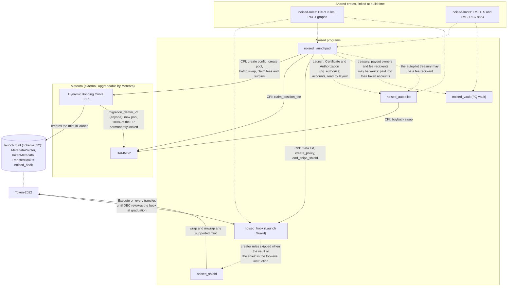

# Noised on-chain programs

The five Solana programs of Noised, "the quantum security layer for Solana": the **launchpad**, the **Launch Guard** transfer hook, the **PQ vault**, the **Shield** and the **Autopilot**. They are written with Anchor 1.2.1, except the vault, the Launch Guard hook, the Shield and the Autopilot, which are written without a framework (`pinocchio`) and keep the Anchor builds' ABIs byte for byte; all are built as SBPF v3.

This page describes every instruction, account, seed, error and event of the five programs, as the code in this directory and the IDLs in [`../idls/`](../idls/) define them. The implementation contract is [docs/SPEC.md](../docs/SPEC.md). If this page and the code ever disagree, the code and the IDLs are right and this page is wrong: please open an issue.

> **Status on 2026-10-12. Read this first.**
>
> - **Devnet only.** `noised_hook`, `noised_launchpad`, `noised_autopilot` and `noised_vault` are deployed on Solana **devnet** (test SOL only). They were deployed from the verified builds made before the project was renamed from Phalanx (the `phalanx_*.so` files), at the same program ids as today's `noised_*` programs ([docs/DEVNET.md](../docs/DEVNET.md#deployed-before-the-rename-to-noised)).
> - **The Shield is not deployed**, on any cluster.
> - **No mainnet deployment** exists.
> - **All deployed programs are upgradeable.** Their upgrade authority is the devnet deployer key `EeGcnw6yAjVC73QdjdtQDqoQgjxDpm2amLWzdoX1Kxvf`, which can replace their code at any time.
> - **Not audited by a professional security firm.** Every review so far was internal and carried out by AI agents ([docs/AUDIT.md](../docs/AUDIT.md)). None of them is an independent audit.
> - **The plan:** professional audit(s), then a mainnet deployment from verifiable builds, then finalization: the upgrade authority is set to None, so the code can never change again ([docs/OPERATIONS.md](../docs/OPERATIONS.md#release-and-finalization)).
>
> Do not use these programs with funds you cannot afford to lose.

## Contents

1. [Overview](#1-overview)
   - [The five programs](#11-the-five-programs) · [How they fit together](#12-how-they-fit-together) · [Shared crates](#13-shared-crates) · [What all five have in common](#14-what-all-five-have-in-common) · [Reading this page](#15-reading-this-page)
2. [Launchpad (`noised_launchpad`)](#2-launchpad-noised_launchpad)
   - [Purpose](#21-purpose) · [Instructions](#22-launchpad-instructions) · [Accounts and PDAs](#23-launchpad-accounts-and-pdas) · [Signed messages and hashes](#24-signed-messages-and-hashes) · [Safety policy](#25-safety-policy) · [Certificate](#26-certificate) · [Invariants](#27-launchpad-invariants) · [Errors](#28-launchpad-errors) · [Events](#29-launchpad-events) · [CPIs, dependencies and costs](#210-launchpad-cpis-dependencies-and-costs) · [Source and tests](#211-launchpad-source-and-tests)
3. [Launch Guard hook (`noised_hook`)](#3-launch-guard-hook-noised_hook)
   - [Purpose](#31-purpose) · [Instructions](#32-hook-instructions) · [Accounts](#33-hook-accounts) · [Decision order](#34-decision-order-of-execute) · [Invariants](#35-hook-invariants) · [Errors](#36-hook-errors) · [Events](#37-hook-events) · [Dependencies and costs](#38-hook-dependencies-and-costs) · [Source and tests](#39-hook-source-and-tests)
4. [PQ vault (`noised_vault`)](#4-pq-vault-noised_vault)
   - [Purpose](#41-purpose) · [Instructions](#42-vault-instructions) · [Accounts and the withdraw message](#43-vault-accounts-and-the-withdraw-message) · [Mint eligibility and delivery](#44-mint-eligibility-and-delivery) · [Invariants](#45-vault-invariants) · [Errors](#46-vault-errors) · [Events](#47-vault-events) · [CPIs, dependencies and costs](#48-vault-cpis-dependencies-and-costs) · [Source and tests](#49-vault-source-and-tests)
5. [Shield (`noised_shield`)](#5-shield-noised_shield)
   - [Purpose](#51-purpose) · [Instructions](#52-shield-instructions) · [Accounts and the zToken mint](#53-shield-accounts-and-the-ztoken-mint) · [Invariants](#54-shield-invariants) · [Errors](#55-shield-errors) · [Events](#56-shield-events) · [CPIs, dependencies and costs](#57-shield-cpis-dependencies-and-costs) · [Source and tests](#58-shield-source-and-tests)
6. [Autopilot (`noised_autopilot`)](#6-autopilot-noised_autopilot)
   - [Purpose](#61-purpose) · [Instructions](#62-autopilot-instructions) · [Accounts and PDAs](#63-autopilot-accounts-and-pdas) · [Authorizations and the timelock](#64-authorizations-and-the-timelock) · [How `run` works](#65-how-run-works) · [Reference price](#66-reference-price) · [Invariants](#67-autopilot-invariants) · [Errors](#68-autopilot-errors) · [Events](#69-autopilot-events) · [CPIs, dependencies and costs](#610-autopilot-cpis-dependencies-and-costs) · [Source and tests](#611-autopilot-source-and-tests)
7. [A launch across the five programs](#7-a-launch-across-the-five-programs)
8. [Building and testing](#8-building-and-testing)
9. [Verifying a deployed program](#9-verifying-a-deployed-program)
10. [Ground rules for changes](#10-ground-rules-for-changes)
11. [Further reading](#11-further-reading)

---

## 1. Overview

### 1.1 The five programs

| Crate | Program | Program id | What it does | Devnet | Deployed `.so` |
|---|---|---|---|---|---:|
| [`noised-launchpad`](noised-launchpad/) | `noised_launchpad` | `CfbRmsFpevhiXkbYK48orBDugdKznnezDiVekjAAbNgc` | Creates and runs token launches on Meteora's Dynamic Bonding Curve (DBC): a fixed safety policy, an on-chain metadata record, optional creator launch rules, an on-chain check of the creator's post-quantum (LMS) signature, a fair-open batch, fee routing and a launch certificate. Also lands the creator identity's post-quantum authorizations that the Autopilot uses. | deployed (pre-rename build) | 846,896 bytes |
| [`noised-hook`](noised-hook/) | `noised_hook` | `cHHLLsEH4eHmqZBT4X5XqzutmkFw3daWSySPtV4csia` | Launch Guard: the Token-2022 transfer hook of every launch mint while its bonding curve runs. Snipe shield (only the batch can buy first), max-buy, max-wallet, an optional wallet-to-wallet lock, immutable-owner destinations and the creator's launch rules, all ending at most 72 hours after launch. Sells are never refused. | deployed (pre-rename build) | 214,984 bytes |
| [`noised-vault`](noised-vault/) | `noised_vault` | `7BQ6FQomidBkd5z7fQfwr9Zt87oahMvMV5dFnw6Dz7nb` | PQ vault: token custody that only an LM-OTS (RFC 8554) hash-based signature can move. The protocol treasury must be one, and launch payouts and fee shares can go to one. | deployed (pre-rename build) | 279,608 bytes |
| [`noised-shield`](noised-shield/) | `noised_shield` | `BUMHJyoS6JCz4pZDfryzXbFDorXb9nmGkj3ziR71z8E9` | Shield: wraps any supported token 1:1 into a Token-2022 "zToken" with confidential balances, and back. | **not deployed** | not deployed (build: 69,736 bytes; the Anchor build was 288,640) |
| [`noised-autopilot`](noised-autopilot/) | `noised_autopilot` | `D5fuqCXNP7BkU3CyNrpZUFStgdZ6XwRkpURiK9v5esbx` | Autopilot: runs a launch's treasury by a published graph (PXG1) that the launch's post-quantum identity authorized: buy back and burn, burn, pay declared recipients, with keepers' tips, a slow reference price and a 72-hour timelock on changes. | deployed (pre-rename build) | 402,032 bytes |

The sizes are those of the deployed `phalanx_*.so` builds ([docs/DEVNET.md](../docs/DEVNET.md#programs-on-devnet)), which equal the final audit-round-4 verification builds of 2026-10-11 ([evidence](../docs/evidence/2026-10-11-audit4-final-verification.md)); the shield's Anchor figure is from that verification, and its build is now the framework-free rewrite (same ABI, [§5.8](#58-shield-source-and-tests)). Their SHA-256 hashes are in [section 9](#9-verifying-a-deployed-program).

### 1.2 How they fit together



In words:

- **Launchpad and Meteora.** The launchpad creates each launch's DBC config by CPI (`create_launch`) and the pool and mint by CPI (`launch`), with the Launch Guard as the mint's transfer hook. It makes the batch's single buy (`execute_batch`), claims trading fees and surplus from DBC, and claims LP fees from DAMM v2 after graduation. Graduation itself is Meteora's: the swap that completes the curve revokes the hook, and anyone can then call DBC's `migration_damm_v2`, which moves the liquidity into a DAMM v2 pool whose LP position is permanently locked and held by the launch's own PDA.
- **Launchpad and the hook.** Only the launchpad can write a hook policy (in `launch`, signed by its `["hook-authority"]` PDA) and only its `execute_batch` can end a policy's snipe shield early. Token-2022 calls the hook's `execute` on every transfer of the mint until the hook is revoked.
- **Launchpad and the Autopilot.** The launchpad's `pq_authorize` writes `Authorization` accounts signed by the launch's post-quantum identity; the Autopilot reads them, and the `Launch` and `Certificate` accounts, by layout. There is no CPI between the two. The Autopilot's treasury PDA can be one of a launch's fee recipients.
- **The vault.** The protocol treasury must be a wSOL vault, and a committer's tokens and refund, and creator fee shares, can be paid straight into vaults. The launchpad recognizes a vault by its account bytes, without a CPI.
- **The shield.** It wraps any supported mint, launch mints included. The hook skips the creator's launch rules (never its built-in checks) when the vault or the shield is the transaction's top-level instruction.
- **Shared crates.** `noised-rules` is used by the hook, the launchpad and the Autopilot; `noised-lmots` by the launchpad and the vault.

### 1.3 Shared crates

| Crate | What the programs use from it | Used by |
|---|---|---|
| [`noised-lmots`](../crates/noised-lmots/) | LM-OTS `LMOTS_SHA256_N32_W4` verification and key ids (vault), LMS `LMS_SHA256_M32_H10` verification and identity ids (launchpad). RFC 8554, `no_std`, checked against the RFC's test vectors; on-chain it hashes with the `sol_sha256` syscall. ([README](../crates/noised-lmots/README.md)) | `noised_launchpad`, `noised_vault` |
| [`noised-onchain`](../crates/noised-onchain/) | Anchor 1.2.1-compatible building blocks for programs written without a framework (pinocchio): the account list and every account constraint with Anchor's error numbers and log lines, `init`, exit and `close`, Borsh arguments and events, PDAs, rent and clock, system and token CPIs, SPL Token / Token-2022 parsing and transfer-hook account resolution, each tested against the Anchor or SPL code it replaces. ([PORTING](../crates/noised-onchain/PORTING.md)) | `noised_vault`, `noised_hook`, `noised_shield`, `noised_autopilot` |
| [`noised-rules`](../crates/noised-rules/) | The PXR1 launch-rules format (verify, evaluate, `rules_hash`) and the PXG1 graph format (verify, due-ness, epochs, caps, shares, `graph_hash`), with their condition VM. `no_std`, allocation-free on the verify and evaluate paths. Its README is normative for both byte formats ([PXR1](../crates/noised-rules/README.md#pxr1-launch-rules), [PXG1](../crates/noised-rules/README.md#pxg1-autopilot-graphs)). | `noised_hook`, `noised_launchpad`, `noised_autopilot` |

On-chain, `noised-lmots` and `noised-rules` are linked with no features (verification only); the signer and SHA-2 backend features are used only by tests and clients. `noised-onchain` has no features; its host-only helpers (`host`, log and CPI capture) are compiled out of program binaries.

### 1.4 What all five have in common

- **Framework and toolchain.** `anchor-lang` and `anchor-spl` pinned to `=1.2.1` in the root [`Cargo.toml`](../Cargo.toml); IDLs generated with `anchor-cli` 1.2.1. The vault, the hook, the Shield and the Autopilot are the exceptions: they link only `pinocchio` (`=0.11.2`) and the shared [`noised-onchain`](../crates/noised-onchain/) crate, and their IDLs are maintained by hand and checked against the programs by host tests ([§3.9](#39-hook-source-and-tests), [§4.9](#49-vault-source-and-tests), [§5.8](#58-shield-source-and-tests), [§6.11](#611-autopilot-source-and-tests)). Every program is built for **SBPF v3** with `cargo-build-sbf --arch v3` (Agave CLI 4.3.0, platform-tools v1.57, pinned in `[workspace.metadata.solana] tools-version`). The release profile has `overflow-checks = true`, `lto = "fat"` and `codegen-units = 1`; the Autopilot alone is optimized for size (`opt-level = "s"`, `[profile.release.package.noised-autopilot]`).
- **Crates.** Each program crate is `crate-type = ["cdylib", "lib"]` with `publish = false`, and has the usual Anchor features (`cpi`, `no-entrypoint`, `idl-build`, ...); the vault, the hook, the Shield and the Autopilot have `cpi`, `no-entrypoint` and `no-log-ix-name` (the hook's `cpi` brings Anchor's CPI client, for the launchpad; it links anchor-lang into the caller's binary, never into the hook's).
- **No admin.** No program has an admin key, a pause switch, a settings-update instruction or a privileged withdrawal ([SECURITY_GUARANTEES](../docs/SECURITY_GUARANTEES.md#5-governance-and-code) G1). The launchpad's one-time `initialize_protocol` is signed by its upgrade authority and can never run again.
- **Nothing is closed** except the vault's `Payout` accounts, which `release` / `release_to` close to the account that paid their rent.
- **Fixed program ids.** Each program's id is its `declare_id!`, and programs refer to each other by hard-coded ids: the hook names the launchpad (the only writer of policies), the vault and the shield; the launchpad links the hook crate and names the vault's id; the Autopilot names the launchpad's. Every external program (Meteora DBC and DAMM v2 with their authority PDAs, Token-2022, SPL Token, the ATA program, SPL Memo, the instructions sysvar, the wSOL mint) is a constant too ([SPEC, Program IDs](../docs/SPEC.md#program-ids)). No program takes a program id unchecked from an account.
- **Domain tags keep the old name.** Signed formats and hashes start with tags such as `PHX-ATTEST-V3`, `PHX-AUTH-V1` and `PHX-PQV4` ("PHX" for Phalanx, the project's original name). They are protocol constants inside every signature and never change ([SPEC §3.10](../docs/SPEC.md#310-client-key-derivation-and-signing-rules-sdk)).

### 1.5 Reading this page

- **Seeds** are written `["launch", creator, launch_seed]`: the byte string `b"launch"`, then the 32 bytes of each key or value. All PDAs are under the program of the section they appear in, unless stated.
- **Sizes** include Anchor's 8-byte account discriminator. **Discriminators** are shown in hex (the first 8 bytes of `sha256("account:<Name>")`, `sha256("global:<instruction>")` or `sha256("event:<Name>")`, as the IDLs record them; the hook's `execute` uses the SPL transfer-hook interface's own discriminator instead).
- **"Permissionless"** means any fee payer may send the instruction; what it can do is still fixed by the accounts and the signed data.
- **Optional accounts** (`opt`): pass the program's own id for "none", as Anchor 1.x expects.
- **Errors** are Anchor custom errors, numbered from 6000 in declaration order. Anchor's own errors can also appear, notably `ConstraintSeeds` (2006) and `AccountNotInitialized` (3012).
- **Legacy and v1 transactions.** A legacy transaction is at most 1,232 bytes. A v1 transaction (SIMD-0385, live on mainnet since 2026-09-15) is at most 4,096 bytes. The instructions that carry a hash-based signature or a large record need v1 and are sent from a throwaway or keeper key; no user wallet ever has to sign a v1 transaction ([SPEC §3.9](../docs/SPEC.md#39-transactions-and-the-v1-wire-format)).
- **Costs.** Compute units (CU) and byte sizes below are measurements quoted from SPEC, DEVNET, the evidence files and AUDIT; each line says where it comes from. Single runs vary by a few thousand CU with PDA bump searches.

---

## 2. Launchpad (`noised_launchpad`)

Program id `CfbRmsFpevhiXkbYK48orBDugdKznnezDiVekjAAbNgc` · source [`noised-launchpad/src/`](noised-launchpad/src/) · IDL [`idls/noised_launchpad.json`](../idls/noised_launchpad.json) · 14 instructions, 10 account types, 14 events, 49 errors · spec [SPEC §1](../docs/SPEC.md#1-launchpad-program-noised_launchpad)

### 2.1 Purpose

In plain words: the launchpad lets anyone launch a token that nobody can rug, not even its creator. The settings that could hide a rug are fixed by the program. The token's name, symbol, description and icon are stored on-chain. The launch can only go live once the creator's post-quantum key has signed it, and only in the time window that signature names. Everyone who joins in the first minutes buys at the same price in one batch, and fees are routed by rules fixed when the launch is created.

Precisely:

- `create_launch` validates the creator's `LaunchParams` against a fixed safety policy ([§2.5](#25-safety-policy)) and creates the launch's DBC transfer-hook config by CPI, with every other DBC field fixed by the program (mint and freeze authority, LP, vesting, migration fees, metadata authority). The parameters name the creator's post-quantum identity (`pq_identity`).
- The token's metadata (name, symbol, uri mode and a document with its description and icon) is an on-chain record (`publish_metadata`) at the address its content hashes to. Optional creator launch rules (PXR1) are a record too (`publish_rules`).
- `attest_launch` verifies on-chain an LMS signature (RFC 8554) by that identity over the launch's configuration, metadata record, rules record and launch window, and burns the one-time leaf that signed. Any valid signature lands, to burn its leaf; only the right one attests.
- `launch` runs only with that attestation and only inside its window, and inside it anyone may run it. It creates the pool and mint from the attested record, installs the Launch Guard policy with the attested rules, and only then writes a certificate whose flags come from re-reading the live mint, DBC config, pool and policy.
- Every DBC role (pool creator, partner and fee claimer, leftover receiver, LP owner) is a PDA of this program. No private key controls a launch after it starts.
- A fair-open batch replaces the race at the open: commits are pooled and bought in one swap, then paid out pro rata to payout owners fixed at the first commit. `execute_batch` then ends the hook's snipe shield, so trading opens at once.
- Fees are routed by immutable rules: the platform share to the treasury (a wSOL PQ vault), the rest to the creator's recipients. LP fees paid in the launched token are burned, never sold.
- `pq_authorize` lands other authorizations by the same identity (same leaf bitmap), which the Autopilot consumes.

### 2.2 Launchpad instructions

Listed in lifecycle order. Instruction names, arguments and accounts are those of the IDL; the checks and errors are read from the handlers in [`instructions/`](noised-launchpad/src/instructions/). Normative descriptions: [SPEC §1.4](../docs/SPEC.md#14-instructions).

| Instruction and arguments | Who may call it | What it does | Key checks | Errors it can return |
|---|---|---|---|---|
| `initialize_protocol(platform_fee_bps: u16)` | **Only the program's upgrade authority** (`authority` signs and pays). | Creates the global `Protocol` account once: the treasury and the platform fee share. No instruction changes it afterwards. | `program.programdata_address() == program_data` and `program_data.upgrade_authority_address == Some(authority)`; `platform_fee_bps <= 5,000`; `treasury` is a Noised PQ vault of wSOL (`pq::is_vault_of`: owned by `noised_vault`, `Vault` discriminator, version 4, mint wSOL); `init`, so it runs once. | `NotUpgradeAuthority`, `InvalidProtocolParams` |
| `create_launch(launch_seed: [u8; 32], params: LaunchParams)` | Anyone. The `creator` signs and pays (its own wallet, a legacy transaction). | Validates `params` ([§2.5](#25-safety-policy)), CPIs DBC `create_config_with_transfer_hook` (config = the `["dbc-config", launch]` PDA as signer; fee claimer and leftover receiver = the launch authority; quote = wSOL; transfer-hook program = `noised_hook`; payer = creator), and writes the `Launch` (version 2, `Configured`) with `params_hash = SHA256(borsh(params))` and snapshots of the protocol's treasury and fee share. | `policy::validate` in this order: decimals, threshold, curve, migration fee option, open delay, guard, max-wallet, max-buy, batch caps, base fee, dynamic fee, fee ceiling, recipients (not the launch authority or batch authority PDA), non-zero `pq_identity`. `quote_mint` is wSOL; `hook_program` is `noised_hook` and executable; DBC program and event authority addresses; DBC must own the config afterwards. | `InvalidDecimals`, `InvalidThreshold`, `InvalidCurve`, `InvalidMigrationFeeOption`, `InvalidOpenDelay`, `InvalidGuard`, `InvalidMaxWallet`, `InvalidMaxBuy`, `InvalidBatchCap`, `InvalidBaseFee`, `FeeScheduleTooLong`, `InvalidDynamicFee`, `FeeTooHigh`, `InvalidRecipients`, `InvalidPqIdentity`, `AccountMismatch`, `UnsafeConfig`, `MathOverflow` |
| `publish_metadata(name: string, symbol: string, flags: u8, uri: string, doc: string)` | Anyone (in practice the throwaway key that then sends the attestation, in a v1 transaction). `payer` signs and pays the rent. | Writes a `TokenMeta` record whole at `["metadata", launch, metadata_hash_v2(name, symbol, flags, uri, doc)]`. Idempotent: an existing record already holds these bytes, so nothing is written or emitted. A pre-funded address is taken over. | Launch `Configured`. `policy::validate_metadata`, in this order: flags are 0, 1 (inline uri) or 2 (external uri); document at most 3,072 bytes and uri at most 200; name 1..=32 and symbol 1..=10 bytes; with the external flag the uri is `https://` plus at least one byte, at most 200 bytes, every byte printable ASCII (0x21..=0x7E), otherwise the uri is empty; the inline flag needs a non-empty document. Lengths are UTF-8 bytes. | `WrongLaunchState`, `InvalidMetadataFlags`, `MetadataTooLong`, `InvalidMetadata` |
| `publish_rules(bytes: bytes)` | Anyone (in practice the attestation's throwaway key, v1). `payer` signs and pays. Optional: a launch without rules attests the zero hash. | Writes a `LaunchRules` record whole at `["rules", launch, SHA256("PHX-RULES-V1" ‖ bytes)]`. Idempotent; a pre-funded address is taken over. | Launch `Configured`; the bytes verify as PXR1 for the launch's `guard_secs` (`noised_rules::RuleSet::verify`). | `WrongLaunchState`, `InvalidRules` |
| `attest_launch(lms_pk: [u8; 56], lms_sig: bytes, metadata_hash: [u8; 32], rules_hash: [u8; 32], not_before: i64, not_after: i64)` | **Anyone may relay; the LMS signature authorizes.** `payer` signs (a throwaway key, v1 transaction) and pays the first rents. | Verifies an LMS signature over the 221-byte message v3 ([§2.4](#24-signed-messages-and-hashes)), burns its leaf in the signing identity's bitmap (creating the `Identity` on first use), and writes every field of the `Attestation` only if the signature **attests**; otherwise it only burns the leaf and emits `PqLeafConsumed`. | Before anything is burned: `token_meta` must be the address `["metadata", launch, metadata_hash]`, and `rules` the address `["rules", launch, rules_hash]`, or none for the zero hash. Then: the signature verifies; its leaf is unused. It attests only if (1) the attestation is free: never written, or the launch is still `Configured` and `now > attestation.not_after`; (2) the signer is `launch.pq_identity`; (3) the window lasts 60..=3,600 s, opens at most 7 days ahead and `max(now, not_before) + 60 <= not_after`; (4) the metadata record exists (`pq::is_metadata_record`); (5) for a non-zero rules hash, the rules record exists (`pq::is_rules_record`). A launch in any status is accepted, so a revealed signature always stays landable. | `InvalidPqSignature`, `PqLeafUsed`, Anchor `ConstraintSeeds` (2006) for a wrong `token_meta`, `rules`, identity or attestation account; `InvalidPqIdentity` only on a SHA-256 collision; `MathOverflow` |
| `launch()` | **Anyone, only inside the attested window** `not_before <= now <= not_after`. `payer` and `base_mint` (a fresh keypair of the payer's choice) sign. A legacy transaction of 23 accounts. | CPIs DBC `initialize_virtual_pool_with_token2022_transfer_hook` (creator = the launch authority PDA) with the record's name and symbol and the uri derived from it; checks the mint, the DBC config and the pool; CPIs `noised_hook::initialize_extra_account_meta_list` and `noised_hook::create_policy` (signed by `["hook-authority"]`) with the attested rules; re-reads the policy; writes the `Certificate`; sets `launch_ts`, `commit_end_ts`, `execute_end_ts`, `guard_end_ts` and `status = Live`. Atomic: if any check fails, nothing of the launch exists. | Launch `Configured`, `has_one` DBC config and launch authority; `["attestation", launch]` names this launch and its identity (an empty, burn-only attestation is refused); the `TokenMeta` is version 1 for this launch and the attested hash; the rules record is present exactly when the attested rules hash is not zero, and its bytes hash to it again; window; mint post-conditions ([§2.6](#26-certificate)); every fixed DBC config value; pool config, creator, mint and vaults; all twelve required check bits; the written policy equals what was asked, rules included. | `WrongLaunchState`, `AccountMismatch`, `AttestationMismatch`, `NotLaunchWindow`, `UnsafeMint`, `MetadataMismatch`, `UnsafeConfig`, `UnsafePolicy`, `InvalidMaxWallet` / `InvalidMaxBuy` (a non-zero cap that rounds to zero), `MathOverflow`; Anchor `AccountNotInitialized` (3012) for a missing record, `ConstraintSeeds` (2006) for another record |
| `commit(amount: u64)` | Anyone. The committer (`owner`) signs and pays. | Moves `amount` wSOL (SPL Token `transfer_checked`) from the owner's wSOL account into the batch wSOL escrow (the batch authority's ATA, created if needed), creates or updates the `Commit` and adds to `total_committed`. The first commit fixes the payout owners `token_owner` and `refund_owner`. | Launch `Live`; `launch_ts <= now < commit_end_ts`; `amount > 0`; batch not executed; each payout owner is the committer or a Noised PQ vault of the paid mint (the base mint for tokens, wSOL for the refund), then fixed; the committer's total stays `<= batch_wallet_cap` when the cap is set; when `token_owner` is a vault, `payout_vault` (`["payout-vault", launch, token_owner]`) adds up every commit naming that vault and is held to the same cap; when it is the committer, `payout_vault` must be none. The total cap never refuses a commit. | `WrongLaunchState`, `AccountMismatch`, `ZeroAmount`, `NotCommitWindow`, `AlreadyExecuted`, `InvalidPayoutOwner`, `CapExceeded`, `MathOverflow` |
| `execute_batch()` | Anyone, once. `payer` signs (and pays for the batch base escrow if missing). **Must be a top-level instruction.** | One DBC `swap2_with_transfer_hook` signed by the batch authority: input the batch wSOL escrow, output the batch base escrow (Token-2022 ATA, created if needed), PartialFill, `amount_0 = min(total_committed, batch_total_cap)`, minimum out 0. Records `quote_spent` and `tokens_out` from the escrows' balance changes, sets `executed`, then CPIs `noised_hook::end_snipe_shield`. Remaining accounts: exactly `[extra_account_meta_list, policy, instructions sysvar, noised_hook]`. | Launch `Live`; not executed; `commit_end_ts <= now < execute_end_ts`; `total_committed > 0`; the DBC pool's `has_swap == 0` (the batch is the pool's first swap); the four hook accounts in canonical order; `quote_spent <= amount_in`; `tokens_out > 0`. A batch that cannot run expires at `execute_end_ts` and is refunded in full by `claim`. | `WrongLaunchState`, `AccountMismatch`, `AlreadyExecuted`, `NotExecuteWindow`, `EmptyBatch`, `PoolAlreadyTraded`, `InvalidHookAccounts`, `PayoutExceedsEscrow`, `EmptySwap`, `MathOverflow`; called by CPI, its buy is refused by the hook (hook error 6000 `SnipeShield`) |
| `claim(owner: pubkey)` | **Anyone** (a permissionless crank; funds only ever go to the commit's payout owners). `payer` signs and pays for missing ATAs. | Pays one commit once. Executed batch: `floor(tokens_out × amount / total_committed)` tokens to the token owner's canonical Token-2022 ATA, and `floor((total_committed − quote_spent) × amount / total_committed)` wSOL to the refund owner's canonical wSOL ATA. Expired batch: the whole commit in wSOL. While the hook is active, the four hook accounts go in the remaining accounts. | Launch `Live`; `commit` at `["commit", launch, owner]` with `commit.owner == owner`; not claimed; `token_owner` and `refund_owner` equal the commit's; before execution and expiry, refused; running totals stay within `tokens_out` and the refundable wSOL; each ATA is the owner's canonical ATA for that mint and token program, created if missing, owned by the token program and of that mint (its owner field is deliberately not compared). | `WrongLaunchState`, `AccountMismatch`, `AlreadyClaimed`, `BatchPending`, `InvalidPayoutOwner`, `PayoutExceedsEscrow`, `InvalidRecipientAccounts`, `InvalidHookAccounts`, `MathOverflow` |
| `claim_fees()` | Anyone. `payer` signs and pays for the launch authority's token accounts if missing. | CPIs DBC `claim_trading_fee2` (fee claimer = launch authority, at most 0 base and `u64::MAX` quote) into the launch authority's wSOL ATA. Works before migration only; DBC refuses it afterwards. | Launch `Live`, `has_one` pool, base mint, DBC config, launch authority; DBC addresses; something was claimed. | `WrongLaunchState`, `AccountMismatch`, `NothingToDo`, `MathOverflow`; DBC errors propagate |
| `claim_surplus()` | Anyone. `payer` signs. | After the curve completes, CPIs DBC `partner_withdraw_surplus` and `creator_withdraw_surplus` (both roles are the launch authority), each only if not done yet, into the launch authority's wSOL ATA. | Launch `Live`, `has_one` pool, DBC config, launch authority; not both surplus withdrawals done (read from the DBC pool). | `WrongLaunchState`, `AccountMismatch`, `NothingToDo`, `MathOverflow`; DBC errors propagate |
| `claim_lp_fees()` | Anyone. `payer` signs. | After migration, CPIs DAMM v2 `claim_position_fee` for one LP position held by the launch authority: base tokens to its Token-2022 ATA, wSOL to its wSOL ATA. One position per transaction. | Launch `Live`, `has_one` base mint and launch authority; the position NFT account is a Token-2022 account of the launch authority holding 1; `checks::verify_lp_position`: the DAMM v2 pool's mints are (base mint, wSOL), the position belongs to that pool and to that NFT; DAMM v2 program, pool authority and event authority addresses; something was received. | `WrongLaunchState`, `AccountMismatch`, `InvalidPosition`, `NothingToDo`, `MathOverflow` |
| `distribute()` | Anyone. `payer` signs and pays for missing token accounts. | Splits the launch authority's whole wSOL balance: `floor(balance × platform_fee_bps / 10,000)` to the treasury's canonical wSOL ATA (the treasury vault's own token account), the rest to the stored recipients by bps (rounded down; the last recipient takes the remainder). Then burns the launch authority's whole base-token balance (`burn_checked`). Remaining accounts: `[wallet_i, wsol_ata_i]` for every stored recipient, in order. | Launch `Live`, `has_one` base mint, launch authority and treasury; exactly two remaining accounts per recipient, each wallet the stored one; every ATA canonical, created if missing (owner field not compared); a non-zero wSOL or base balance; the split sums to the balance. | `WrongLaunchState`, `AccountMismatch`, `InvalidRecipientAccounts`, `NothingToDo`, `PayoutExceedsEscrow`, `MathOverflow` |
| `pq_authorize(lms_pk: [u8; 56], lms_sig: bytes, kind: u8, payload_hash: [u8; 32])` | **Anyone may relay; the LMS signature authorizes.** `payer` signs (a throwaway key, v1 transaction). | Verifies an LMS signature over the 140-byte authorization message, burns its leaf in the **same** identity bitmap as attestations, and writes the `Authorization` at `["auth", launch, [kind], payload_hash]` whole only if nothing was written there yet, the signer is `launch.pq_identity` and `kind` is 1, 2 or 3; otherwise it only burns the leaf (`PqLeafConsumed`). The launchpad gives the payload no meaning: the Autopilot reads it ([§6.4](#64-authorizations-and-the-timelock)). | The signature verifies; its leaf is unused; every account but the payer is fixed by the seeds. Time and slot come from `Clock`, never from arguments. | `InvalidPqSignature`, `PqLeafUsed`, Anchor `ConstraintSeeds` (2006); `InvalidPqIdentity` only on a SHA-256 collision; `MathOverflow` |

<details>
<summary><b>Account order of every launchpad instruction (from the IDL)</b></summary>

| Instruction | Discriminator | Accounts | Accounts, in order (s = signer, w = writable, opt = optional: pass the program id for "none") |
|---|---|---:|---|
| `initialize_protocol(platform_fee_bps: u16)` | `bce9fc6a8692ca5b` | 6 | `authority` (s, w) · `protocol` (w) · `treasury` · `program` · `program_data` · `system_program` |
| `create_launch(launch_seed: [u8; 32], params: LaunchParams)` | `efdfff8627797f3e` | 10 | `creator` (s, w) · `protocol` · `launch` (w) · `launch_authority` · `dbc_config` (w) · `quote_mint` · `hook_program` · `dbc_program` · `dbc_event_authority` · `system_program` |
| `publish_metadata(name: string, symbol: string, flags: u8, uri: string, doc: string)` | `b3bfa861c719e592` | 4 | `payer` (s, w) · `launch` · `token_meta` (w) · `system_program` |
| `publish_rules(bytes: bytes)` | `d5f586baa8198fe9` | 4 | `payer` (s, w) · `launch` · `rules` (w) · `system_program` |
| `attest_launch(lms_pk: [u8; 56], lms_sig: bytes, metadata_hash: [u8; 32], rules_hash: [u8; 32], not_before: i64, not_after: i64)` | `b518c935f67efd4f` | 7 | `payer` (s, w) · `launch` · `identity` (w) · `attestation` (w) · `token_meta` · `system_program` · `rules` (opt) |
| `launch()` | `99f15de116454a3d` | 23 | `payer` (s, w) · `launch` (w) · `launch_authority` · `dbc_config` · `base_mint` (s, w) · `pool` (w) · `base_vault` (w) · `quote_vault` (w) · `quote_mint` · `dbc_pool_authority` · `hook_authority` · `extra_account_meta_list` (w) · `policy` (w) · `certificate` (w) · `hook_program` · `dbc_program` · `dbc_event_authority` · `token_2022_program` · `token_program` · `system_program` · `attestation` · `token_meta` · `rules` (opt) |
| `commit(amount: u64)` | `df8c8ea5e5d09c4a` | 13 | `owner` (s, w) · `launch` (w) · `commit` (w) · `batch_authority` · `quote_mint` · `owner_quote_account` (w) · `batch_quote_escrow` (w) · `token_program` · `associated_token_program` · `system_program` · `token_owner` · `refund_owner` · `payout_vault` (w, opt) |
| `execute_batch()` | `709fd333ee46d43c` | 21 | `payer` (s, w) · `launch` (w) · `batch_authority` · `dbc_config` · `pool` (w) · `base_vault` (w) · `quote_vault` (w) · `base_mint` (w) · `quote_mint` · `batch_quote_escrow` (w) · `batch_base_escrow` (w) · `dbc_pool_authority` · `dbc_program` · `dbc_event_authority` · `token_program` · `token_2022_program` · `associated_token_program` · `system_program` · `hook_authority` · `policy` (w) · `hook_program` |
| `claim(owner: pubkey)` | `3ec6d6c1d59f6cd2` | 16 | `payer` (s, w) · `launch` (w) · `commit` (w) · `token_owner` · `refund_owner` · `batch_authority` · `base_mint` · `quote_mint` · `batch_quote_escrow` (w) · `batch_base_escrow` (w, opt) · `refund_owner_ata` (w, opt) · `token_owner_ata` (w, opt) · `token_program` · `token_2022_program` · `associated_token_program` · `system_program` |
| `claim_fees()` | `52fbe99c0c34b8ca` | 18 | `payer` (s, w) · `launch` · `launch_authority` · `dbc_config` · `pool` (w) · `base_vault` (w) · `quote_vault` (w) · `base_mint` · `quote_mint` · `authority_base_ata` (w) · `authority_quote_ata` (w) · `dbc_pool_authority` · `dbc_program` · `dbc_event_authority` · `token_program` · `token_2022_program` · `associated_token_program` · `system_program` |
| `claim_surplus()` | `c323cdcdb1928d3e` | 14 | `payer` (s, w) · `launch` · `launch_authority` · `dbc_config` · `pool` (w) · `quote_vault` (w) · `quote_mint` · `authority_quote_ata` (w) · `dbc_pool_authority` · `dbc_program` · `dbc_event_authority` · `token_program` · `associated_token_program` · `system_program` |
| `claim_lp_fees()` | `4856d48e3c264a4b` | 19 | `payer` (s, w) · `launch` · `launch_authority` · `damm_pool` · `position` (w) · `position_nft_account` · `token_a_vault` (w) · `token_b_vault` (w) · `base_mint` · `quote_mint` · `authority_base_ata` (w) · `authority_quote_ata` (w) · `damm_pool_authority` · `damm_program` · `damm_event_authority` · `token_program` · `token_2022_program` · `associated_token_program` · `system_program` |
| `distribute()` | `bf2cdfcfa4ec7e3d` | 13 | `payer` (s, w) · `launch` · `launch_authority` · `treasury` · `base_mint` (w) · `quote_mint` · `authority_quote_ata` (w) · `authority_base_ata` (w) · `treasury_quote_ata` (w) · `token_program` · `token_2022_program` · `associated_token_program` · `system_program` |
| `pq_authorize(lms_pk: [u8; 56], lms_sig: bytes, kind: u8, payload_hash: [u8; 32])` | `89bf3ed6b9288ff7` | 5 | `payer` (s, w) · `launch` · `identity` (w) · `authorization` (w) · `system_program` |

</details>

### 2.3 Launchpad accounts and PDAs

**Data accounts.** No account of this program is ever closed.

| Account | Seeds | Size (bytes) | Version | Discriminator | Key fields | Written by |
|---|---|---:|---:|---|---|---|
| `Protocol` | `["protocol"]` | 44 | 1 | `2d27652b73488328` | `treasury` (a wSOL PQ vault), `platform_fee_bps` | `initialize_protocol`, once; never changes |
| `Launch` | `["launch", creator, launch_seed]` | 585 | 2 | `903333a3ce55d526` | `status` (`Configured`/`Live`, at offset 13), `creator` (informational after creation), `dbc_config` (78), `launch_authority`, `batch_authority`, `base_mint` (174) and `pool` (default until `launch`), snapshots of `treasury` and `platform_fee_bps`, `recipients[4]` and `recipient_count`, every launch parameter, the resolved `batch_total_cap`, `params_hash`, the timeline (`launch_ts`, `commit_end_ts`, `execute_end_ts`, `guard_end_ts`), the batch (`total_committed`, `executed`, `quote_spent`, `tokens_out`) and the running payout totals (`tokens_claimed`, `quote_refunded`), `pq_identity` (553) | `create_launch`; then `launch`, `commit`, `execute_batch` and `claim` advance the timeline and the batch |
| `Commit` | `["commit", launch, owner]` | 147 | 2 | `de9e66763341a682` | `owner`, `amount`, `claimed`, `token_owner`, `refund_owner` | `commit`; `claim` sets `claimed` |
| `PayoutVault` | `["payout-vault", launch, vault]` | 82 | 1 | `83cea0ca7c617ade` | `vault`, `committed` (at 74..82): the sum of every commit naming that vault as token owner | `commit` |
| `Identity` | `["identity", SHA256(0x21 ‖ lms_pk)]` | 196 | 1 | `3a84050cb0a45570` | `public_key` (56 bytes: `u32be(6) ‖ u32be(3) ‖ I ‖ T[1]`), `used` (a 128-byte bitmap of the 1,024 leaves: leaf `q` is bit `q & 7` of byte `q >> 3`), `used_count` | the first `attest_launch` or `pq_authorize` signature of that key; bits are only ever added |
| `Attestation` | `["attestation", launch]` | 2,708 | 3 | `987db75624927949` | `launch` (10..42), `pq_identity` (42..74), `leaf` (74..76), `metadata_hash` (76..108), `rules_hash` (108..140), `message_hash` (140..172), `slot` (172..180), `not_before` (180..188), `not_after` (188..196), signature length (196..200) and the full 2,508-byte LMS signature (200..2,708) | `attest_launch`; replaced whole only while the launch is `Configured` and its window has passed; never changes once the launch is `Live` |
| `TokenMeta` | `["metadata", launch, metadata_hash]` | 91 + name + symbol + uri + doc (93 to 3,405) | 1 | `8257ae23152c5c13` | `flags` (10), `launch` (11..43), `metadata_hash` (43..75), then `name`, `symbol`, `uri`, `doc` as borsh strings | `publish_metadata`, whole, once; never modified |
| `LaunchRules` | `["rules", launch, rules_hash]` | 78 + len (at most 1,306) | 1 | `ee49471de730278d` | `launch` (10..42), `rules_hash` (42..74), `u32` length (74), the PXR1 bytes (from 78, at most 1,228) | `publish_rules`, whole, once; never modified |
| `Authorization` | `["auth", launch, [kind], payload_hash]` | 2,669 | 1 | `0344a8f3c3a8204b` | `launch` (10..42), `pq_identity` (42..74), `kind` (74), `payload_hash` (75..107), `message_hash` (107..139), `unix_time` (139..147), `slot` (147..155), `leaf` (155..157), signature length (157..161) and the 2,508-byte signature (161..2,669) | `pq_authorize`, once; never modified |
| `Certificate` | `["certificate", base_mint]` | 519 | 4 | `cae5dedc74144a43` | see [§2.6](#26-certificate) | `launch`, once; never modified |

Anyone may publish metadata or rules records under any launch, each at the address of its own content. Only the record the attestation names (`Attestation.metadata_hash` and `rules_hash` before launch, `Certificate.metadata` and `rules_hash` after) is the launch's: readers resolve records through those fields, never by searching for a launch's records.

**Authority PDAs.** These hold no data. They are the only "keys" behind a launch, and only this program can sign for them.

| PDA | Seeds | What it controls |
|---|---|---|
| Launch authority | `["authority", launch]` | DBC **pool creator**, **partner / fee claimer** and **leftover receiver**; after migration, owner of the DAMM v2 LP position NFT (permanently locked; no instruction withdraws liquidity or moves the NFT); owner of the fee accounts (its wSOL ATA and base-token ATA). Signs the pool creation in `launch`, `claim_trading_fee2`, the surplus withdrawals, `claim_position_fee`, and the transfers and burn of `distribute`. Exempt owner number 2 in the hook policy. |
| Batch authority | `["batch", launch]` | Owner of the batch escrows: its wSOL ATA (SPL Token) and base-token ATA (Token-2022). Signs the batch swap as DBC's `payer` and the transfers of `claim`. Exempt owner number 1 in the hook policy. |
| DBC config | `["dbc-config", launch]` | The address of the launch's DBC `ConfigWithTransferHook`; signs as `config` in `create_config_with_transfer_hook`. Owned by DBC afterwards, and immutable. |
| Hook authority | `["hook-authority"]` (one for the whole program) | The only signer `noised_hook::create_policy` and `noised_hook::end_snipe_shield` accept. The launchpad signs with it only in `launch` (for the new mint's policy) and in `execute_batch` (for its own launch's policy). |

`launch` also has DBC create the pool, its base and quote vaults and the mint, and the hook create the mint's meta list and policy ([§3.3](#33-hook-accounts)). Account layouts are pinned by host tests (for example `pq_account_layouts_are_pinned`, `certificate_v4_appends_the_rules_hash`); the Autopilot reads `Launch` version 2 at offsets 13, 78, 174 and 553 ([§6.10](#610-autopilot-cpis-dependencies-and-costs)).

**On devnet** the protocol is initialized: `Protocol` `BTiVRCENNQB8wnDCbAAoufHX3EgDKG9AioTu3BiDKc5M` holds treasury `8LgGRGoK3SxtV9yosGr5G3S61ibfgrvdHaYoTYnBFgHH` (a wSOL vault of `noised_vault`) and `platform_fee_bps` 1000 ([docs/DEVNET.md](../docs/DEVNET.md#protocol-init-pass)).

### 2.4 Signed messages and hashes

Built on-chain from account state and the signed arguments ([`pq.rs`](noised-launchpad/src/pq.rs)):

```text
attestation message v3 (221 bytes), signed by the launch's identity (attest_launch):
  "PHX-ATTEST-V3" (13) || program_id (32) || launch (32) || launch.params_hash (32) || launch.creator (32)
  || metadata_hash (32) || rules_hash (32) || i64le(not_before) (8) || i64le(not_after) (8)

authorization message (140 bytes), signed by the launch's identity (pq_authorize):
  "PHX-AUTH-V1" (11) || program_id (32) || launch (32) || launch.creator (32) || u8 kind (1) || payload_hash (32)

metadata_hash = SHA256("PHX-META-V2" || u32le(len name) || name || u32le(len symbol) || symbol || u8 flags
                       || u32le(len uri) || uri || u32le(len doc) || doc)
rules_hash    = SHA256("PHX-RULES-V1" || PXR1 bytes), or 32 zero bytes for no rules
params_hash   = SHA256(borsh(LaunchParams))           (field order is part of the hash and never changes)
identity id   = SHA256(0x21 || lms_pk)                (the Identity seed and LaunchParams.pq_identity)
```

- **Scheme.** RFC 8554 `LMS_SHA256_M32_H10` over `LMOTS_SHA256_N32_W4`: one 56-byte public key with 1,024 one-time leaves, 2,508-byte signatures. The leaf `q` comes from the signature. Every valid signature at an unused leaf lands and burns its leaf, whatever it signed; whether it also attests or authorizes is decided afterwards ([POST_QUANTUM §3.7](../docs/POST_QUANTUM.md#37-attest_launch-every-valid-signature-lands-only-the-right-one-attests)).
- **The mint's uri** is derived from the record by `launch`: empty without a uri flag; `"data:application/json;base64," + base64(doc)` (RFC 4648, padded; at most 4,125 bytes) with flag 1; the record's `uri` with flag 2.
- **Relayers.** Every account of `attest_launch` and `pq_authorize` except the payer is fixed by the signed data, so whoever relays a signature can land it or hold it back, but cannot change what it does ([SECURITY_GUARANTEES](../docs/SECURITY_GUARANTEES.md#8-post-quantum-launch-attestation) A5).

### 2.5 Safety policy

The creator chooses only `LaunchParams`. `create_launch` checks every field ([`policy.rs`](noised-launchpad/src/policy.rs)), and every other DBC config value is fixed by the program and re-checked live in `launch` ([`checks.rs`](noised-launchpad/src/checks.rs)). Normative: [SPEC §1.2](../docs/SPEC.md#12-safety-policy-enforced-in-create_launch).

| `LaunchParams` field | Type | Bound | Error |
|---|---|---|---|
| `token_decimal` | `u8` | 6..=9 | `InvalidDecimals` |
| `sqrt_start_price` | `u128` | DBC's range: at least 4,295,048,016 and below 79,226,673,521,066,979,257,578,248,091 | `InvalidCurve` |
| `curve` | `Vec<CurvePoint { sqrt_price: u128, liquidity: u128 }>` | 1..=8 points (DBC allows 16; 8 keeps `create_launch` inside a legacy transaction), strictly increasing prices up to DBC's maximum, liquidity > 0 | `InvalidCurve` |
| `migration_quote_threshold` | `u64` | 1 SOL ..= 100,000 SOL, in lamports | `InvalidThreshold` |
| `base_fee` | `BaseFeeParams { cliff_fee_numerator: u64, first_factor: u16, second_factor: u64, third_factor: u64, base_fee_mode: u8 }` | mode 0 (linear) or 1 (exponential) fee scheduler; the schedule fully set or fully off; exponential reduction below 10,000; cliff at most 99% and floor at least 0.25% (numerators over 1,000,000,000); duration `first_factor × second_factor` at most `open_delay_secs`, so the batch pays the floor fee | `InvalidBaseFee`, `FeeScheduleTooLong` |
| `dynamic_fee` | `Option<DynamicFeeParams>` | bin step 1 and `bin_step_u128` 1,844,674,407,370,955; `filter_period < decay_period`; `reduction_factor <= 10,000`; `variable_fee_control` and `max_volatility_accumulator` at most 0xFFFFFF | `InvalidDynamicFee` |
| (floor fee + largest dynamic fee) | | at most 10% (`MAX_TRADING_FEE_BPS` = 1,000) | `FeeTooHigh` |
| `migration_fee_option` | `u8` | 0..=5: DAMM v2 tiers 0.25%, 0.3%, 1%, 2%, 4%, 6% | `InvalidMigrationFeeOption` |
| `open_delay_secs` | `u32` | 60..=1,800: the commit window | `InvalidOpenDelay` |
| `guard_secs` | `u32` | from `open_delay_secs + 600` to 259,200 (72 h) | `InvalidGuard` |
| `max_wallet_bps` | `u16` | 0 (off) or 10..=10,000 of the initial supply | `InvalidMaxWallet` |
| `max_buy_bps` | `u16` | 0 (off) or 1..=10,000 | `InvalidMaxBuy` |
| `p2p_locked` | `bool` | pause wallet-to-wallet transfers during the guard | |
| `batch_wallet_cap` | `u64` | 0 (no cap) or at least the resolved total cap / 200 | `InvalidBatchCap` |
| `batch_total_cap` | `u64` | 0 (= the threshold) or threshold / 10 ..= threshold; commits above it are refunded pro rata | `InvalidBatchCap` |
| `recipients` | `Vec<FeeRecipient { wallet: Pubkey, bps: u16 }>` | 1..=4, distinct, non-default, `bps > 0`, summing to 10,000, never the launch's own authority or batch PDA | `InvalidRecipients` |
| `pq_identity` | `[u8; 32]` | not all zero | `InvalidPqIdentity` |

**Fixed by the program** (re-checked by `checks::inspect_config` after the pool CPI): quote mint wSOL; `token_type` 1 (Token-2022); `token_update_authority` 1 (immutable); `migration_option` 1 (DAMM v2); `collect_fee_mode` 0 (fees in wSOL only); `activation_type` 1 (timestamp); `partner_permanent_locked_liquidity_percentage` 100 and every other LP share 0, no LP vesting; migration fee 0 / 0 (Meteora still keeps its fixed 0.2%); `creator_trading_fee_percentage` 0; dynamic supply (unsold tokens are burned at migration); no locked vesting (no creator allocation); `pool_creation_fee` 0; no first-swap fee exemption; fee claimer and leftover receiver = the launch authority; transfer-hook program = `noised_hook`.

**Hook policy values** written in `launch`: `snipe_shield_secs = open_delay_secs + 600`, `guard_secs` as given, `max_wallet = floor(initial_supply × max_wallet_bps / 10,000)`, `max_buy` likewise, `exempt = [batch authority, launch authority, default, default]`, `rules` = the attested record's bytes (empty without rules).

Other constants ([`constants.rs`](noised-launchpad/src/constants.rs)): `EXECUTION_GRACE_SECS` 600, `MAX_PLATFORM_FEE_BPS` 5,000, `MIN_LAUNCH_WINDOW_SECS` 60, `MAX_LAUNCH_WINDOW_SECS` 3,600, `MAX_LAUNCH_LEAD_SECS` 604,800 (7 days), `SAFETY_POLICY_VERSION` 3, metadata limits `MAX_NAME_LEN` 32, `MAX_SYMBOL_LEN` 10, `MAX_URI_LEN` 200, `MAX_DOC_LEN` 3,072, `MAX_INLINE_URI_LEN` 4,125.

### 2.6 Certificate

`["certificate", base_mint]`, 519 bytes, version 4. Written once by `launch` from what it re-read on-chain, never modified or closed ([SPEC §1.5](../docs/SPEC.md#15-certificate-certificate-base_mint)).

| Offset | Field | Offset | Field |
|---|---|---|---|
| 8 / 9 | `version` (4) / `bump` | 224..232 | `max_wallet` |
| 10..42 | `launch` | 232..240 | `max_buy` |
| 42..74 | `base_mint` | 240 | `p2p_locked` |
| 74..106 | `pool` | 241..243 | `platform_fee_bps` |
| 106..138 | `dbc_config` | 243..379 | `recipients` (4 × `{wallet, bps}`) |
| 138..170 | `creator` (informational, no powers) | 379..411 | `params_hash` |
| 170..178 | `launched_at` | 411..413 | `policy_version` (3) |
| 178 / 179..187 | `token_decimal` / `initial_supply` | 413..445 | `pq_identity` |
| 187..191 | `checks` | 445..447 | `pq_leaf` |
| 191..199 / 199 | `migration_quote_threshold` / `migration_fee_option` | 447..455 | `attested_slot` |
| 200..208 | `snipe_shield_end_ts` (the scheduled end) | 455..487 | `metadata` (the attested `TokenMeta`) |
| 208..216 / 216..224 | `execute_end_ts` / `guard_end_ts` | 487..519 | `rules_hash` (zero for none) |

| Bit | Name | Set when (checked live in `launch`) |
|---:|---|---|
| 1 | `MINT_AUTHORITY_NONE` | the mint authority is None |
| 2 | `FREEZE_AUTHORITY_NONE` | the freeze authority is None |
| 4 | `METADATA_UPDATE_AUTHORITY_NONE` | the TokenMetadata update authority is None and names this mint |
| 8 | `METADATA_POINTER_AUTHORITY_NONE` | the MetadataPointer authority is None and points at the mint |
| 16 | `EXTENSION_SET_EXACT` | the mint has exactly MetadataPointer, TokenMetadata and TransferHook |
| 32 | `HOOK_IS_NOISED` | the TransferHook program is `noised_hook` and its authority is DBC's pool authority `FhVo3mqL8PW5pH5U2CN4XE33DokiyZnUwuGpH2hmHLuM` |
| 64 | `LP_PERMANENTLY_LOCKED` | the config locks 100% of the migrated LP for the partner (the launch authority), every other LP share 0 |
| 128 | `NO_MIGRATION_FEE` | the config sets no creator or partner migration fee |
| 256 | `NO_CREATOR_ALLOCATION` | the config has no locked vesting |
| 512 | `QUOTE_IS_WSOL` | the config's quote mint is wSOL |
| 1024 | `PQ_ATTESTED` | the attestation was checked before any CPI |
| 2048 | `METADATA_ONCHAIN` | the mint's TokenMetadata is exactly the attested record's name, symbol and derived uri, with no additional metadata |
| 4096 | `RULES_BOUND` | informational, never required: the re-read policy holds the attested rules and they are not empty |

`launch` refuses to finish unless all twelve required bits are set (`checks::ALL` = 4,095). A certificate's `checks` is therefore 4,095 without creator rules and 8,191 with them: **readers must test `(checks & 4095) == 4095`, never `checks == 4095`**. `RULES_BOUND` means "rules are bound", not "protected". The batch caps are not in the certificate; they are fixed fields of the `Launch` account.

### 2.7 Launchpad invariants

Each item is enforced on-chain; numbers refer to [SPEC §7](../docs/SPEC.md#7-invariants-audit-checklist), letters to the rows of [SECURITY_GUARANTEES](../docs/SECURITY_GUARANTEES.md).

| Invariant | Enforced by |
|---|---|
| Every certified mint: mint and freeze authority None, metadata and pointer authorities None, extensions exactly {MetadataPointer, TokenMetadata, TransferHook(`noised_hook`)} with DBC's pool authority as hook authority (#1; T1 to T5) | `checks::inspect_mint`, run in `launch` before the certificate is written |
| Every launchpad-created DBC config holds exactly the fixed values (#2; T6, P1, P2, L5) | `dbc_params::config_parameters` in `create_launch`, re-checked by `checks::inspect_config` in `launch` |
| Batch: commits sum to `total_committed`; `quote_spent <= min(total_committed, batch_total_cap)`; each commit is paid once, only to the payout owners fixed at its first commit; payouts never exceed `tokens_out` and `total_committed − quote_spent`; an expired batch refunds 100%; every commit naming one vault, together, stays within `batch_wallet_cap` (#4; L2, L3, A7) | `commit.rs` (owners, caps, `PayoutVault`), `execute_batch.rs` (`amount_in`, `quote_spent <= amount_in`), `claim.rs` (`claimed`, running totals, `PayoutExceedsEscrow`), `math::batch_share` (floor division) |
| Fees: `distribute` pays out at most the balance; the platform share uses the snapshot bps and goes to the treasury, a wSOL PQ vault; recipients and bps never change after `create_launch` (#5; F1 to F4) | `math::split_fees`, `distribute.rs`, `policy::validate_recipients`, `initialize_protocol.rs`; no update instruction exists |
| Funds owned by launchpad PDAs move only by the batch buy, batch claims, fee distribution and base-token burns (#6) | the only instructions that move tokens out of an account a launchpad PDA owns are `execute_batch` (the swap), `claim` (transfers) and `distribute` (transfers and the burn); `claim_fees`, `claim_surplus` and `claim_lp_fees` only move fees into the launch authority's accounts |
| No admin: `Protocol` cannot be modified; no pause (#7; G1, G3) | `initialize_protocol` uses `init` and checks the upgrade authority; no other instruction writes `Protocol` |
| The batch is the pool's first swap, or it refunds (#13; L1, L4) | `checks::dbc_pool_has_swapped` (`PoolAlreadyTraded`) in `execute_batch`, and the hook's snipe shield ([§3.4](#34-decision-order-of-execute)) |
| A launch goes live only with an attestation by `launch.pq_identity` over message v3, and only inside its window; an attestation is replaced only while the launch is `Configured` and after its window ended, whole; it never changes once `Live` (#14; A1, A4) | `attest_launch.rs`, `pq::launch_window_is_valid`, `launch.rs` (`AttestationMismatch`, `NotLaunchWindow`) |
| A leaf of an identity is accepted at most once, ever, across attestations and authorizations; every valid signature at an unused leaf lands (#15; A2) | `pq::burn_leaf`, `pq::mark_leaf_used` (one bitmap per identity) |
| The mint's metadata is the attested record, which is never modified or closed (#16; M1 to M3) | `publish_metadata.rs` (content-addressed `init_if_needed`), `launch.rs` (seeds from `attestation.metadata_hash`), `checks::verify_token_metadata` (`METADATA_ONCHAIN`) |
| The installed rules are exactly the attested bytes (#20; CR4) | `launch.rs`: the rules record only when the attested hash is non-zero, re-hashed (review 4, R6a), passed to `create_policy`, and the re-read policy must hold exactly them (`UnsafePolicy`) |
| An `Authorization` is written at most once per `(launch, kind, payload_hash)`, only after an LMS signature by the launch's identity verified on-chain, only for kinds 1 to 3, with time and slot from `Clock`, and never modified or closed (#21; A6) | `pq_authorize.rs`, `AUTHORIZATION_KINDS` in `constants.rs` |
| Relayers can land or delay a signature but not change what it does (A5) | every account of `attest_launch` and `pq_authorize` but the payer is fixed by seeds over the signed data |
| The LP position can never be withdrawn (P3) | the launch authority holds the NFT; no instruction removes liquidity or moves it |

### 2.8 Launchpad errors

`LaunchpadError`: 49 codes, 6000 to 6048. New codes are appended at the end; existing numbers never change ([SPEC §1.7](../docs/SPEC.md#17-errors)).

| Code | Name | Message (as in the IDL) |
|---:|---|---|
| 6000 | `NotUpgradeAuthority` | Signer is not the program's upgrade authority |
| 6001 | `InvalidProtocolParams` | Platform fee is above the maximum or the treasury is not a wSOL PQ vault |
| 6002 | `InvalidDecimals` | Token decimals must be 6..=9 |
| 6003 | `InvalidThreshold` | Migration threshold must be 1..=100_000 SOL |
| 6004 | `InvalidCurve` | Start price or curve is outside DBC's rules (1..=8 increasing points, liquidity > 0) |
| 6005 | `InvalidBaseFee` | Base fee must be a linear or exponential scheduler within DBC's bounds |
| 6006 | `FeeScheduleTooLong` | Fee schedule must end before the batch executes (duration <= open delay) |
| 6007 | `InvalidDynamicFee` | Dynamic fee parameters are outside DBC's bounds |
| 6008 | `FeeTooHigh` | Fee after the schedule (base + max dynamic) exceeds the safety ceiling |
| 6009 | `InvalidMigrationFeeOption` | Migration fee option must be 0..=5 (fixed DAMM v2 fee tiers) |
| 6010 | `InvalidOpenDelay` | Open delay must be 60..=1800 seconds |
| 6011 | `InvalidGuard` | Guard must cover the open delay plus the execution window and last at most 72h |
| 6012 | `InvalidMaxWallet` | Max wallet must be 0 (off) or 10..=10_000 bps |
| 6013 | `InvalidMaxBuy` | Max buy must be 0 (off) or 1..=10_000 bps |
| 6014 | `InvalidBatchCap` | Batch caps: total 0 or 10%..=100% of the threshold; per wallet 0 or at least 1/200 of the total |
| 6015 | `InvalidRecipients` | Recipients: 1..=4 distinct, non-default wallets with bps > 0 summing to 10_000 |
| 6016 | `InvalidMetadata` | Name (1..=32 bytes) or symbol (1..=10) is out of bounds, or the external uri is not https:// in printable ASCII |
| 6017 | `WrongCreator` | Only the launch creator can do this |
| 6018 | `WrongLaunchState` | Launch is not in the required state |
| 6019 | `AccountMismatch` | Account does not match the launch |
| 6020 | `UnsafeMint` | Freshly created mint failed a safety post-condition |
| 6021 | `UnsafeConfig` | DBC config or pool does not hold the expected safe values |
| 6022 | `UnsafePolicy` | Hook policy does not hold the expected values |
| 6023 | `NotCommitWindow` | Commits are only accepted during the commit window |
| 6024 | `NotExecuteWindow` | The batch can only execute during the execution window |
| 6025 | `AlreadyExecuted` | The batch has already executed |
| 6026 | `EmptyBatch` | Nothing was committed to the batch |
| 6027 | `EmptySwap` | Batch swap returned no tokens |
| 6028 | `AlreadyClaimed` | Commit has already been claimed |
| 6029 | `BatchPending` | The batch has not executed or expired yet |
| 6030 | `CapExceeded` | Commit or batch cap exceeded |
| 6031 | `ZeroAmount` | Amount must be greater than zero |
| 6032 | `PayoutExceedsEscrow` | Payout would exceed what the escrow holds for this launch |
| 6033 | `InvalidHookAccounts` | Transfer-hook accounts are missing or wrong |
| 6034 | `InvalidRecipientAccounts` | Recipient accounts are missing or wrong |
| 6035 | `NothingToDo` | Nothing to claim or distribute |
| 6036 | `InvalidPosition` | Position is not a launch-authority LP position of this launch's DAMM v2 pool |
| 6037 | `MathOverflow` | Arithmetic overflow |
| 6038 | `PoolAlreadyTraded` | The pool was traded before the batch; the batch can only refund |
| 6039 | `InvalidPqIdentity` | Post-quantum identity is missing or does not match the launch |
| 6040 | `InvalidPqSignature` | LMS signature is malformed or does not verify over the launch's attestation message |
| 6041 | `PqLeafUsed` | This one-time leaf of the post-quantum identity has already signed |
| 6042 | `AttestationMismatch` | Attestation does not match the launch, its identity or its metadata |
| 6043 | `InvalidPayoutOwner` | Payout owner must be the committer or a PQ vault of the paid mint (one commit per vault), and never changes |
| 6044 | `NotLaunchWindow` | The launch can only go live inside the window its attestation signed |
| 6045 | `InvalidMetadataFlags` | Metadata flags: an unknown bit or both uri modes, a uri without the external-uri flag, or an inline uri without a document |
| 6046 | `MetadataTooLong` | Metadata document is over 3,072 bytes or the uri is over 200 |
| 6047 | `MetadataMismatch` | The mint's metadata does not equal the attested on-chain record |
| 6048 | `InvalidRules` | Launch rules do not verify (PXR1) for this launch's guard |

Notes: `WrongCreator` (6017) is no longer returned since `launch` became permissionless; it is kept so that the numbers after it stay the same. `MetadataMismatch` (6047) cannot fire with an honest DBC: it guards against a DBC upgrade that altered the strings. In `attest_launch` and `pq_authorize`, `InvalidPqIdentity` (6039) can only mean a SHA-256 collision; both instructions otherwise reject only an invalid signature, a used leaf or a wrong account.

### 2.9 Launchpad events

| Event | Discriminator | Fields, in order |
|---|---|---|
| `Authorized` | `762e67fd65760680` | `launch: pubkey`, `authorization: pubkey`, `pq_identity: [u8; 32]`, `kind: u8`, `payload_hash: [u8; 32]`, `leaf: u16`, `unix_time: i64`, `slot: u64` |
| `BatchClaimed` | `3c2a7828517e80a0` | `launch: pubkey`, `owner: pubkey`, `tokens: u64`, `refund: u64`, `expired: bool`, `token_owner: pubkey`, `refund_owner: pubkey` |
| `BatchExecuted` | `4dd66f481130554d` | `launch: pubkey`, `total_committed: u64`, `quote_spent: u64`, `tokens_out: u64` |
| `Committed` | `469ea2561d6f8fe2` | `launch: pubkey`, `owner: pubkey`, `amount: u64`, `owner_total: u64`, `total_committed: u64`, `token_owner: pubkey`, `refund_owner: pubkey` |
| `Distributed` | `0ad4184e23cab686` | `launch: pubkey`, `platform_amount: u64`, `recipients_amount: u64`, `base_burned: u64` |
| `FeesClaimed` | `16686ede269d0e3e` | `launch: pubkey`, `quote_amount: u64`, `surplus: bool` |
| `LaunchAttested` | `ad978becaa6d8415` | `launch: pubkey`, `pq_identity: [u8; 32]`, `leaf: u16`, `metadata_hash: [u8; 32]`, `rules_hash: [u8; 32]`, `slot: u64`, `not_before: i64`, `not_after: i64` |
| `LaunchCreated` | `3b26bee621225914` | `launch: pubkey`, `creator: pubkey`, `dbc_config: pubkey`, `params_hash: [u8; 32]`, `platform_fee_bps: u16`, `pq_identity: [u8; 32]` |
| `Launched` | `d17f1d9881d4bdb7` | `launch: pubkey`, `base_mint: pubkey`, `pool: pubkey`, `certificate: pubkey`, `initial_supply: u64`, `launch_ts: i64`, `commit_end_ts: i64`, `execute_end_ts: i64`, `guard_end_ts: i64`, `pq_identity: [u8; 32]`, `pq_leaf: u16` |
| `LpFeesClaimed` | `6a4cf012e95ba3d7` | `launch: pubkey`, `position: pubkey`, `base_amount: u64`, `quote_amount: u64` |
| `MetadataPublished` | `785c2aaf9fae1871` | `launch: pubkey`, `token_meta: pubkey`, `metadata_hash: [u8; 32]`, `flags: u8`, `uri_len: u16`, `doc_len: u16` |
| `PqLeafConsumed` | `b2bb4ff2a632570e` | `pq_identity: [u8; 32]`, `leaf: u16`, `launch: pubkey` |
| `ProtocolInitialized` | `ad7aa8fe09764c84` | `treasury: pubkey`, `platform_fee_bps: u16` |
| `RulesPublished` | `1a103e1e5e6d4038` | `launch: pubkey`, `rules: pubkey`, `rules_hash: [u8; 32]`, `len: u16` |

`LaunchAttested` can be emitted more than once per launch (a replaced attestation). While the launch is `Configured`, the `Attestation` account, not an older event, is authoritative.

### 2.10 Launchpad CPIs, dependencies and costs

**Calls into other programs**

| Target | Instructions | From | How |
|---|---|---|---|
| Meteora DBC 0.2.1 (`dbcij3LWUppWqq96dh6gJWwBifmcGfLSB5D4DuSMaqN`) | `create_config_with_transfer_hook`; `initialize_virtual_pool_with_token2022_transfer_hook`; `swap2_with_transfer_hook`; `claim_trading_fee2`; `partner_withdraw_surplus`, `creator_withdraw_surplus` | `create_launch`; `launch`; `execute_batch`; `claim_fees`; `claim_surplus` | `declare_program!(dynamic_bonding_curve)` over the vendored IDL [`idls/dynamic_bonding_curve.json`](../idls/dynamic_bonding_curve.json). `launch` builds the pool instruction's data itself (`dbc_params::initialize_pool_data`) so the derived uri goes straight into it, and sends it with `invoke_signed`. |
| Meteora DAMM v2 (`cpamdpZCGKUy5JxQXB4dcpGPiikHawvSWAd6mEn1sGG`) | `claim_position_fee` | `claim_lp_fees` | `declare_program!(cp_amm)` over [`idls/cp_amm.json`](../idls/cp_amm.json) |
| `noised_hook` | `initialize_extra_account_meta_list`, `create_policy`; `end_snipe_shield` | `launch`; `execute_batch` | the `noised-hook` crate with its `cpi` feature |
| Token-2022, SPL Token | `transfer_checked` (with the hook's extra accounts resolved by `spl_transfer_hook_interface::onchain::add_extra_accounts_for_execute_cpi` while the hook is active), `burn_checked` | `commit`, `claim`, `distribute` | `token_util.rs` (`claim`, `distribute`); Anchor's `token_interface::transfer_checked` (`commit`) |
| Associated Token Account program | `create_idempotent` | `claim`, `distribute` (`AtaCreator::ensure`); Anchor `init_if_needed` ATAs in `commit`, `execute_batch`, `claim_fees`, `claim_surplus`, `claim_lp_fees`, `distribute` | |
| System program | account creation | every instruction that creates an account | |

The Meteora IDLs come from Meteora's MIT-licensed SDKs ([`idls/LICENSE-meteora`](../idls/LICENSE-meteora)). The launchpad also **reads** accounts it does not own, without any CPI: the vault's `Vault` bytes (`pq::is_vault_of`), the DBC config and pool (zero-copy reads after an owner and discriminator check), the DAMM v2 pool and position, and the hook policy it just wrote. Crates: `noised-lmots` (LMS), `noised-rules` (PXR1), `solana-sha256-hasher` (the `sol_sha256` syscall), `spl-transfer-hook-interface`, `bytemuck` (`=1.25.2`, for the zero-copy types `declare_program!` generates).

**CPI depth** (the runtime allows 5 levels): `execute_batch` → DBC swap → Token-2022 → hook = 4; `launch` → DBC pool init → Token-2022 / System = 3; `launch` → hook `create_policy` → System = 3; `claim` → Token-2022 → hook = 3; `execute_batch` → hook `end_snipe_shield` = 2. Because the hook recognizes the batch buy only when `execute_batch` is the top-level instruction, a CPI'd `execute_batch` cannot succeed ([SPEC §1.8](../docs/SPEC.md#18-cpi-depth-budget), [ARCHITECTURE §6](../docs/ARCHITECTURE.md#6-cpi-graph-and-depth-budget)).

**Measured costs**

| Instruction | Transaction | Size | Compute units | Source |
|---|---|---|---|---|
| `initialize_protocol` | legacy | | 10,924 | devnet |
| `create_launch` | legacy (creator's wallet) | typical 867 B; largest (8 points, 4 recipients, dynamic fee, compute-budget instructions) 1,107 B, or 1,203 B with a separate fee payer | about 57k; devnet 55,746 and 64,740 | SPEC §1.2 (`a3_the_largest_create_launch_fits_a_legacy_transaction`), DEVNET |
| `publish_metadata` | v1 | 309 to 3,621 B | 12,668 to 23,799; devnet 14,115 and 17,215 | SPEC §1.4, DEVNET |
| `publish_rules` | v1 (a legacy transaction fits up to 898 bytes of rules) | 580 to 1,522 B | 11,117 for a typical 286-byte set, about 16k to 17.6k for the largest (1,228 bytes); devnet 13,149 | SPEC §1.4, DEVNET |
| `attest_launch` | v1 | 3,005 B, 3,037 B with a rules account | 91k to 115k (message v3); devnet 103,910 and 109,995 | SPEC §1.4, DEVNET |
| `launch` | legacy, 23 accounts | 988 B without rules, 1,020 B with a rules account | about 143k to 210k, about 150k to 158k with the largest rule set; devnet 153,591 and 154,022 | SPEC §1.4 (review-4 build), DEVNET |
| `commit` | legacy | 718 B (naming two vaults) | 47.2k; devnet 59,393 and 63,895 | SPEC §1.4, DEVNET |
| `execute_batch` | legacy, top level | 946 B | 114k to 174k, of which `end_snipe_shield` 13.65k; devnet 149,738 and 152,484 | SPEC §1.4, DEVNET |
| `claim` | legacy | 973 B (third-party claim into two vaults) | 80.5k; devnet 87,392 and 95,006 | SPEC §1.4, DEVNET |
| `claim_fees` | legacy | | 79,779 (LiteSVM); 75,197 (Surfpool fork of devnet) | DEVNET |
| `claim_surplus` | legacy | | 41,867 (fork) | DEVNET |
| `claim_lp_fees` | legacy | | 40,684 (fork) | DEVNET |
| `distribute` | legacy | | 28,975 (fork) | DEVNET |
| `pq_authorize` | v1 | about 2,924 B | 93k to 107k; devnet 86,459 | SPEC §1.4, DEVNET |

Client compute limits used by the SDK: `attest_launch` 300,000 CU and 2 MiB of loaded data; `launch` 300,000 CU; `publish_metadata` 100,000 CU and 2 MiB; a `[launch, commit]` v1 bundle 330,000 CU and 8 MiB ([SPEC §3.9](../docs/SPEC.md#39-transactions-and-the-v1-wire-format)).

### 2.11 Launchpad source and tests

- **Source.** [`lib.rs`](noised-launchpad/src/lib.rs) (entry points), [`instructions/`](noised-launchpad/src/instructions/) (one file per instruction; `claim_fees.rs` also holds `claim_surplus`), [`state.rs`](noised-launchpad/src/state.rs) (accounts, `LaunchParams`, check bits), [`policy.rs`](noised-launchpad/src/policy.rs) (safety policy, metadata rules, uri derivation), [`pq.rs`](noised-launchpad/src/pq.rs) (messages, hashes, leaf bitmap, launch window, vault recognition), [`checks.rs`](noised-launchpad/src/checks.rs) (post-conditions), [`math.rs`](noised-launchpad/src/math.rs) (payout and fee math), [`token_util.rs`](noised-launchpad/src/token_util.rs) (signed transfers, burns, `AtaCreator`), [`hook_accounts.rs`](noised-launchpad/src/hook_accounts.rs), [`dbc_params.rs`](noised-launchpad/src/dbc_params.rs), [`base64.rs`](noised-launchpad/src/base64.rs), [`constants.rs`](noised-launchpad/src/constants.rs), [`error.rs`](noised-launchpad/src/error.rs), [`events.rs`](noised-launchpad/src/events.rs).
- **Host tests** (83, in the root workspace): [`src/tests/`](noised-launchpad/src/tests/): checks, math, metadata, parameters, policy, PQ, rules and authorizations, schedule.
- **LiteSVM suite** (84 tests, run serially, against the mainnet DBC, DAMM v2 and Token-2022 binaries): [`tests/litesvm/`](noised-launchpad/tests/litesvm/). Files: `smoke.rs` (4), `lifecycle.rs` (1, through DAMM v2), `audit_regressions.rs` (12), `audit_round2.rs` (9), `audit_round3.rs` (10), `audit_round4.rs` (2), `metadata.rs` (13), `pq_v2.rs` (20), `rules.rs` (10), `pq_authorize.rs` (3).
- **Integration suite** [`../tests/integration/`](../tests/integration/) also exercises the launchpad build: attestation and metadata vectors (`lms_vectors.rs`, `metadata_record.rs`, `metadata_vectors.rs`, `programmable_vectors.rs`, `vectors_onchain.rs`).
- SPEC §6 maps every required scenario to its tests ([SPEC §6](../docs/SPEC.md#6-tests)).

---

## 3. Launch Guard hook (`noised_hook`)

Program id `cHHLLsEH4eHmqZBT4X5XqzutmkFw3daWSySPtV4csia` · source [`noised-hook/src/`](noised-hook/src/) (without a framework; the Anchor reference it implements: [`noised-hook/anchor/`](noised-hook/anchor/)) · IDL [`idls/noised_hook.json`](../idls/noised_hook.json) · 4 instructions, 1 account type, 2 events, 13 errors · design [docs/HOOKS.md](../docs/HOOKS.md) · spec [SPEC §1.3](../docs/SPEC.md#13-launch-timeline) and [§1.9](../docs/SPEC.md#19-creator-launch-rules-and-the-hook-policy)

### 3.1 Purpose

In plain words: the Launch Guard is the rule-keeper that Token-2022 consults on every transfer of a freshly launched token, but only while its bonding curve runs. Until the opening batch has bought, nobody can buy from the pool. For up to 72 hours it can also cap how much one transfer or one account may take, pause wallet-to-wallet transfers, and apply the creator's own signed launch rules. It can never stop anyone from selling.

Precisely: `noised_hook` is a Token-2022 transfer hook (SPL transfer-hook interface). Meteora DBC keeps the hook active only while the curve runs and revokes it (program and authority set to None) in the swap that completes the curve. The launchpad writes one `HookPolicy` per mint, once, in `launch`. `execute` then decides every transfer from that policy: sells and everything after `guard_end_ts` are allowed from the policy's fixed head before the rest is decoded; until `snipe_shield_end_ts` the only buy allowed is the one inside the launchpad's top-level `execute_batch`; during the guard, destinations must have Token-2022's `ImmutableOwner` extension, the optional wallet-to-wallet lock and the caps apply, and finally the creator's PXR1 rules may refuse more. The rules are stateless and every one has a hard expiry. The hook makes no CPI.

### 3.2 Hook instructions

| Instruction and arguments | Who may call it | What it does | Key checks | Errors it can return |
|---|---|---|---|---|
| `initialize_extra_account_meta_list()` | Anyone, once per mint (`payer` signs and pays). The launchpad calls it in `launch`. | Creates the mint's `ExtraAccountMetaList` at `["extra-account-metas", mint]` with exactly two extra accounts: the policy PDA `["policy", mint]` (derived from the literal seed and account index 1, the mint) and the instructions sysvar, both read-only and not signers. The contents are always the same. | The mint is a Token-2022 mint whose transfer-hook program is `noised_hook`; `init` (a second call fails). | `WrongHookProgram` |
| `create_policy(params: PolicyParams)` | **Only the launchpad**: `launchpad_authority` must sign and be the launchpad's `["hook-authority"]` PDA, which only the launchpad program can produce. `payer` signs and pays. | Writes `HookPolicy` (version 2) at `["policy", mint]` once: `pool`, `base_vault` (derived as DBC's `["token_vault", mint, pool]`), `launch_ts = now`, `snipe_shield_end_ts = now + snipe_shield_secs`, `guard_end_ts = now + guard_secs`, `max_wallet`, `max_buy`, `p2p_locked`, `exempt[4]`, `rules`. | The mint uses this hook; `pool` is owned by DBC and equals `params.pool`; `guard_secs <= 72 h`; `snipe_shield_secs <= 1 h` and `<= guard_secs`; `max_wallet` 0 or at least supply / 1,000; `max_buy` 0 or at least supply / 10,000; `rules` empty or verifying as PXR1 for `guard_secs`; `init` (one policy per mint, ever). | `WrongHookProgram`, `InvalidPool`, `InvalidPolicy`, `InvalidRules`; an Anchor seeds error for any other signer |
| `execute(amount: u64)` | Token-2022, on every transfer of a mint whose hook is `noised_hook` (the SPL transfer-hook `Execute` instruction, with the interface's own discriminator). It writes nothing, so calling it directly can only return "allowed" or an error. | Decides one transfer ([§3.4](#34-decision-order-of-execute)). | Reads only the policy head, then (when needed) the policy, the source's owner, the destination's owner, balance and extensions, and for creator rules the mint's supply and the instructions sysvar. | `PolicyMismatch`, `SnipeShield`, `MutableOwner`, `TransfersLocked`, `MaxBuy`, `MaxWallet`, `RuleDenied`, `MalformedTokenAccount`; Anchor account errors for a policy without a valid head |
| `end_snipe_shield()` | **Only the launchpad's `["hook-authority"]` PDA**, which the launchpad signs only in `execute_batch`, after the batch bought, for its own launch's policy. | Sets `snipe_shield_end_ts = min(snipe_shield_end_ts, now)`. Nothing else in the policy changes, the guard rules and their end included. | `policy` at `["policy", policy.mint]` with its stored bump; `instructions` is the sysvar; the transaction's current top-level instruction must be the launchpad (`CfbRmsFpevhiXkbYK48orBDugdKznnezDiVekjAAbNgc`) with `execute_batch`'s discriminator `709fd333ee46d43c`. It does not read the mint, so it works after DBC revoked the hook in the batch's own swap. | `NotInBatch`; an Anchor seeds error for any other signer or policy |

`PolicyParams { pool: Pubkey, snipe_shield_secs: u32, guard_secs: u32, max_wallet: u64, max_buy: u64, p2p_locked: bool, exempt: [Pubkey; 4], rules: Vec<u8> }`.

<details>
<summary><b>Account order of every hook instruction (from the IDL)</b></summary>

| Instruction | Discriminator | Accounts | Accounts, in order (s = signer, w = writable, opt = optional: pass the program id for "none") |
|---|---|---:|---|
| `initialize_extra_account_meta_list()` | `5cc5aec5297c1303` | 4 | `payer` (s, w) · `extra_account_meta_list` (w) · `mint` · `system_program` |
| `create_policy(params: PolicyParams)` | `1b51211bc467f635` | 6 | `payer` (s, w) · `launchpad_authority` (s) · `mint` · `pool` · `policy` (w) · `system_program` |
| `execute(amount: u64)` | `692565c54bfb661a` | 7 | `source` · `mint` · `destination` · `authority` · `extra_account_meta_list` · `policy` · `instructions` |
| `end_snipe_shield()` | `dbb6f8341a0649a1` | 3 | `launchpad_authority` (s) · `policy` (w) · `instructions` |

`execute`'s first five accounts are fixed by the transfer-hook interface; Token-2022 appends the two extra accounts from the meta list (`policy`, `instructions`).

</details>

### 3.3 Hook accounts

| Account | Seeds | Size (bytes) | Contents |
|---|---|---:|---|
| `HookPolicy` | `["policy", mint]` | 279 + rules length (at most 1,507) | version 2, discriminator `6772f6550f16bec3`. Written once by `create_policy`; only `end_snipe_shield` can change one field, and only earlier. No instruction closes it. |
| `ExtraAccountMetaList` | `["extra-account-metas", mint]` | `ExtraAccountMetaList::size_of(2)` | the two extra metas above; no instruction updates or closes it |

`HookPolicy` layout ([SPEC §1.9](../docs/SPEC.md#19-creator-launch-rules-and-the-hook-policy)):

| Offset | Field | Offset | Field |
|---|---|---|---|
| 8 / 9 | `version` (2) / `bump` | 122..130 | `guard_end_ts` |
| 10..42 | `mint` | 130..138 | `max_wallet` |
| 42..74 | `pool` | 138..146 | `max_buy` |
| 74..106 | `base_vault` | 146 | `p2p_locked` |
| 106..114 | `launch_ts` | 147..275 | `exempt` (4 × 32: batch authority, launch authority, two unused) |
| 114..122 | `snipe_shield_end_ts` | 275..279 / 279.. | `rules` length (`u32`) / the PXR1 bytes |

**The policy head.** `execute` first reads only `PolicyHead`: the `HookPolicy` discriminator, at least 130 bytes, `mint` (10), `base_vault` (74) and `guard_end_ts` (122). Every policy version has these at the same offsets, so nothing stored after them can ever block a sell or anything after the guard (review 4, R3).

**Authority.** The hook owns no authority PDA. Its one trusted signer is the launchpad's `["hook-authority"]` PDA (`seeds::program = LAUNCHPAD_PROGRAM_ID` in the Anchor reference; the program compares it with that PDA, `LAUNCHPAD_HOOK_AUTHORITY` = `HXXwgdDQUFk9PF7XUHZDaxqorJ4RKhVvsL1KMabFUKBp`, a constant pinned by a test). Hard-coded ids ([`lib.rs`](noised-hook/src/lib.rs)): the launchpad, Meteora DBC, the vault and the shield, and `EXECUTE_BATCH_DISCRIMINATOR`. Hard bounds ([`rules.rs`](noised-hook/src/rules.rs) `bounds`): `MAX_GUARD_SECS` 259,200, `MAX_SNIPE_SHIELD_SECS` 3,600, `MIN_MAX_WALLET_DIVISOR` 1,000, `MIN_MAX_BUY_DIVISOR` 10,000; `MAX_EXEMPT` 4; `MAX_RULES_LEN` 1,228.

### 3.4 Decision order of `execute`

A **buy** is any transfer whose source is the policy's DBC base vault, whatever its destination and amount. A **sell** is a transfer into the base vault from any other account. Steps 1 to 3 are decided from the policy head; the order is part of the safety argument ([HOOKS §2](../docs/HOOKS.md#decision-order-in-execute), [SPEC §1.3](../docs/SPEC.md#13-launch-timeline)).

1. No Noised policy for the mint (the policy account is not owned by the hook, or empty): **allow**. A policy of another mint: refuse (`PolicyMismatch`).
2. Not a buy, and either a sell or a zero amount: **allow**, from account keys and the amount alone.
3. `now >= guard_end_ts`: **allow**.
4. A buy before `snipe_shield_end_ts` whose transaction's current top-level instruction is not the launchpad's `execute_batch`: refuse (`SnipeShield`), whatever the amount and whoever receives the tokens.
5. A zero amount (only a buy can still be zero here): allow.
6. The destination's owner is exempt (the batch authority or the launch authority): allow.
7. The destination token account lacks Token-2022's `ImmutableOwner` extension: refuse (`MutableOwner`).
8. The source's owner is exempt (batch claims): allow.
9. Not a buy and `p2p_locked`: refuse (`TransfersLocked`). Then `amount > max_buy` (if set): `MaxBuy`; destination balance after the transfer `> max_wallet` (if set): `MaxWallet`.
10. The creator's rules, if the policy has any: the first active rule that refuses wins (`RuleDenied`, logged as `Launch rule {i} (code {c}) refused the transfer`). Skipped when the current top-level instruction's program is the Noised vault or shield (holders' exits). Only here does the hook read the mint's supply and the instructions sysvar's top-level program and instruction count. Stored rules that do not parse refuse (fail closed); `create_policy` never stores such bytes.

### 3.5 Hook invariants

| Invariant | Enforced by |
|---|---|
| No sell and no zero-amount non-buy is ever refused; nothing is refused at or after `guard_end_ts`; mints without a Noised policy are never restricted; a transfer out of the base vault is always a buy (#3; L6, L7) | `execute` (head fast path), `rules::built_ins`; 200,000-case property tests `sells_are_never_blocked`, `everything_is_allowed_after_the_guard` |
| Before `snipe_shield_end_ts` the only buy is the batch buy, whatever its amount and whoever receives it (#12; L1) | `rules::built_ins` checks the shield before the zero-amount and exemption passes; `inside_execute_batch` reads the instructions sysvar as `load_current_index_checked` and `load_instruction_at_checked` read it (the sysvar's address, then the current top-level instruction; tested against solana-instructions-sysvar on random and malformed data) |
| A policy's snipe-shield end only moves earlier, and only by the launchpad's `execute_batch` for its own launch; nothing else in a policy ever changes (#17; G4) | `end_snipe_shield` (`rules::shield_end_after_batch` = `min`), the launchpad-PDA signer, `NotInBatch`; `create_policy` uses `init` |
| Before `guard_end_ts`, no transfer that is not a sell (and not zero) lands in a token account whose owner can be reassigned, except one an exempt launchpad PDA owns (#18; L8) | step 7, `has_immutable_owner` (reads the extension as Token-2022 does; anything malformed reads as "no extension") |
| Creator rules only refuse, only before `guard_end_ts`, after every built-in decision; they never see a sell, a claim, the batch buy, a zero amount, an exempt account or a holder's exit through the vault or shield (#19; CR1 to CR3) | `rules::creator_rules` runs only on `Step::CreatorRules`; `VAULT_PROGRAM_ID` / `SHIELD_PROGRAM_ID` skip |
| The policy's bounds hold whatever the caller asks (defense in depth) | `create_policy` re-checks its own hard bounds and re-verifies the rules (`InvalidPolicy`, `InvalidRules`) |

### 3.6 Hook errors

`HookError`: 13 codes, 6000 to 6012. `MutableOwner` (6010) was appended by audit round 3's fix F2; `RuleDenied` and `InvalidRules` by the programmable launches.

| Code | Name | Message (as in the IDL) |
|---:|---|---|
| 6000 | `SnipeShield` | Launch guard: buying opens when the snipe-shield countdown ends |
| 6001 | `TransfersLocked` | Launch guard: wallet-to-wallet transfers are paused until the guard ends |
| 6002 | `MaxBuy` | Launch guard: transfer is larger than the max-buy cap |
| 6003 | `MaxWallet` | Launch guard: receiving account would exceed the max-wallet cap |
| 6004 | `WrongHookProgram` | Mint's transfer hook is not this program |
| 6005 | `PolicyMismatch` | Policy belongs to a different mint |
| 6006 | `InvalidPolicy` | Policy is outside the hook's hard bounds |
| 6007 | `InvalidPool` | Pool is not a Meteora DBC account |
| 6008 | `MalformedTokenAccount` | Malformed token account |
| 6009 | `NotInBatch` | Only the launchpad's execute_batch can end the snipe shield |
| 6010 | `MutableOwner` | Launch guard: the receiving token account must have an immutable owner while the guard is on |
| 6011 | `RuleDenied` | Launch rule: this transfer is not allowed right now |
| 6012 | `InvalidRules` | Launch rules do not verify (PXR1) for this guard |

### 3.7 Hook events

| Event | Discriminator | Fields, in order |
|---|---|---|
| `PolicyCreated` | `3bbd4179569d6c0a` | `mint: pubkey`, `pool: pubkey`, `snipe_shield_end_ts: i64`, `guard_end_ts: i64`, `max_wallet: u64`, `max_buy: u64`, `p2p_locked: bool`, `rules_len: u16` |
| `SnipeShieldEnded` | `cf89fe12ceddddc3` | `mint: pubkey`, `pool: pubkey`, `scheduled_end_ts: i64`, `snipe_shield_end_ts: i64` |

### 3.8 Hook dependencies and costs

- **CPIs: none.** The hook never invokes another program; Token-2022 re-derives and checks its extra accounts before calling it.
- **Crates:** `pinocchio` (entrypoint, account views, syscalls), `noised-onchain` (the Anchor-compatible account checks, errors and system CPIs of the two `init`s), `noised-rules` (PXR1 verification and evaluation, allocation-free). No framework: every account constraint of the Anchor build is an explicit check in [`processor.rs`](noised-hook/src/processor.rs), in Anchor's order and with Anchor's error numbers. The meta list's contents are written as `ExtraAccountMetaList::init` (spl-tlv-account-resolution 0.11.1) writes them, and the instructions sysvar is read as solana-instructions-sysvar 3.0.1 reads it; host tests check both against those crates. SBPF v3 binary: 46,600 bytes (the Anchor build: 214,976).
- **Compute** (LiteSVM; [SPEC §1.9](../docs/SPEC.md#19-creator-launch-rules-and-the-hook-policy), [HOOKS §7](../docs/HOOKS.md#7-compute-and-cpi-depth)): `execute` for a buy 984 CU without rules and 4,723 with the largest rule set; a wallet-to-wallet transfer 995 → 4,738; a sell 502 either way (the head fast path); a batch claim 982 → 982; the batch buy 1,070; `end_snipe_shield` 2,549. The review-4 Anchor build measured 3,295 → 9,126, 3,318 → 8,194, 2,425, 3,302 → 3,416, 5,838 and 13,727; with it a whole hooked `transfer_checked` in the middle of the guard, without rules, was 20,469 CU (hook 3,319), and on devnet Flow B's hooked wallet transfers took 21,036 CU (allowed) and 22,865 CU (refused by a rule) in total ([DEVNET](../docs/DEVNET.md#flow-b-custom-launch-with-rules-pass)). Clients add about 6k CU for buys and transfers under large rule sets.
- **Never upgrade the hook in place to a different `Execute` account list.** Existing meta lists cannot be rewritten, so every transfer of every existing launch would fail, sells included ([OPERATIONS, Deployment invariants](../docs/OPERATIONS.md#deployment-invariants)).

### 3.9 Hook source and tests

- **Source.** [`lib.rs`](noised-hook/src/lib.rs) (program id, hard-coded ids, discriminators, events and their payloads), [`processor.rs`](noised-hook/src/processor.rs) (the four instructions: account checks in the Anchor order, handlers, exit; `execute`, the meta list's contents, sysvar reads, `has_immutable_owner`), [`rules.rs`](noised-hook/src/rules.rs) (`built_ins`, `creator_rules`, bounds, host property tests), [`state.rs`](noised-hook/src/state.rs) (`HookPolicy`, `PolicyHead`, the in-place policy reader and writer, `PolicyParams`, seeds), [`error.rs`](noised-hook/src/error.rs) (error numbers and Anchor-format error logs), and, host only, [`client.rs`](noised-hook/src/client.rs) (the Anchor client API: `accounts`, `instruction`) and [`cpi.rs`](noised-hook/src/cpi.rs) (Anchor's CPI client, `cpi` feature). The Anchor source it implements is kept in [`anchor/`](noised-hook/anchor/).
- **Host tests** (45 inline, and [`tests/abi.rs`](noised-hook/tests/abi.rs): discriminators, account lists and type layouts against the IDL; the policy and the events against Anchor's serialization; errors against anchor-lang's table; argument decoding against Borsh): the decision table, 200,000-case property tests, the policy head, the sysvar reads against solana-instructions-sysvar, the meta list against spl-tlv-account-resolution, `has_immutable_owner` against spl-token-2022, dispatch.
- **Integration suite** [`../tests/integration/tests/hook.rs`](../tests/integration/tests/hook.rs) (25 tests under the mainnet Token-2022 binary), plus the launchpad's LiteSVM suite against mainnet DBC and the shield's suite (`launch_guard_hook_accounts_are_forwarded_and_enforced`).

---

## 4. PQ vault (`noised_vault`)

Program id `7BQ6FQomidBkd5z7fQfwr9Zt87oahMvMV5dFnw6Dz7nb` · source [`noised-vault/src/`](noised-vault/src/) · IDL [`idls/noised_vault.json`](../idls/noised_vault.json) · 4 instructions, 2 account types, 3 events, 7 errors · spec [SPEC §3](../docs/SPEC.md#3-pq-vault-noised_vault--contract-for-clients) · background [POST_QUANTUM §4 and §5](../docs/POST_QUANTUM.md#4-the-vaults-signature-scheme-lm-ots-lmots_sha256_n32_w4)

### 4.1 Purpose

In plain words: a PQ vault holds tokens that only a post-quantum signature can move. No ordinary wallet key, not even the one paying the fees, has any power over it. Each signature is used once: every withdrawal hands the vault to the next key.

Precisely: a vault is a PDA that owns one associated token account for one mint and holds one LM-OTS public key (RFC 8554, `LMOTS_SHA256_N32_W4`, about 128-bit security against a quantum attacker). The only way tokens leave is a signature by that key over the exact withdrawal: vault, mint, sequence number, recipient wallet, maximum amount and the next key. LM-OTS keys are one-time, so `withdraw` rotates the key in place and binds each key to its position by its LM-OTS index (`q = sequence`). `withdraw` touches nothing a third party controls, so a revealed signature always executes; it only reserves the amount in a `Payout`, and delivery is a separate step (`release` or `release_to`). Mints that would leave an Ed25519 path to the deposit are refused at `open_vault`.

### 4.2 Vault instructions

| Instruction and arguments | Who may call it | What it does | Key checks | Errors it can return |
|---|---|---|---|---|
| `open_vault(key_id_arg: [u8; 32], key: VaultKey)` | Anyone (`payer` signs and pays). | Creates the `Vault` at `["vault", mint, key_id_arg]` (version 4, `sequence` 0, the given key, `reserved` 0) and its token account, ATA(vault, mint, the mint's token program), with `init_if_needed` (anyone may pre-create the ATA without blocking the open). | `key.q == 0`; `key_id(key) == key_id_arg`; the mint is eligible ([§4.4](#44-mint-eligibility-and-delivery)); `init`, so a genesis key opens one vault per mint, once. | `InvalidKeyIndex`, `KeyIdMismatch`, `UnsupportedMint` |
| `withdraw(args: WithdrawArgs)` | **Anyone may submit; the LM-OTS signature of the vault's current key authorizes.** `payer` signs (no authority over the vault) and pays the payout's rent, refunded at delivery. A v1 transaction. | Verifies the signature over the 185-byte message; reserves `min(max_amount, balance − reserved)` (0 when `destination_owner` is the vault itself) in a new `Payout` at `["payout", vault, u64le(sequence)]`; increments `sequence`; installs the next key. **No token moves.** | In this order: `key_id(next_key) == next_key_id`; `next_key_id != vault.key_id`; the signature verifies over the message with the vault's current `sequence`; `next_key.q == sequence + 1` (so at `sequence = u32::MAX` nothing can execute). `vault_token_account` is read-only and only its balance is read. | `KeyIdMismatch`, `InvalidNextKey`, `InvalidSignature`, `InvalidKeyIndex`, `MathOverflow` |
| `release()` | Anyone (`payer` signs and pays for the recipient's ATA if missing). | Delivers a payout to the canonical ATA of its `destination_owner` (created if missing): a Memo CPI first when the destination requires memos, then `transfer_checked` signed by the vault PDA (with the mint's transfer-hook accounts from the remaining accounts), `reserved -= amount`, and the payout is closed to its `rent_payer`. | `payout` at its seeds with `has_one` vault, rent payer and destination owner; the destination is the canonical ATA of that owner for this mint and token program, owned by the token program and holding this mint (its owner field is deliberately not compared); `memo_program` is SPL Memo. A zero payout moves nothing and only closes the payout. | `InvalidDestination`, `MathOverflow`, Anchor constraint errors |
| `release_to()` | **Only the payout's `destination_owner`**, which signs. | The same delivery, to any token account of the mint the recipient chooses: for recipients whose canonical ATA cannot receive (for example a confidential-transfer account that refuses non-confidential credits, or a frozen one), or any account the recipient prefers. | Same payout constraints; `destination` is a token account of `mint` under `token_program`, any owner. | `MathOverflow`, Anchor constraint errors |

`VaultKey { id: [u8; 16], q: u32, k: [u8; 32] }` (the LM-OTS `I`, leaf index `q` and public key hash `K`); `WithdrawArgs { signature: Vec<u8> (2,176 bytes: C ‖ y[0..67]), destination_owner: Pubkey (a wallet, never a token account), max_amount: u64, next_key_id: [u8; 32], next_key: VaultKey }`.

<details>
<summary><b>Account order of every vault instruction (from the IDL)</b></summary>

| Instruction | Discriminator | Accounts | Accounts, in order (s = signer, w = writable, opt = optional: pass the program id for "none") |
|---|---|---:|---|
| `open_vault(key_id_arg: [u8; 32], key: VaultKey)` | `b5f8e44306af25a7` | 7 | `payer` (s, w) · `mint` · `vault` (w) · `vault_token_account` (w) · `token_program` · `associated_token_program` · `system_program` |
| `withdraw(args: WithdrawArgs)` | `b712469c946da122` | 7 | `payer` (s, w) · `mint` · `vault` (w) · `vault_token_account` · `payout` (w) · `token_program` · `system_program` |
| `release()` | `fdf90fce1c7fc1f1` | 12 | `payer` (s, w) · `mint` · `vault` (w) · `vault_token_account` (w) · `payout` (w) · `rent_payer` (w) · `destination_owner` · `destination` (w) · `memo_program` · `token_program` · `associated_token_program` · `system_program` |
| `release_to()` | `590b96a88cc93884` | 9 | `destination_owner` (s) · `mint` · `vault` (w) · `vault_token_account` (w) · `payout` (w) · `rent_payer` (w) · `destination` (w) · `memo_program` · `token_program` |

`release` and `release_to` take the mint's transfer-hook extra accounts as remaining accounts when the mint has an active hook (for a Noised launch token: the meta list, the policy, the instructions sysvar and the hook program).

</details>

### 4.3 Vault accounts and the withdraw message

| Account | Seeds | Size (bytes) | Version | Discriminator | Contents |
|---|---|---:|---:|---|---|
| `Vault` | `["vault", mint, genesis_key_id]` | 174 | 4 | `d308e82b02987577` | `mint` (10..42), `genesis_key_id` (the PDA seed: the address commits to the key that opened it), `sequence` (withdrawals executed, signed into every message), the current key (`key_id`, `key_ident`, `key_q` always equal to `sequence`, `key_k`), `reserved` (tokens held for undelivered payouts). Never closed; the address never changes. |
| `Payout` | `["payout", vault, u64le(sequence)]` | 122 | 1 | `452df583da659ee4` | `vault`, `sequence`, `destination_owner`, `amount`, `rent_payer`. Created by `withdraw`; closed by `release` / `release_to` (rent back to `rent_payer`). Only this program can create an account there and each sequence is used once, so the address can never be squatted. |
| Vault token account | ATA(vault, mint, token program) | | | | The **deposit address**. Created by `open_vault`, never moves, never closed. |

**Authority.** The `Vault` PDA itself signs every transfer out of its token account (seeds `["vault", mint, genesis_key_id, bump]`), and only inside `release` / `release_to`, for exactly a payout's amount. Key id: `key_id = SHA256(0x20 ‖ u32be(3) ‖ I ‖ u32be(q) ‖ K)` (`noised_lmots::key_id`).

**Withdraw message** (185 bytes, [`message.rs`](noised-vault/src/message.rs); [SPEC §3.4](../docs/SPEC.md#34-withdraw-message-185-bytes-programsnoised-vaultsrcmessagers)):

| Offset | Bytes | Field |
|---:|---:|---|
| 0 | 8 | `"PHX-PQV4"` (domain tag and version) |
| 8 | 1 | `0x01` (withdraw) |
| 9 | 32 | program id |
| 41 | 32 | vault address |
| 73 | 32 | mint |
| 105 | 8 | `sequence`, u64 little-endian (the vault's value before this withdrawal) |
| 113 | 32 | `destination_owner` (the recipient wallet) |
| 145 | 8 | `max_amount`, u64 little-endian |
| 153 | 32 | `next_key_id` |

It contains no blockhash or time, so a dropped transaction can be re-broadcast with the same signature; the `sequence` makes a signature valid at exactly one position of the vault's history.

### 4.4 Mint eligibility and delivery

**Eligible mints** (`token.rs::require_supported_mint`): every SPL Token mint. A Token-2022 mint is refused (`UnsupportedMint`) if it has NonTransferable, PermanentDelegate, MintCloseAuthority **with an authority**, or TransferFeeConfig with a fee-config **or** withdraw-withheld authority; an extension type the interface crate does not know fails to parse and is refused too. A transfer fee whose two authorities are None is accepted (it applies only to the amount a payout moves). Freeze authority, Pausable, DefaultAccountState and transfer hooks are accepted: they can delay a payout, never block `withdraw`, never take funds ([SPEC §3.5](../docs/SPEC.md#35-mint-eligibility-open_vault-tokenrsrequire_supported_mint)).

**Delivery** ([SPEC §3.7](../docs/SPEC.md#37-delivery-rules)): a payout can be delayed by the mint's freeze or pause authority, a transfer hook (for example the Launch Guard's lock, caps or `MutableOwner` during a launch's guard; a launch's creator rules never apply to a payout sent as the vault's own top-level instruction), or a destination that cannot receive. The payout stays reserved and can be delivered later; a recipient can delay only its own payout. `withdraw` with `max_amount = 0` is a pure key rotation, which hands control of everything in the vault to the next key's holder without moving a token. **Native SOL or other mints sent to the vault PDA itself are unrecoverable** ([SPEC §3.8](../docs/SPEC.md#38-deposits-and-what-cannot-be-recovered)).

### 4.5 Vault invariants

| Invariant | Enforced by |
|---|---|
| Tokens leave a vault's token account only through `release` / `release_to` of a `Payout`, which only a valid LM-OTS signature of the vault's current key over the exact (program, vault, mint, sequence, destination owner, max amount, next key id) creates; it holds `min(max_amount, balance − reserved)` and is paid only to the owner's canonical ATA or to an account that owner signs for (#8; V1, V3) | `withdraw` (`noised_lmots::verify` over `withdraw_message`), `Payout` `has_one` constraints, `token::ensure_canonical_ata`, the `destination_owner` signer of `release_to` |
| No key ever controls a vault twice and no signature executes twice: every withdrawal increments `sequence` and installs a next key whose index is `sequence + 1`; the genesis key's index is 0 (#8; V2) | `state::next_key_index`, `InvalidKeyIndex`, `InvalidNextKey`, one `Payout` per sequence (`init`) |
| A valid signature always executes: `withdraw` reads no account a third party controls (#10; V4) | the read-only `vault_token_account`, the fresh `Payout` PDA, no token transfer in `withdraw` |
| `reserved <= vault token balance` before and after every instruction; no payout spends another's tokens (#11; V5) | `withdraw` reserves only `balance − reserved`; delivery subtracts exactly the payout amount |
| Mints that leave an Ed25519 path to the deposit cannot be vaulted (V6) | `token::require_supported_mint` |

### 4.6 Vault errors

`VaultError`: 7 codes, 6000 to 6006. `InvalidKeyIndex` was appended by audit round 2 (key-index binding).

| Code | Name | Message (as in the IDL) |
|---:|---|---|
| 6000 | `KeyIdMismatch` | Key id does not match the LM-OTS public key |
| 6001 | `InvalidSignature` | Invalid post-quantum signature |
| 6002 | `InvalidNextKey` | The next key must differ from the current key |
| 6003 | `UnsupportedMint` | Mint cannot be held in a vault |
| 6004 | `InvalidDestination` | Destination is not the recipient's associated token account for this mint |
| 6005 | `MathOverflow` | Arithmetic overflow |
| 6006 | `InvalidKeyIndex` | Key index q must be 0 for a new vault and the vault's sequence + 1 for the next key |

### 4.7 Vault events

| Event | Discriminator | Fields, in order |
|---|---|---|
| `PayoutReleased` | `f5c32502c8467ed2` | `vault: pubkey`, `payout: pubkey`, `sequence: u64`, `destination_owner: pubkey`, `destination: pubkey`, `amount: u64` |
| `VaultOpened` | `c6fac3191a6bc510` | `vault: pubkey`, `mint: pubkey`, `key_id: [u8; 32]` |
| `VaultWithdrawn` | `ee09dbacbc4d4868` | `vault: pubkey`, `mint: pubkey`, `sequence: u64`, `destination_owner: pubkey`, `amount: u64`, `payout: pubkey`, `next_key_id: [u8; 32]` |

### 4.8 Vault CPIs, dependencies and costs

- **Token program** (SPL Token or Token-2022 only, as Anchor's `Interface<TokenInterface>` checked it): `transfer_checked` signed by the vault PDA, with the mint's transfer-hook accounts resolved as `spl_transfer_hook_interface::onchain::add_extra_accounts_for_execute_cpi` (spl-tlv-account-resolution 0.11.1) resolves them when the mint has an active hook ([`noised-onchain` `token/hook.rs`](../crates/noised-onchain/src/token/hook.rs), tested against those crates).
- **SPL Memo** (`MemoSq4gqABAXKb96qnH8TysNcWxMyWCqXgDLGmfcHr`, address-checked) immediately before a transfer into a Token-2022 account that requires incoming memos; Token-2022 accepts a memo only as the previous sibling instruction. The memo is `noised-vault payout` in today's source; **the vault deployed on devnet (the pre-rename build) writes `phalanx-vault payout`**.
- **Associated Token Account program** (`create_idempotent` in `release`; Anchor `init_if_needed` in `open_vault`) and the System program, only to create accounts.
- **Crates:** `pinocchio` (entrypoint, account views, CPI, syscalls), [`noised-onchain`](../crates/noised-onchain/) (the shared Anchor-compatible account checks, error logs, Token-2022 parsing and CPIs, on pinocchio and `solana-sha256-hasher`), `noised-lmots` (LM-OTS verification and key ids). No framework: every account constraint of the Anchor build is an explicit check in [`processor.rs`](noised-vault/src/processor.rs), in Anchor's order and with Anchor's error numbers. Token-2022 account parsing and the transfer-hook account resolution ([`noised-onchain`](../crates/noised-onchain/src/token/)) are written from, and tested against, the SPL crates the Anchor build used. No Meteora dependency; the vault never calls a Noised program.
- **Transactions** ([SPEC §3.9](../docs/SPEC.md#39-transactions-and-the-v1-wire-format)): `withdraw` carries 2,312 bytes of instruction data, so it needs a **v1** transaction: alone 2,693 B (a legacy encoding would be 2,777 B, over the 1,232-byte limit), about 79k to 106k CU; with `release` of the same payout 2,845 B and about 121k to 172k CU for an SPL Token mint, 2,977 B and about 145k to 190k CU for a Token-2022 mint with the Launch Guard hook (LiteSVM, 26 runs). `open_vault`, deposits, `release` and `release_to` fit legacy transactions. `open_vault` of the devnet treasury (wSOL) took 30,642 CU ([DEVNET](../docs/DEVNET.md#protocol-init-pass)).

### 4.9 Vault source and tests

- **Source.** [`lib.rs`](noised-vault/src/lib.rs) (program id, discriminators, `WithdrawArgs`, events), [`processor.rs`](noised-vault/src/processor.rs) (the four instructions: account checks in the Anchor order, handlers, exit), [`state.rs`](noised-vault/src/state.rs) (`Vault`, `Payout`, `VaultKey`, key index, account layouts), [`message.rs`](noised-vault/src/message.rs) (the 185-byte message), [`token.rs`](noised-vault/src/token.rs) (mint eligibility), [`error.rs`](noised-vault/src/error.rs) (`VaultError` and the error numbers the program logs), and, host only, [`client.rs`](noised-vault/src/client.rs) (the Anchor client API: `accounts`, `instruction`). The generic parts (entrypoint, account checks, Anchor-format error logs, rent, CPIs, Token-2022 parsing, transfer-hook accounts) are [`noised-onchain`](../crates/noised-onchain/).
- **Host tests** (6 inline, and [`tests/abi.rs`](noised-vault/tests/abi.rs): discriminators, account lists and type layouts against the IDL; accounts and events against Anchor's serialization; errors against anchor-lang's table and the IDL; argument decoding against Borsh; the mint policy against spl-token-2022, on random and malformed inputs; the shared parts are tested in [`noised-onchain`](../crates/noised-onchain/tests/): rent against solana-rent, token parsing and transfer-hook resolution against the SPL crates, error lines against anchor-lang). **Integration suite** [`../tests/integration/tests/vault.rs`](../tests/integration/tests/vault.rs) (39 tests against the mainnet Token-2022, SPL Token and ATA binaries) and the SDK byte vectors ([`../tests/integration/vectors/vault_withdraw.json`](../tests/integration/vectors/vault_withdraw.json), checked by `sdk_vectors.rs` and `vectors_onchain.rs`).

---

## 5. Shield (`noised_shield`)

Program id `BUMHJyoS6JCz4pZDfryzXbFDorXb9nmGkj3ziR71z8E9` (**not deployed**) · source [`noised-shield/src/`](noised-shield/src/) · IDL [`idls/noised_shield.json`](../idls/noised_shield.json) · 3 instructions, 1 account type, 3 events, 10 errors · spec [SPEC §2](../docs/SPEC.md#2-shield-program-noised_shield--opt-in-confidential-balances) · background [docs/PRIVACY.md](../docs/PRIVACY.md)

### 5.1 Purpose

In plain words: the Shield lets you hide your token balance and how much you send, by swapping your tokens 1:1 for a private twin (a "zToken") and back. It does not hide who you deal with, and its encryption is not post-quantum.

Precisely: `wrap` locks base tokens in an escrow and mints zTokens equal to what the escrow measurably received; the zToken is a Token-2022 mint with Confidential Balances (`ConfidentialTransferMint`), on which holders hide balances and transfer amounts with plain Token-2022 instructions done client-side. `unwrap` burns zTokens from the holder's public balance and releases the same number of base tokens. Nobody controls a shield: creation is permissionless and once per base mint; the zToken has no freeze authority, no confidential-transfer authority, no auditor and immutable metadata; its mint authority is a PDA used only by `wrap`. AMMs cannot trade confidential mints, so privacy is a separate, reversible layer next to the tradeable token.

### 5.2 Shield instructions

| Instruction and arguments | Who may call it | What it does | Key checks | Errors it can return |
|---|---|---|---|---|
| `create_shield()` | Anyone, once per base mint (`payer` signs and pays). | Creates the `Shield` at `["shield", base_mint]`, the zToken mint at `["z-mint", base_mint]` (Token-2022) and the escrow, ATA(shield authority, base mint, base token program), with `init_if_needed` (a pre-created ATA does not block it; a donated balance there is allowed surplus). | The base mint is SPL Token, or Token-2022 with extensions only from {MetadataPointer, TokenMetadata, TransferHook, TransferFeeConfig}; the zToken address holds no account yet (a pre-funded address is topped up and taken over); the created zToken is re-read and must match exactly ([§5.3](#53-shield-accounts-and-the-ztoken-mint)); `escrow >= supply`; `init` on `Shield`. | `UnsupportedExtension`, `MalformedBaseMint`, `ZMintInUse`, `ZMintMisconfigured`, `MathOverflow` |
| `wrap(amount: u64)` | The owner or delegate of `user_base` (`user` signs). | `transfer_checked` of `amount` base tokens into the escrow (the base mint's transfer-hook accounts go in the remaining accounts), then `mint_to_checked` of exactly what the escrow received (less than `amount` under a transfer fee), signed by the shield authority. `user_z` may be any zToken account. | `amount > 0`; `user_base` is not the escrow; the shield's `base_mint`, `base_token_program`, `z_mint` and `escrow` match (`has_one`); received > 0; minted == received; escrow balance >= zToken supply. | `ZeroAmount`, `SameAccount`, `NothingReceived`, `AccountingMismatch`, `Undercollateralized` |
| `unwrap(amount: u64)` | The owner or delegate of `user_z` (`user` signs). | `burn_checked` of `amount` zTokens from `user_z` (its public balance), then `transfer_checked` of `amount` base tokens from the escrow to any base token account `user_base`, signed by the shield authority. A base-mint transfer fee is charged to the unwrapper. | `amount > 0`; `user_base` is not the escrow; `has_one` as above; burned == released == amount; escrow balance >= zToken supply. | `ZeroAmount`, `SameAccount`, `AccountingMismatch`, `Undercollateralized` |

Confidential operations (configure the account, deposit, apply the pending balance, confidential transfer, withdraw) are plain Token-2022 instructions, not shield instructions.

<details>
<summary><b>Account order of every shield instruction (from the IDL)</b></summary>

| Instruction | Discriminator | Accounts | Accounts, in order (s = signer, w = writable, opt = optional: pass the program id for "none") |
|---|---|---:|---|
| `create_shield()` | `2f267d3ee401a474` | 10 | `payer` (s, w) · `base_mint` · `shield` (w) · `shield_authority` · `z_mint` (w) · `escrow` (w) · `base_token_program` · `token_2022_program` · `associated_token_program` · `system_program` |
| `wrap(amount: u64)` | `b2280abde481ba8c` | 10 | `user` (s) · `shield` · `shield_authority` · `base_mint` · `z_mint` (w) · `escrow` (w) · `user_base` (w) · `user_z` (w) · `base_token_program` · `token_2022_program` |
| `unwrap(amount: u64)` | `7eafc60ed445322c` | 10 | `user` (s) · `shield` · `shield_authority` · `base_mint` · `z_mint` (w) · `escrow` (w) · `user_base` (w) · `user_z` (w) · `base_token_program` · `token_2022_program` |

`wrap` and `unwrap` take the base mint's transfer-hook extra accounts as remaining accounts when it has an active hook.

</details>

### 5.3 Shield accounts and the zToken mint

| Account | Seeds | Size (bytes) | Contents |
|---|---|---:|---|
| `Shield` | `["shield", base_mint]` | 149 (8 + `Shield::INIT_SPACE`) | version 1, discriminator `7ad2ab847cebbaf8`: `bump`, `authority_bump`, `z_mint_bump`, `decimals`, `base_mint`, `base_token_program` (SPL Token or Token-2022), `z_mint`, `escrow`, `created_at`. Written once; no instruction modifies or closes it. |
| Shield authority | `["shield-authority", base_mint]` | data-less | **Mint authority of the zToken and owner of the escrow.** The program signs with it only inside `wrap` (minting exactly what the escrow received) and `unwrap` (releasing exactly what was burned). |
| zToken mint | `["z-mint", base_mint]` | Token-2022 mint | see below |
| Escrow | ATA(shield authority, base mint, base token program) | token account | holds the wrapped base tokens |

**The zToken mint**, created in this order and then re-verified on the live account (`zmint::verify`, else `ZMintMisconfigured`): extensions exactly `ConfidentialTransferMint` (authority None, auto-approve new accounts, no auditor ElGamal key), `MetadataPointer` (authority None, pointing at itself) and `TokenMetadata`; `InitializeMint2` with the base mint's decimals, mint authority = the shield authority, freeze authority None; metadata initialized and its update authority set to None in the same instruction; supply 0. Metadata ([`metadata.rs`](noised-shield/src/metadata.rs)): name `"Shielded " + name` cut to 32 bytes, symbol `"z" + symbol` cut to 10 bytes, both from the base mint's canonical Token-2022 metadata with invisible characters removed, or else from the first 8 (name) or 4 (symbol) characters of the base mint's address; the uri is copied only if it is at most 200 bytes with no invisible character, otherwise empty (so a launch mint whose document holds an icon gives a zToken with an empty uri).

**Accepted base mints** ([`policy.rs`](noised-shield/src/policy.rs)): SPL Token mints, and Token-2022 mints whose extensions are all in {MetadataPointer, TokenMetadata, TransferHook, TransferFeeConfig}. Refused: PermanentDelegate, Pausable, DefaultAccountState, NonTransferable, ConfidentialTransferMint, ConfidentialMintBurn, MintCloseAuthority, ScaledUiAmount, InterestBearingConfig and every other or unknown extension (fail closed). A zToken therefore can never be shielded again.

### 5.4 Shield invariants

| Invariant | Enforced by |
|---|---|
| Escrow balance >= zToken supply after every shield instruction (#9; S1). Strict equality cannot be required: anyone can donate to the escrow or burn zTokens directly, and equality would let a one-unit donation brick every wrap and unwrap. | `token::require_backed`; exact deltas in `wrap` (minted == received) and `unwrap` (burned == released == amount) |
| Nobody controls a zToken (S2) | `zmint::verify` after creation |
| Only base mints without dangerous extensions can be shielded (S3) | `policy::ALLOWED_BASE_EXTENSIONS`, `inspect_token_2022_mint` |
| One shield per base mint, never modified or closed | `init` on `["shield", base_mint]`; no update or close instruction |

What the Shield does not do: it hides amounts, not who transacts with whom; ElGamal / Ristretto encryption is not post-quantum; Token-2022 is upgradeable by a multisig and the ZK ElGamal proof program has a feature-gate kill switch; a base mint's own authorities keep their powers over the escrow ([PRIVACY §1](../docs/PRIVACY.md#1-what-is-hidden-and-what-is-not), [§6](../docs/PRIVACY.md#6-trust-and-availability)).

### 5.5 Shield errors

`ShieldError`: 10 codes, 6000 to 6009.

| Code | Name | Message (as in the IDL) |
|---:|---|---|
| 6000 | `UnsupportedExtension` | Base mint has a Token-2022 extension the shield does not accept |
| 6001 | `MalformedBaseMint` | Base mint's Token-2022 data could not be parsed |
| 6002 | `ZeroAmount` | Amount must be greater than zero |
| 6003 | `NothingReceived` | The escrow received no tokens (the transfer fee took everything) |
| 6004 | `Undercollateralized` | zToken supply exceeds the escrow balance |
| 6005 | `AccountingMismatch` | Minted or burned zTokens do not match the escrow balance change |
| 6006 | `ZMintInUse` | zToken mint address is already in use |
| 6007 | `ZMintMisconfigured` | zToken mint failed its post-creation checks |
| 6008 | `SameAccount` | Source and destination token accounts must differ |
| 6009 | `MathOverflow` | Arithmetic overflow |

### 5.6 Shield events

| Event | Discriminator | Fields, in order |
|---|---|---|
| `ShieldCreated` | `e9de4b46664b4143` | `shield: pubkey`, `base_mint: pubkey`, `base_token_program: pubkey`, `z_mint: pubkey`, `escrow: pubkey`, `decimals: u8`, `name: string`, `symbol: string`, `uri: string`, `payer: pubkey` |
| `Unwrapped` | `19565d509171565d` | `shield: pubkey`, `base_mint: pubkey`, `user: pubkey`, `amount: u64`, `z_supply: u64`, `escrow_balance: u64` |
| `Wrapped` | `0b7f911fce864982` | `shield: pubkey`, `base_mint: pubkey`, `user: pubkey`, `amount: u64`, `minted: u64`, `z_supply: u64`, `escrow_balance: u64` |

### 5.7 Shield CPIs, dependencies and costs

- **Base token program** (SPL Token or Token-2022 only, as Anchor's `Interface<TokenInterface>` checked it): `transfer_checked` with the base mint's transfer-hook accounts resolved as `spl_transfer_hook_interface::onchain::add_extra_accounts_for_execute_cpi` (spl-tlv-account-resolution 0.11.1) resolves them (`noised_onchain::token::hook`, tested against those crates). Token-2022 passes every extra account to the hook without signer privileges, so the remaining accounts cannot borrow the shield authority's signature.
- **Token-2022** for the zToken: the extension initializations, `InitializeMint2`, `TokenMetadata` initialize and update-authority, `mint_to_checked`, `burn_checked`.
- **System program**: create (or top up, allocate and assign) the zToken PDA; **ATA program** for the escrow.
- **Crates:** `pinocchio` (entrypoint, account views, CPI, syscalls) and `noised-onchain` (the shared Anchor-compatible account checks, errors, Token-2022 parsing and CPIs). No framework: every account constraint of the Anchor build is an explicit check in [`processor.rs`](noised-shield/src/processor.rs), in Anchor's order and with Anchor's error numbers; the zToken's Token-2022 instructions are built byte for byte as the SPL builders build them ([`zmint.rs`](noised-shield/src/zmint.rs), tested against them). The shield never calls a Noised program.
- **Launch tokens.** On a Noised launch mint during its guard, a `wrap` or `unwrap` sent as the shield's own top-level instruction is decided by the Launch Guard's built-in checks alone; creator rules never apply to it ([SPEC §1.9](../docs/SPEC.md#19-creator-launch-rules-and-the-hook-policy)).
- **Costs.** No compute figure is published for `create_shield`, `wrap` or `unwrap`. The confidential Token-2022 operations are the expensive part: about 223k CU of proof verification for a confidential transfer (about 368k with a transfer fee) and about 111k CU for a withdrawal's range proof ([PRIVACY §7](../docs/PRIVACY.md#7-practical-limits)).

### 5.8 Shield source and tests

- **Source.** Written without a framework (`pinocchio` and `noised-onchain`); the Anchor 1.2.1 source it implements, check for check, is kept (not compiled) in [`anchor/`](noised-shield/anchor/). [`lib.rs`](noised-shield/src/lib.rs) (program id, discriminators, events and their payloads), [`processor.rs`](noised-shield/src/processor.rs) (the three instructions: account checks in the Anchor order, handlers, exit), [`state.rs`](noised-shield/src/state.rs) (`Shield` and its layout), [`policy.rs`](noised-shield/src/policy.rs) (base-mint allowlist), [`zmint.rs`](noised-shield/src/zmint.rs) (zToken creation, its instruction data, verification), [`metadata.rs`](noised-shield/src/metadata.rs) (zToken name, symbol, uri), [`token.rs`](noised-shield/src/token.rs) (`require_backed`, balance reloads), [`error.rs`](noised-shield/src/error.rs) (error numbers and Anchor-format error logs), and, host only, [`client.rs`](noised-shield/src/client.rs) (the Anchor client API: `accounts`, `instruction`).
- **Host tests** (20 inline, and [`tests/abi.rs`](noised-shield/tests/abi.rs) (30): discriminators, account lists and layouts against the IDL; the account and the events against Anchor's serialization; errors against anchor-lang's table and the Anchor build's; argument decoding against Borsh; the base-mint policy, the zToken metadata and the zToken verification against the Anchor build's own code (`anchor/`, compiled there as the reference) on random and malformed inputs; the zToken creation's CPIs against the SPL builders). **LiteSVM suite** (23 tests against the mainnet Token-2022 v11 binary, with the ZK ElGamal proof program for the confidential test): [`tests/litesvm/`](noised-shield/tests/litesvm/): `shield.rs` (7), `base_mints.rs` (7), `launch_metadata.rs` (4), `confidential.rs` (1), `constraints.rs` (4: every account check of the three instructions, one at a time, with the error number and the account Anchor's log line names; it passes against the Anchor build too). An account-to-account confidential transfer is plain Token-2022 and is not covered.

---

## 6. Autopilot (`noised_autopilot`)

Program id `D5fuqCXNP7BkU3CyNrpZUFStgdZ6XwRkpURiK9v5esbx` · source [`noised-autopilot/src/`](noised-autopilot/src/) · IDL [`idls/noised_autopilot.json`](../idls/noised_autopilot.json) · 10 instructions, 2 account types, 10 events, 43 errors · spec [SPEC §9](../docs/SPEC.md#9-autopilot-program-noised_autopilot) · graphs [PXG1](../crates/noised-rules/README.md#pxg1-autopilot-graphs)

### 6.1 Purpose

In plain words: an Autopilot lets a token's treasury run itself. A creator can promise "buy back and burn every day" or "pay these people", and the chain makes sure that is all the treasury can ever do. Anyone can trigger a step that is due, for a small capped tip. Changing the plan needs the creator's post-quantum key and takes effect only 72 hours later, and the plan can be frozen forever.

Precisely: a launch's treasury is the PDA `["treasury", launch]` of this program, with its wSOL and token accounts, funded by the creator-fee share the launchpad's `distribute` routes to it, or by anyone. A PXG1 graph is published content-addressed (`publish_graph`) and becomes active only through an `Authorization` the launchpad wrote after verifying the launch identity's LMS signature over the change (`activate`, then `apply_pending`, at the earliest 72 hours after a replacement is queued); `freeze` makes it permanent and `revoke_operator` removes the operator. `run` executes one due node: buy back and burn on the launch's own DAMM v2 pool, burn treasury tokens, or pay the graph's declared recipients, bounded by the graph's trigger, condition, per-run cap, budget and run limit, and for buybacks by a slow reference price and the lowest recently observed pool price. There is no admin, no pause and no configuration account, and no instruction touches the launch, its hook policy, its LP or its mint's authorities.

### 6.2 Autopilot instructions

| Instruction and arguments | Who may call it | What it does | Key checks | Errors it can return |
|---|---|---|---|---|
| `init_autopilot()` | Anyone, once per launch (`payer` signs and pays). | Creates the `Autopilot` at `["autopilot", launch]` (version 1) and the treasury's wSOL ATA (`init_if_needed`: `distribute` may have created it already). Seeds the reference price with the launch's migration sqrt price, read from its DBC config. | `launch` is a launchpad `Launch` version 2 (owner, discriminator, version, at least 585 bytes), `Configured` or `Live`; `dbc_config` is the launch's, owned by DBC, 1,128 bytes, wSOL quote, migration price > 0; `init`. | `NotALaunch`, `InvalidDbcConfig`, `InvalidRecipientAccounts` (the `wsol_mint` account is not the wSOL mint) |
| `bind_mint()` | Anyone, once (`payer` signs and pays the treasury token account). | Records the launch's mint and creates the treasury's Token-2022 token ATA. | Mint not bound yet; the launch is `Live`; `mint` is its `base_mint`; `certificate` is `["certificate", mint]` under the launchpad, version 3 or 4, for this launch and mint, with `(checks & 4095) == 4095`. | `MintAlreadyBound`, `NotALaunch`, `LaunchNotLive`, `InvalidCertificate` |
| `bind_pool()` | Anyone, once. | Records the DAMM v2 pool DBC's migration created for the launch. From then on the launch counts as graduated and that pool is the only one a buyback trades on. | Mint bound; pool not bound; `damm_config` is a DAMM v2 `Config` (328 bytes) whose `pool_creator_authority` (offset 40) is DBC's pool authority; `damm_pool` is `["pool", config, max(mint, wSOL), min(mint, wSOL)]` under DAMM v2, exists, and trades (mint, wSOL) as (A, B). | `MintNotBound`, `PoolAlreadyBound`, `InvalidDammConfig`, `InvalidPool`, `NotGraduated` (the pool does not exist yet) |
| `publish_graph(bytes: bytes)` | Anyone (`payer` signs and pays). | Writes a `GraphRecord` whole at `["graph", launch, SHA256("PHX-GRAPH-V1" ‖ bytes)]`. Idempotent; a pre-funded address is taken over. Publishing activates nothing. | `launch` is a launchpad `Launch` version 2; the bytes verify as PXG1 (`Graph::verify`, at most 2,044 bytes). | `NotALaunch`, `InvalidGraph` |
| `activate(activate_at: i64)` | Anyone; **authorized by a kind-1 `Authorization`** of the launch's identity. | Queues the published graph, with the operator it names, to take effect at `activate_at`; replaces any queued graph. | The authorization ([§6.4](#64-authorizations-and-the-timelock)) is over `SHA256("PHX-GRAPH-ACT-V1" ‖ autopilot ‖ graph_hash ‖ i64le(activate_at))` and fresh; not frozen; a first graph (nothing active or queued): `activate_at >= now`; otherwise `activate_at >= max(now, the authorization's unix_time) + 259,200`. | `InvalidGraph`, `NotALaunch`, `InvalidAuthorization`, `StaleAuthorization`, `Frozen`, `ActivationInPast`, `TimelockTooShort`, `MathOverflow` |
| `apply_pending()` | Anyone. | At or after `activate_at`, the queued graph becomes active: fresh node states, `partial_spent` cleared, its operator, and its activation recorded (`active_auth` = the activation authorization used, `active_activate_at`). | A queued graph exists (and is the `graph` account given); `now >= pending_activate_at`; not frozen. | `NoPendingUpdate`, `UpdateNotDue`, `Frozen` |
| `freeze(not_after: i64)` | Anyone; **authorized by a kind-2 `Authorization`**. | Makes the active graph permanent and cancels a queued update. | Not frozen; a graph is active; `now <= not_after`; the authorization is over `SHA256("PHX-GRAPH-FRZ-V2" ‖ autopilot ‖ active_graph ‖ i64le(not_after))` and fresh. | `Frozen`, `NoActiveGraph`, `FreezeExpired`, `NotALaunch`, `InvalidAuthorization`, `StaleAuthorization` |
| `revoke_operator()` | Anyone; **authorized by a kind-3 `Authorization`**. | Clears the operator, and the same operator from a queued graph. Allowed on a frozen graph (it only removes power). | An operator is set; the authorization is over `SHA256("PHX-OP-REVOKE-V3" ‖ autopilot ‖ active_graph ‖ operator ‖ active_auth)` and fresh. | `NoOperator`, `NotALaunch`, `InvalidAuthorization`, `StaleAuthorization` |
| `run(node: u8, amount: Option<u64>)` | Anyone: `caller` signs and receives the tip in any wSOL account (`tip_account`). An **operator-gated** node also needs the graph's `operator` as a signer. | Runs one due node of the active graph (BUYBACK_BURN, BURN or DISTRIBUTE_SOL), records the run and the price, and pays the caller's tip from the treasury's wSOL ([§6.5](#65-how-run-works)). | Mint bound; a graph is active; no queued update is due; everything in [§6.5](#65-how-run-works). | `MintNotBound`, `NoActiveGraph`, `PendingUpdateDue`, `InvalidGraph`, `InvalidPool`, `InvalidDammAccounts`, `NoSuchNode`, `NoOperator`, `WrongOperator`, `NodeNotDue`, `NotGraduated`, `MaxRunsReached`, `BudgetSpent`, `ConditionFalse`, `AmountNotAllowed`, `InvalidAmount`, `NothingToDo`, `AmountTooSmall`, `RemainderTooSmall`, `PriceNotObserved`, `PremiumExceeded`, `PriceOutOfRange`, `SwapShortfall`, `UnexpectedAccounts`, `InvalidRecipientAccounts`, `NoRecipientAccount`, `MathOverflow` |
| `update_price()` | Anyone, free (no tip), any time after `bind_pool`. | Records an observation of the bound pool's price and moves the reference ([§6.6](#66-reference-price)). Emits `ReferencePriceUpdated` on every call. | The pool is bound and `damm_pool` is it. | `NotGraduated`, `InvalidPool` |

<details>
<summary><b>Account order of every Autopilot instruction (from the IDL)</b></summary>

| Instruction | Discriminator | Accounts | Accounts, in order (s = signer, w = writable, opt = optional: pass the program id for "none") |
|---|---|---:|---|
| `init_autopilot()` | `78ec2322731ea6f5` | 10 | `payer` (s, w) · `launch` · `dbc_config` · `autopilot` (w) · `treasury` · `wsol_mint` · `treasury_wsol` (w) · `token_program` · `associated_token_program` · `system_program` |
| `bind_mint()` | `fc592493b5e7a0db` | 10 | `payer` (s, w) · `autopilot` (w) · `launch` · `certificate` · `mint` · `treasury` · `treasury_token` (w) · `token_2022_program` · `associated_token_program` · `system_program` |
| `bind_pool()` | `2afdb7f63a6a5cf3` | 3 | `autopilot` (w) · `damm_config` · `damm_pool` |
| `publish_graph(bytes: bytes)` | `6bd8ac731d7d03e0` | 4 | `payer` (s, w) · `launch` · `graph` (w) · `system_program` |
| `activate(activate_at: i64)` | `c2cb23649737aa52` | 4 | `autopilot` (w) · `launch` · `graph` · `authorization` |
| `apply_pending()` | `5856e8302a96b4c4` | 2 | `autopilot` (w) · `graph` |
| `freeze(not_after: i64)` | `ff5bcf54fbc2fe3f` | 3 | `autopilot` (w) · `launch` · `authorization` |
| `revoke_operator()` | `b919574d58081eaf` | 3 | `autopilot` (w) · `launch` · `authorization` |
| `run(node: u8, amount: Option<u64>)` | `cb1be4dad0452354` | 13 | `caller` (s) · `operator` (s, opt) · `autopilot` (w) · `graph` · `treasury` · `treasury_wsol` (w) · `treasury_token` (w) · `mint` (w) · `wsol_mint` · `damm_pool` (opt) · `tip_account` (w) · `token_program` · `token_2022_program` |
| `update_price()` | `3d22759b4b227bd0` | 2 | `autopilot` (w) · `damm_pool` |

`run`'s remaining accounts: for BUYBACK_BURN exactly 5 (DAMM v2's pool authority, the pool's token A vault, token B vault, DAMM v2's event authority, the DAMM v2 program); for BURN none; for DISTRIBUTE_SOL the canonical wSOL ATA address of every recipient, writable, in graph order, whether or not an account exists there.

</details>

### 6.3 Autopilot accounts and PDAs

| Account | Seeds | Size (bytes) | Version | Discriminator | Contents |
|---|---|---:|---:|---|---|
| `Autopilot` | `["autopilot", launch]` | 1,244 | 1 | `71c3e5399efa3186` | `treasury_bump`, `launch`, `mint` (default until `bind_mint`), `damm_pool` (default until `bind_pool`: not graduated), `active_graph` (zero: none), the queued update (`pending_graph`, `pending_activate_at`, `pending_operator`), `activated_at`, `frozen`, `operator`, `auth_marks` (3 × `{slot, key}`: the latest authorization used per kind), `seq` (successful runs), the reference price (`ref_sqrt_price` Q64.64, `ref_updated_at`, `ref_allowance`, `ref_allowance_at`), `observations` (2 × `{index, first_at, min, max}`), tip counters (`tip_epoch_start`, `tips_in_epoch`), `nodes` (16 × `{last_run, last_seq, epoch_start, runs_in_epoch, spent_in_epoch}`), then, appended by audit round 4 with no version change: `active_auth` (1,076..1,108), `active_activate_at` (1,108..1,116), `partial_spent` (16 × `u64`, 1,116..1,244). Never closed. |
| `GraphRecord` | `["graph", launch, graph_hash]` | 78 + len (graph at most 2,044 bytes) | 1 | `765f5c156716b378` | `launch` (10..42), `graph_hash` (42..74), `u32` length (74), the PXG1 bytes (from 78). Created whole by `publish_graph`; never modified or closed. |

**The treasury.** `["treasury", launch]` is a data-less PDA, the **treasury authority**: it owns the treasury's wSOL ATA (SPL Token) and token ATA (Token-2022) and signs only this program's own CPIs (the buyback swap, burns, wSOL transfers to recipients and tips). It is derivable before the launch exists, so `create_launch` can name it as a fee recipient (`distribute` then pays its wSOL ATA); anyone may also donate. No instruction closes, delegates or re-owns a treasury account, and the treasury never sells the token. The wSOL ATA is created by `init_autopilot` (or by `distribute`), the token ATA by `bind_mint`.

**Re-verifying the running graph** from this account alone: the launchpad `Authorization` at `["auth", launch, [1], SHA256("PHX-GRAPH-ACT-V1" ‖ autopilot ‖ active_graph ‖ i64le(active_activate_at))]` must be `active_auth`, and it holds the identity's full LMS signature over the 140-byte authorization message ([SPEC §9.1](../docs/SPEC.md#91-accounts)).

**Graphs (PXG1)**, normative in [`crates/noised-rules/README.md`](../crates/noised-rules/README.md#pxg1-autopilot-graphs): at most 2,044 bytes, up to 16 nodes and 8 recipients (bps summing to 10,000), an optional operator key; `graph_hash = SHA256("PHX-GRAPH-V1" ‖ bytes)`. A node has a trigger (1 `EVERY`, at least 600 s; 2 `AFTER` another node; 3 `ON_GRADUATED`; 4 `WHEN`), an optional condition (on the reference price, never spot), an action (1 `BUYBACK_BURN`, 2 `BURN`, 3 `DISTRIBUTE_SOL`; 4 and 5 are reserved and refused), `operator_gated`, `epoch_secs` (at least 3,600), `budget_per_epoch`, `p1` (the per-run cap), `p2` (the buyback premium, at most 2,000 bps) and `max_runs_per_epoch` ([SPEC §9.2](../docs/SPEC.md#92-graphs-pxg1)).

### 6.4 Authorizations and the timelock

Every graph change needs an `Authorization` written by the launchpad's `pq_authorize` ([§2.2](#22-launchpad-instructions)) of the matching kind over the matching payload. The Autopilot reads it by layout (`launchpad::check_authorization`): owned by the launchpad, at `["auth", launch, [kind], payload_hash]` with its stored bump, version 1, exactly 2,669 bytes, for this launch, by the launch's `pq_identity`, holding a 2,508-byte signature; otherwise `InvalidAuthorization`.

| Kind | Used by | Payload hash (integers little-endian; `autopilot` = `["autopilot", launch]`) |
|---:|---|---|
| 1 `GRAPH_ACTIVATE` | `activate` | `SHA256("PHX-GRAPH-ACT-V1" ‖ autopilot ‖ graph_hash ‖ i64 activate_at)` |
| 2 `GRAPH_FREEZE` | `freeze` | `SHA256("PHX-GRAPH-FRZ-V2" ‖ autopilot ‖ graph_hash ‖ i64 not_after)` (version 2 since review 4, R5) |
| 3 `OPERATOR_REVOKE` | `revoke_operator` | `SHA256("PHX-OP-REVOKE-V3" ‖ autopilot ‖ active graph_hash ‖ operator ‖ active_auth)` (version 3 since audit round 4, A4-3: a revocation names the activation it revokes) |

**Freshness** (`logic::check_fresh`): authorizations are ordered by (landing slot, account address), and each is used at most once. An activation must be newer than the latest activation **and** the latest revocation used; a freeze newer than the latest freeze and the latest activation; a revocation newer than the latest revocation. Otherwise `StaleAuthorization`. So a revoked operator gets no power back from anything signed before its revocation, and a freeze cannot cancel a newer queued graph. **Timelock:** a first graph may take effect at its signed `activate_at`; replacing an active or a queued graph takes effect only at `activate_at >= max(now, the authorization's landing time) + 259,200 s` (72 h, `UPDATE_TIMELOCK_SECS`). A frozen graph never changes. The **operator** (an Ed25519 key named in the graph, for example an AI agent) alone runs operator-gated nodes and chooses only their timing and amount within the bounds; the identity can revoke it, also on a frozen graph ([SPEC §9.3](../docs/SPEC.md#93-graph-changes-and-authorizations)).

### 6.5 How `run` works

In order ([`instructions/run.rs`](noised-autopilot/src/instructions/run.rs), [`logic.rs`](noised-autopilot/src/logic.rs); [SPEC §9.5](../docs/SPEC.md#95-run)):

1. No queued update may be due (`PendingUpdateDue`).
2. Once graduated, the run reads the bound pool (a buyback's pool and remaining accounts must be valid: `InvalidPool`, `InvalidDammAccounts`; a burn or a distribution that cannot read the pool skips this), records an observation and moves the reference as `update_price` does. Every run is an observation.
3. `logic::plan_run`: the node exists (`NoSuchNode`); a gated node is signed by the stored operator (`NoOperator`, `WrongOperator`); the node is due: its trigger, the runs this epoch (`MaxRunsReached`), the budget this epoch (`BudgetSpent`), its condition on the **reference** price (`ConditionFalse`), otherwise `NodeNotDue`.
4. **Amount.** `cap = min(p1 − partial_spent[node], budget left this epoch)` and `limit = min(cap, treasury balance)`. The operator gives an amount in `1..=limit` on its gated nodes (`InvalidAmount`). A keeper that names no amount moves `limit` (`NothingToDo` at 0). For a buyback a keeper may instead choose from `min(floor, limit)` (at least 1) up to `limit`, where `floor` is 1% of the pool's wSOL (`AmountTooSmall` below, `InvalidAmount` above; `AmountNotAllowed` for other actions); the amount must equal `cap` or leave at least `floor` of it (`RemainderTooSmall`). A keeper-chosen buyback below `cap` is a **partial run**: it spends budget and adds to `partial_spent[node]` but does not count as a run, so the node stays due for the rest.
5. **The action**, through fixed program ids only:
   - `BUYBACK_BURN`: only after `bind_pool` (`NotGraduated`); observations spanning at least 60 s in the current and previous 900-second bucket (`PriceNotObserved`); `spot <= bound × (1 + p2)` with `bound = min(reference, lowest price observed in the window)` (`PremiumExceeded`); a DAMM v2 `swap` of exactly the amount of treasury wSOL for the token, with a minimum out priced from the bound at the premium (`PriceOutOfRange` if it would be 0); exactly the amount must leave and at least the minimum arrive (`SwapShortfall`); then every token received is burned in the same instruction.
   - `BURN`: burns treasury tokens; no remaining accounts (`UnexpectedAccounts`).
   - `DISTRIBUTE_SOL`: plans `floor(amount × bps / 10,000)` per recipient and pays it to the recipient's canonical wSOL ATA. A recipient whose address holds no initialized SPL Token wSOL account it owns is skipped and its share stays in the treasury; a run that pays nobody fails (`NoRecipientAccount`). Keepers never create recipient accounts. The node's budget is charged the planned total.
6. **Tip** to the caller's wSOL account: `min(100,000 lamports, the run's own maximum, what is left of 5,000,000 lamports this UTC day, the treasury's wSOL after the action, 10% of the value the run moved)`. The run's own maximum is 100,000 lamports, or `100,000 × amount / p1` for a partial buyback. The value is the lamports swapped for a buyback, the lamports actually paid for a distribution, and for a burn the tokens burned valued at `min(reference, lowest observed price)` after graduation and at nothing before it.

Constants ([`constants.rs`](noised-autopilot/src/constants.rs)): `UPDATE_TIMELOCK_SECS` 259,200; `TIP_LAMPORTS` 100,000; `TIP_EPOCH_SECS` 86,400; `TIP_EPOCH_CAP` 5,000,000; `TIP_MAX_SHARE_BPS` 1,000; `OBS_BUCKET_SECS` 900; `OBS_MIN_SPAN_SECS` 60; `REF_UP_SQRT_BPS_PER_HOUR` 243; `KEEPER_MIN_POOL_BPS` 100.

### 6.6 Reference price

Observations (`update_price` and every run) keep, per 900-second bucket, only the lowest and the highest pool price, so extra observations cannot hide one. The current and the previous bucket (the last 15 to 30 minutes) are the window, usable once its earliest observation is at least 60 s old. The reference starts at the launch's migration price. It rises toward the window's lowest price only when every observation is above it, by at most 243 sqrt-bps per hour (about 5% of price per hour) from an allowance capped at one hour that only real rises spend; it falls at once to the window's highest price when every observation is below it ([`reference.rs`](noised-autopilot/src/reference.rs); [SPEC §9.6](../docs/SPEC.md#96-reference-price-and-observations)).

**The bound needs an honest observation in each window** (audit round 4, A4-1): if one party makes every observation of a window, it can walk the reference up by at most about 5% an hour, or after a fall nobody observed, price a buyback at the stale reference. Keepers make their own `update_price` observation at least 60 s before every buyback, and an independent `update_price` at least every 10 minutes is recommended ([OPERATIONS, Keepers](../docs/OPERATIONS.md#keepers)).

### 6.7 Autopilot invariants

The audit list in [`lib.rs`](noised-autopilot/src/lib.rs) (invariants 1 to 7), [SPEC §7](../docs/SPEC.md#7-invariants-audit-checklist) #22 to #24, and [SECURITY_GUARANTEES §11](../docs/SECURITY_GUARANTEES.md#11-autopilot) AP1 to AP7:

| Invariant | Enforced by |
|---|---|
| Treasury value leaves only through burns of treasury tokens, the bound pool's wSOL vault in a buyback whose every received token is burned in the same instruction, the active graph's recipients' canonical wSOL ATAs, and the caller's bounded tip (#22; lib 1; AP1) | `run.rs` (`buyback`, `distribute`), `cpi.rs`, `logic::take_tip` |
| The treasury never sells the token: the only swap's input is the treasury's wSOL account and its output the treasury's token account (lib 2; AP2) | `cpi::damm_swap`, called only from `buyback` |
| No treasury account is closed, delegated or re-owned; the only programs that move value are DAMM v2, Token-2022 and SPL Token, at fixed ids; ATA and System are called only to create accounts (lib 3; AP2) | `cpi.rs` has no close, approve, set-authority or arbitrary invoke |
| A node runs only when the graph says so and moves at most `min(p1, budget left, treasury)`; splitting a run never moves more than the run would (lib 4; AP6) | `logic::plan_run`, `logic::record_run`, `partial_spent` |
| A buyback trades only on the pool bound by `bind_pool`, only with observations spanning at least 60 s, only within the node's premium over `min(reference, lowest observed price)`, with a priced minimum out; the reference rises at most about 5% per hour and falls at once (#24; lib 5; AP5) | `bind_pool` (`external::check_migration_config`, `pool_address`), `reference.rs`, `logic.rs` |
| The active graph changes only through an `Authorization` of the launch identity, each used at most once and never after a newer one it could undo; a replacement takes effect at least 72 h after it became visible; a frozen graph never changes; a freeze is used only until its signed `not_after`; a revoked operator gets no power back; a revocation names the activation it revokes (#23; lib 6; AP3, AP4) | `governance.rs`, `logic::check_fresh`, `check_activation`, `check_freeze_window`, `check_apply` |
| A failed check changes nothing: every refusal is an error (lib 7) | Anchor's transaction atomicity; no refusal returns `Ok` |
| No admin; nothing touches the launch, its LP, its hook policy or its mint's authorities; launchpad accounts are read only at known versions (`Launch` 2, `Certificate` 3 and 4, `Authorization` 1) (#7; AP7) | `launchpad.rs` (owner, discriminator, version and length checked before any read) |

### 6.8 Autopilot errors

`AutopilotError`: 43 codes, 6000 to 6042. `FreezeExpired` (6040) was appended by review 4 (R5); `RemainderTooSmall` (6041) and `NoRecipientAccount` (6042) by audit round 4.

| Code | Name | Message (as in the IDL) |
|---:|---|---|
| 6000 | `NotALaunch` | Account is not a Noised launchpad launch |
| 6001 | `LaunchNotLive` | The launch is not live yet |
| 6002 | `InvalidCertificate` | Certificate is not the launchpad's for this launch and mint, or lacks a safety check |
| 6003 | `InvalidDbcConfig` | DBC config is not the launch's (wSOL quote, migration price) |
| 6004 | `MintAlreadyBound` | The autopilot's mint is already bound |
| 6005 | `MintNotBound` | The autopilot's mint is not bound yet (bind_mint once the launch is live) |
| 6006 | `InvalidGraph` | Graph bytes do not verify as PXG1 |
| 6007 | `GraphMismatch` | Graph record is not the one this autopilot names |
| 6008 | `InvalidAuthorization` | Authorization is not the launch identity's authorization of this action |
| 6009 | `StaleAuthorization` | Authorization landed before one already used |
| 6010 | `Frozen` | The graph is frozen forever |
| 6011 | `NoActiveGraph` | No graph is active |
| 6012 | `NoPendingUpdate` | No graph update is pending |
| 6013 | `ActivationInPast` | A first graph must activate now or later |
| 6014 | `TimelockTooShort` | A graph update must take effect at least 72 hours after it is queued |
| 6015 | `UpdateNotDue` | The pending graph update is not due yet |
| 6016 | `PendingUpdateDue` | A graph update is due: apply it first |
| 6017 | `NoOperator` | There is no operator |
| 6018 | `NoSuchNode` | No such node in the active graph |
| 6019 | `NodeNotDue` | The node is not due |
| 6020 | `NotGraduated` | The token has not graduated to its DAMM v2 pool |
| 6021 | `MaxRunsReached` | The node ran as often as allowed this epoch |
| 6022 | `BudgetSpent` | The node spent its budget for this epoch |
| 6023 | `ConditionFalse` | The node's condition does not hold |
| 6024 | `WrongOperator` | Only the graph's operator can run this node |
| 6025 | `AmountNotAllowed` | Only operator-gated nodes and buybacks take an amount |
| 6026 | `InvalidAmount` | The amount must be above zero and within the node's cap and the treasury |
| 6027 | `NothingToDo` | The treasury holds nothing this node could move |
| 6028 | `PremiumExceeded` | The pool price is above the reference price plus the node's premium |
| 6029 | `PriceOutOfRange` | The reference price is out of range for this swap |
| 6030 | `SwapShortfall` | The swap did not take exactly the amount in or returned less than the minimum |
| 6031 | `InvalidPool` | Pool is not the launch's DAMM v2 pool |
| 6032 | `InvalidDammAccounts` | DAMM v2 accounts are missing or wrong |
| 6033 | `InvalidRecipientAccounts` | Recipient accounts are missing or wrong |
| 6034 | `PriceNotObserved` | Observe the pool price first (update_price), then run at least a minute later |
| 6035 | `MathOverflow` | Arithmetic overflow |
| 6036 | `UnexpectedAccounts` | This action takes no remaining accounts |
| 6037 | `AmountTooSmall` | A keeper's buyback must move at least 1% of the pool's SOL (or the node's whole amount) |
| 6038 | `InvalidDammConfig` | DAMM v2 config is not one DBC migrates through |
| 6039 | `PoolAlreadyBound` | The autopilot's pool is already bound |
| 6040 | `FreezeExpired` | The freeze authorization is past its not_after |
| 6041 | `RemainderTooSmall` | A keeper's partial buyback must leave at least 1% of the pool's SOL of the node's amount (or move all of it) |
| 6042 | `NoRecipientAccount` | No recipient of a share has a wSOL account to receive it |

Note: `GraphMismatch` (6007) is declared but the current code never returns it: every graph account is bound by its seeds `["graph", launch, graph_hash]` (in `activate` with the record's own stored hash, in `apply_pending` and `run` with the hash the `Autopilot` names), so a wrong graph fails Anchor's seeds check instead. It keeps its number like every other code.

### 6.9 Autopilot events

| Event | Discriminator | Fields, in order |
|---|---|---|
| `AutopilotInitialized` | `fd38e52dd5d0e6f6` | `autopilot: pubkey`, `launch: pubkey`, `treasury: pubkey`, `ref_sqrt_price: u128` |
| `GraphActivated` | `5a4a0d5f1bcb721b` | `autopilot: pubkey`, `graph_hash: [u8; 32]`, `operator: pubkey` |
| `GraphFrozen` | `0b7378595c375612` | `autopilot: pubkey`, `graph_hash: [u8; 32]`, `cancelled: [u8; 32]` |
| `GraphPublished` | `5d282d7cfa8b9b13` | `launch: pubkey`, `graph: pubkey`, `graph_hash: [u8; 32]`, `len: u16` |
| `GraphQueued` | `c0f75b17efeefd01` | `autopilot: pubkey`, `graph_hash: [u8; 32]`, `activate_at: i64`, `authorization: pubkey`, `operator: pubkey` |
| `MintBound` | `eaf4c0f26729ff12` | `autopilot: pubkey`, `mint: pubkey` |
| `NodeRan` | `b543b67221b554e0` | `autopilot: pubkey`, `node: u8`, `action: u8`, `seq: u64`, `spent: u64`, `bought: u64`, `burned: u64`, `tip: u64`, `caller: pubkey`, `spot_sqrt_price: u128`, `ref_sqrt_price: u128`, `partial: bool`, `skipped: u8`, `kept: u64` |
| `OperatorRevoked` | `ea294e17bfe06740` | `autopilot: pubkey`, `operator: pubkey`, `pending_cleared: bool` |
| `PoolBound` | `ead42045f0ed211c` | `autopilot: pubkey`, `damm_pool: pubkey`, `damm_config: pubkey` |
| `ReferencePriceUpdated` | `54bb4935cbae05ee` | `autopilot: pubkey`, `old_sqrt_price: u128`, `new_sqrt_price: u128`, `spot_sqrt_price: u128` |

`NodeRan.partial` marks a keeper's partial buyback; `skipped` has bit `i` set when recipient `i` was skipped; `kept` is the skipped shares' sum (all three appended by audit round 4).

### 6.10 Autopilot CPIs, dependencies and costs

- **DAMM v2 `swap`** (exact in, no referral), built by hand in [`cpi.rs`](noised-autopilot/src/cpi.rs) with the fixed program id and discriminator (`external::DAMM_SWAP_DISCRIMINATOR`), signed by the treasury authority. The Autopilot does not use `declare_program!`; the Meteora layouts it reads are pinned in host tests against the launchpad's `declare_program!` types (`src/tests/layout_tests.rs`).
- **Token-2022** `burn_checked` of treasury tokens; **SPL Token** `transfer_checked` of treasury wSOL (distributions and tips), both built in [`cpi.rs`](noised-autopilot/src/cpi.rs) and checked against the SPL builders in host tests. **ATA** and **System**, through `init` / `init_if_needed` as the Anchor build ran them, only to create the Autopilot, the treasury accounts and graph records.
- **No CPI into the launchpad or the hook.** It reads by layout ([`launchpad.rs`](noised-autopilot/src/launchpad.rs), [`external.rs`](noised-autopilot/src/external.rs)), checking owner, discriminator, version and length first: the launchpad's `Launch` version 2 (status at 13, `dbc_config` at 78, `base_mint` at 174, `pq_identity` at 553; at least 585 bytes), `Certificate` versions 3 and 4 (prefix through `checks` at 187..191), `Authorization` version 1 (exactly 2,669 bytes); DBC's `ConfigWithTransferHook` (1,128 bytes; quote mint at 8, migration sqrt price at 280); DAMM v2's `Config` (328 bytes; pool creator authority at 40) and `Pool` (1,112 bytes; token A and B mints at 168 and 200, vaults at 232 and 264, sqrt price at 456). A later launchpad account version stops what reads it until the Autopilot is updated ([OPERATIONS, Deployment invariants](../docs/OPERATIONS.md#deployment-invariants) 4).
- **Crates:** `pinocchio` (entrypoint, account views, CPI, syscalls), [`noised-onchain`](../crates/noised-onchain/) (the shared Anchor-compatible account checks, error logs, token account parsing and CPIs), `noised-rules` (PXG1 verification, due-ness, epochs, caps, shares). No framework: every account constraint of the Anchor build is an explicit check, in Anchor's order, in [`instructions/`](noised-autopilot/src/instructions/) (the `[A]` comments), and the Anchor source is kept verbatim in [`anchor/`](noised-autopilot/anchor/) as the reference it implements. Binary: 402,000 bytes with Anchor, 110,328 without (SBPF v3).
- **CPI depth:** `run` (buyback) → DAMM v2 `swap` → SPL Token / Token-2022 = 3 (the launch's hook is already revoked); burns and distributions = 2; `init_autopilot` / `bind_mint` → ATA program → token program / System = 3.

**Measured costs** (LiteSVM, legacy transactions unless noted; [SPEC §9.9](../docs/SPEC.md#99-measured-costs)): the framework-free build, and the audit-round-4 Anchor build with its devnet and fork figures from [DEVNET](../docs/DEVNET.md). Transaction sizes are the same (same accounts and data).

| Instruction | CU (LiteSVM, framework-free) | CU / bytes (LiteSVM, Anchor build) | Devnet or fork (Anchor build) |
|---|---|---|---|
| `run` BUYBACK_BURN | 48,065 (by the operator 43,577; a gated node of the largest graph 43,863) | 68,834 / 845 B (by the operator 67,163 / 853 B; a gated node of the largest graph 62,970 / 853 B) | 82,511 (fork) |
| `run` BURN | 24,960 | 42,095 / 680 B | |
| `run` DISTRIBUTE_SOL | 2 recipients 37,138; 8 recipients 48,274; 3 recipients with 1 skipped 40,540 | 2 recipients 58,732 / 746 B; 8 recipients 92,812 / 944 B; 3 recipients with 1 skipped 51,891 | |
| `update_price` | 5,175 | 12,773 / 283 B | 11,934 (fork) |
| `activate` | 8,308 | 16,204 / 357 B | 16,205 (devnet) |
| `apply_pending` | 6,066 | 13,317 / 283 B | 13,317 (devnet) |
| `freeze` | 6,153 | 13,824 / 324 B | |
| `revoke_operator` | 5,980 | 13,595 / 316 B | |
| `init_autopilot` | 24,700 | 47,312 / 515 B | 47,303 (devnet) |
| `bind_mint` | 13,526 | 23,487 / 515 B | 42,722 (devnet) |
| `bind_pool` | 8,639 | 16,174 / 316 B | 13,174 (fork) |
| `publish_graph` | 92-byte graph 4,754; 2,044-byte graph 13,596 | 92-byte graph 9,323 / 413 B; 2,044-byte graph 18,617 / 2,338 B as a **v1** transaction | 122-byte graph 10,980 (devnet) |

### 6.11 Autopilot source and tests

- **Source.** [`lib.rs`](noised-autopilot/src/lib.rs) (program id, discriminators, the invariant list), [`processor.rs`](noised-autopilot/src/processor.rs) (dispatch and the checks the instructions share), [`instructions/`](noised-autopilot/src/instructions/) (`init_autopilot.rs`, `bind_mint.rs`, `bind_pool.rs`, `publish_graph.rs`, `governance.rs` for `activate`, `apply_pending`, `freeze` and `revoke_operator`, `run.rs`, `update_price.rs`: accounts and constraints in Anchor's order, handler, exit), [`state.rs`](noised-autopilot/src/state.rs) (accounts and their Borsh layouts), [`logic.rs`](noised-autopilot/src/logic.rs) (planning, freshness, timelock, tips), [`reference.rs`](noised-autopilot/src/reference.rs) and [`price.rs`](noised-autopilot/src/price.rs) (reference price and pricing), [`int.rs`](noised-autopilot/src/int.rs) (Euclidean division by a positive constant), [`launchpad.rs`](noised-autopilot/src/launchpad.rs) (launchpad readers and payloads), [`external.rs`](noised-autopilot/src/external.rs) (DBC and DAMM v2 readers), [`cpi.rs`](noised-autopilot/src/cpi.rs), [`constants.rs`](noised-autopilot/src/constants.rs), [`error.rs`](noised-autopilot/src/error.rs), [`events.rs`](noised-autopilot/src/events.rs), and, host only, `client.rs` (the Anchor client API: `accounts`, `instruction`). The Anchor 1.2.1 source it implements: [`anchor/`](noised-autopilot/anchor/) (not compiled; the app's docs reference is generated from it).
- **Host tests** (62 in [`src/tests/`](noised-autopilot/src/tests/): logic, price, reference, layouts, invariants; 13 in [`tests/abi.rs`](noised-autopilot/tests/abi.rs): discriminators, account lists and layouts against the IDL, accounts and events against Anchor's serialization, argument decoding against Borsh, errors against anchor-lang's table and the IDL, the CPIs against the SPL builders and the DAMM v2 client, dispatch and first checks in Anchor's order).
- **LiteSVM suite** (36 tests, against the real launchpad, hook and vault builds and the mainnet DBC, DAMM v2 and token programs, on launches it creates, graduates and migrates): [`tests/litesvm/`](noised-autopilot/tests/litesvm/): `autopilot.rs` (14), `audit4.rs` (9), `review_fixes.rs` (11), `cross_program.rs` (1: launchpad authorizations driving activate, revoke and freeze), `invariants.rs` (1: treasury value leaves only to allowed sinks).
- **Mutation check:** `python -I scripts/autopilot/autopilot_mutants.py` (242 mutants plus 12 documented equivalents: the 234 of audit round 4, re-targeted to the framework-free source, and 8 of its own code: layout, events, dispatch, error lines, integer division).

---

## 7. A launch across the five programs

Who does what, step by step. "Anyone" means any fee payer; the throwaway key is a fresh Ed25519 key the creator's client funds with a little SOL and that has no authority. Timeline normative in [SPEC §1.3](../docs/SPEC.md#13-launch-timeline); end-to-end narrative in [ARCHITECTURE §2](../docs/ARCHITECTURE.md#2-launch-lifecycle).

**Once per deployment**

| Step | Program and instruction | Signer | What happens |
|---|---|---|---|
| 0a | `noised_vault::open_vault` (wSOL) | anyone | opens the treasury vault; its phrase must be backed up, because the treasury can never change |
| 0b | `noised_launchpad::initialize_protocol` | the launchpad's upgrade authority | writes `Protocol` (treasury = that vault, platform fee); must run before the launchpad is finalized |

**A launch**

| Step | Program and instruction | Signer, transaction | When | What happens across programs |
|---|---|---|---|---|
| 1 | launchpad `create_launch` | the creator's wallet, legacy | any time | `Launch` (`Configured`) at `["launch", creator, launch_seed]`; CPI → **DBC** `create_config_with_transfer_hook` with the Launch Guard as hook program. The parameters name the creator's post-quantum identity and may name the Autopilot treasury `["treasury", launch]` as a fee recipient. |
| 2 | launchpad `publish_metadata` | throwaway key, v1 | while `Configured` | the `TokenMeta` record at the address of its content hash |
| 3 | launchpad `publish_rules` (optional) | throwaway key, v1 | while `Configured` | the `LaunchRules` record; the client waits for confirmation (finalized preferred) before attesting |
| 4 | launchpad `attest_launch` | throwaway key relays the creator's **LMS signature**, v1 | while `Configured` | burns a leaf of the creator's identity; writes `Attestation` with the metadata hash, rules hash and window `[not_before, not_after]` |
| 5 | launchpad `launch` | **anyone** (a keeper at `not_before`), legacy | only inside the signed window | CPI → **DBC** creates the pool and the **Token-2022 mint** (metadata from the record, hook = `noised_hook`); CPI → **hook** meta list and `create_policy` (with the attested rules); certificate; `Live`. T0 = this moment. |
| 6 | launchpad `commit` | each committer's wallet | `[T0, T0 + open_delay)`, 1 to 30 min | wSOL into the batch escrow; payout owners (self or **vaults**) fixed at the first commit |
| 7 | launchpad `execute_batch` | anyone, top-level | `[T0 + open_delay, T0 + open_delay + 600 s)` | CPI → **DBC** `swap2_with_transfer_hook` (→ Token-2022 → **hook** `execute`, which admits only this buy); then CPI → **hook** `end_snipe_shield`: public trading opens now. If it cannot run (nobody sent it, `PoolAlreadyTraded`, `EmptySwap`), the batch expires and refunds in full. |
| 8 | launchpad `claim` | anyone (crank) | after execution or expiry | tokens and refund to the payout owners' canonical ATAs (a vault's ATA is its token account) |
| 9 | trading on DBC (Meteora's instructions) | traders | until the curve completes | every transfer → Token-2022 → **hook** `execute`: sells always pass; until `guard_end_ts` (at most 72 h) the caps, the optional lock, immutable-owner destinations and creator rules apply |
| 10 | graduation: the swap that completes the curve; then DBC `migration_damm_v2` | anyone | after completion | DBC revokes the hook (program and authority None) inside the completing swap; migration creates the **DAMM v2** pool with 100% of the LP permanently locked, its NFT held by the launch authority; unsold tokens are burned |
| 11 | launchpad `claim_fees` (before migration), `claim_surplus` (after completion), `claim_lp_fees` (after migration), then `distribute` | anyone | any time fees exist | fees reach the launch authority; `distribute` pays the platform share to the **treasury vault**, the rest to the recipients (possibly **vaults** or the **Autopilot treasury**), and burns base-token fees |

**The Autopilot** (optional; `init_autopilot` and the graph steps can run before or after `launch`)

| Step | Program and instruction | Signer | When | What happens |
|---|---|---|---|---|
| A1 | autopilot `init_autopilot` | anyone | launch `Configured` or `Live` | `Autopilot`, treasury wSOL account, reference seeded with the migration price |
| A2 | autopilot `publish_graph` | anyone | any time | the `GraphRecord` at its content hash |
| A3 | launchpad `pq_authorize` (kind 1) | throwaway key relays the creator's **LMS signature**, v1 | any time | `Authorization` over the activation payload; burns a leaf of the same identity |
| A4 | autopilot `activate`, then `apply_pending` | anyone | `apply_pending` at or after `activate_at` | the graph becomes active (a first graph at once; a replacement at least 72 h later) |
| A5 | autopilot `bind_mint` | anyone | after `launch` | binds the certified mint, creates the treasury token account |
| A6 | autopilot `bind_pool` | anyone | after DBC's migration | binds the DAMM v2 pool: from now on the launch counts as graduated |
| A7 | autopilot `update_price` | anyone, free | after `bind_pool` | observations and the reference price |
| A8 | autopilot `run` | keepers (for a tip) or the operator | when a node is due | buyback and burn (CPI → **DAMM v2**), burn, or pay recipients |
| A9 | launchpad `pq_authorize` (kind 2 or 3), then autopilot `freeze` or `revoke_operator` | identity, then anyone | any time | freeze the graph forever, or remove the operator |

**Holders, any time:** `noised_vault` `withdraw` then `release` / `release_to` to move vaulted tokens; `noised_shield` `create_shield` (once per mint), `wrap`, `unwrap` for confidential balances.

---

## 8. Building and testing

Commands from the root README ([Build and test from source](../README.md#build-and-test-from-source)) and [OPERATIONS, Build and Test](../docs/OPERATIONS.md#build); nothing here adds flags of its own. The Linux commands are in the root README.

**Toolchain.** Agave CLI 4.3.0 (it bundles `cargo-build-sbf` 4.3.0 with platform-tools v1.57), host Rust 1.98.0, `anchor-cli` 1.2.1 (only for IDLs), Python 3 (standard library only) for the reference checks. On Windows, the MSVC linker and the Agave CLI on PATH, typically from a script of your own that `NOISED_ENV_SCRIPT` points at and that you dot-source in the same PowerShell session.

**Why SBPF v3.** Once the SIMD-0500 feature gate activates, only v3 programs can be deployed, upgraded or finalized, and `cargo-build-sbf` 4.3.0 still defaults to v0, so `--arch v3` must be passed every time. Before any deploy, the ELF header's `e_flags` (offset 48) must be 3.

```powershell
$env:NOISED_BUILD_ROOT = 'D:\noised-build'      # example: build output and scratch directories
. $env:NOISED_ENV_SCRIPT                        # optional: MSVC, Agave 4.3.0 CLI (cargo-build-sbf 4.3.0), caches
$env:CARGO_TARGET_DIR = "$env:NOISED_BUILD_ROOT\target"
$env:CARGO_BUILD_JOBS = '4'

# On-chain builds, always SBPF v3 (.so files land in $env:CARGO_TARGET_DIR\deploy)
cargo-build-sbf --manifest-path programs/noised-hook/Cargo.toml --arch v3
cargo-build-sbf --manifest-path programs/noised-vault/Cargo.toml --arch v3
cargo-build-sbf --manifest-path programs/noised-launchpad/Cargo.toml --arch v3
cargo-build-sbf --manifest-path programs/noised-shield/Cargo.toml --arch v3
cargo-build-sbf --manifest-path programs/noised-autopilot/Cargo.toml --arch v3

# SBPF v3 check: must print 3
python -c "import struct,sys; print(struct.unpack_from('<I', open(sys.argv[1],'rb').read(64), 48)[0])" "$env:CARGO_TARGET_DIR\deploy\noised_hook.so"

# IDLs (anchor-cli 1.2.1), repeated for each of the five programs; idls/ and sdk/src/idl/ must stay identical
anchor idl build -p noised_launchpad -o idls/noised_launchpad.json
```

`cargo-build-sbf` also writes a `<name>-keypair.json` into the deploy directory when none exists. That is a **random** key, not the program id: always deploy with `--program-id .keys\<name>-keypair.json` ([OPERATIONS, Build](../docs/OPERATIONS.md#build)).

**Tests.** The host tests of the root workspace (`crates/*`, `programs/*`) and four **separate LiteSVM workspaces**, each with its own lockfile:

```powershell
cargo test --workspace --locked                                       # host tests: 323 (autopilot 62, hook 39, launchpad 83, shield 17, vault 6, the two crates)
cargo test -p noised-lmots --features signer,sha2-backend --locked   # RFC 8554 known answers (35)
cargo test -p noised-rules --all-features --locked                   # the rules crate with every feature (81)

$env:NOISED_SBF_DIR = "$env:CARGO_TARGET_DIR\deploy"                 # the suites load the .so files built above
$env:CARGO_TARGET_DIR = "$env:NOISED_BUILD_ROOT\target-integration"
cargo test --manifest-path tests/integration/Cargo.toml --locked                                     # 113: vault, hook, PQ and metadata vectors
$env:CARGO_TARGET_DIR = "$env:NOISED_BUILD_ROOT\target-lp-svm"
cargo test --manifest-path programs/noised-launchpad/tests/litesvm/Cargo.toml --locked -- --test-threads=1   # 84, serially
$env:CARGO_TARGET_DIR = "$env:NOISED_BUILD_ROOT\target-sh-svm"
cargo test --manifest-path programs/noised-shield/tests/litesvm/Cargo.toml --locked                  # 19
$env:CARGO_TARGET_DIR = "$env:NOISED_BUILD_ROOT\target-ap-svm"
cargo test --manifest-path programs/noised-autopilot/tests/litesvm/Cargo.toml --locked               # 36

# Or every build and Rust suite in one go, each workspace in its own target dir under NOISED_BUILD_ROOT:
powershell -NoProfile -ExecutionPolicy Bypass -File scripts\test-all.ps1
```

The test counts are those of the final verification run of 2026-10-11, where every suite passed ([evidence](../docs/evidence/2026-10-11-audit4-final-verification.md)); SPEC §6 maps every required scenario to its tests.

- **Why separate workspaces.** LiteSVM 0.17 pins older `solana-*` crates that would otherwise downgrade the programs' audited dependency graph, so the four suites are excluded from the root workspace and a plain `cargo test --workspace` never runs them.
- **Why separate target directories.** The program crates are `cdylib` + `lib`, so cargo writes their rlibs without a hash suffix, and two workspaces built into one target directory overwrite each other's artifacts. This once broke `cargo test --workspace` with "cannot find `cpi` in `noised_hook`" ([OPERATIONS, Test](../docs/OPERATIONS.md#test)). Give every workspace its own `CARGO_TARGET_DIR`, as above.
- **Program binaries.** The suites look for the `.so` files in `NOISED_SBF_DIR`, then `SBF_OUT_DIR`, then `<target>\deploy`. `tests/integration` refuses a `.so` that is not SBPF v3 or is older than its sources (`NOISED_ALLOW_STALE_SBF=1` overrides the age check only).
- **Fixtures.** The LiteSVM suites run our builds against mainnet dumps of Meteora DBC, DAMM v2, Token-2022, SPL Token and the ATA program, plus DAMM v2 migration configs and the wSOL mint. `scripts/fetch-fixtures.sh [out_dir]` or `scripts\fetch-fixtures.ps1 [-Out <dir>]` writes them (default `NOISED_FIXTURES_DIR`, else `fixtures/`, gitignored) and compares each program's SHA-256 with the hash it was tested against ([OPERATIONS, Test fixtures](../docs/OPERATIONS.md#test-fixtures)). The shield's suite also accepts `NOISED_FIXTURES`.
- **Independent reference checks** (standard-library Python): `python3 -I scripts/pq/lms_reference.py appendix-f crates/noised-lmots/tests/rfc8554_appendix_f.json`, and the `attest-vectors`, `metadata-vectors` and `programmable-vectors` modes over `tests/integration/vectors/`.
- **Mutation checks.** `tests/integration/mutants.ps1` builds 229 deliberately broken copies of the vault (38), the hook (66) and the launchpad (125) and runs the suites against each (about 70 minutes; [README](../tests/integration/README.md#mutation-check)); `python -I scripts/autopilot/autopilot_mutants.py` (234 plus 12 documented equivalents), `python -I scripts/rules/rules_mutants.py` (180) and `python -I scripts/pq/lms_mutants.py` (31). With `--check`, the Python scripts only test that every pattern still matches once. Run `mutants.ps1` after any change to the vault, the hook, or the launchpad's attestation, metadata, rules or `pq_authorize` code.
- **CI** ([`.github/workflows/ci.yml`](../.github/workflows/ci.yml)) runs formatting and clippy (`-D warnings`) in all five workspaces and every suite above except the `noised-rules --all-features` run.

---

## 9. Verifying a deployed program

**1. Who can change it.**

```bash
solana program show CfbRmsFpevhiXkbYK48orBDugdKznnezDiVekjAAbNgc -u devnet
```

The `Authority:` line names the key that can replace the program's code. On devnet today it is the deployer, `EeGcnw6yAjVC73QdjdtQDqoQgjxDpm2amLWzdoX1Kxvf`, for all four deployed programs. A finalized program prints `Authority: none`; no Noised program is finalized yet. The data length should equal the `.so` size below (each devnet program was deployed with `--max-len` equal to its `.so` size).

**2. What code it runs.** Dump the program and hash it:

```bash
solana program dump -u devnet CfbRmsFpevhiXkbYK48orBDugdKznnezDiVekjAAbNgc noised_launchpad.so
sha256sum noised_launchpad.so         # PowerShell: Get-FileHash noised_launchpad.so -Algorithm SHA256
```

| Program | Program id | ProgramData | Data length | SHA-256 of the deployed build |
|---|---|---|---:|---|
| `noised_hook` (`phalanx_hook.so`) | `cHHLLsEH4eHmqZBT4X5XqzutmkFw3daWSySPtV4csia` | `CPh2VRvpRG1Utp8kkPtxvsEM2kvyHeBJLdXojn33Jowx` | 214,984 | `5f71b6812c62301e86bb369acfdff70d57721f61330cd78f8c5a55e0db45e141` |
| `noised_autopilot` (`phalanx_autopilot.so`) | `D5fuqCXNP7BkU3CyNrpZUFStgdZ6XwRkpURiK9v5esbx` | `CzC1TELZTPPUVYENqJbRGunsGJH8zegfKTsoda2RXcR8` | 402,032 | `46f3a4242ac4961bdbc7e24e4ec5e0bf17d25b925706468418c0b9cd386a61ea` |
| `noised_launchpad` (`phalanx_launchpad.so`) | `CfbRmsFpevhiXkbYK48orBDugdKznnezDiVekjAAbNgc` | `7F533qLZoXf4cEGnywZ4H4p2fkTUC7MkQghm8VwBzYnv` | 846,896 | `b20d0a610db3f3e272e148719b645c6526cabad6bf63c0ad20d204a079f7fced` |
| `noised_vault` (`phalanx_vault.so`) | `7BQ6FQomidBkd5z7fQfwr9Zt87oahMvMV5dFnw6Dz7nb` | `AXNGGsEypP6ocuiAkm3EMuABGGkFGL4F88cmG8A8dwS7` | 279,608 | `c3be1ece4893576f9bae8c94da5b6d7afa3338144148e90d76a4f7fcd3afb132` |
| `noised_shield` | `BUMHJyoS6JCz4pZDfryzXbFDorXb9nmGkj3ziR71z8E9` | not deployed | | build `phalanx_shield.so`: `1104ae12e301dab66729be44ca12ce3490f7993bb27c5fb98ab5263dd58735de` |

Source: [docs/DEVNET.md](../docs/DEVNET.md#programs-on-devnet), where each deploy was checked the same way (authority, data length, and the dump's SHA-256 against the local file). Because `--max-len` equals the `.so` size, a devnet dump is exactly the program file. In general a dump includes the ProgramData account's zero padding, so its hash identifies the dump file, not the executable; compare `solana-verify get-program-hash` instead ([OPERATIONS, Test fixtures](../docs/OPERATIONS.md#test-fixtures)).

**3. That the code is this repository's.** Reproducible builds use `solana-verify` (Docker, so Linux CI). From [OPERATIONS, Verifiable builds](../docs/OPERATIONS.md#verifiable-builds-linux-ci), for a mainnet release:

```bash
cargo install solana-verify --locked --version 0.5.2   # pin the version
solana-verify build --library-name noised_hook --arch v3        # repeat for each program
solana-verify get-executable-hash target/deploy/noised_hook.so
solana-verify get-program-hash -um cHHLLsEH4eHmqZBT4X5XqzutmkFw3daWSySPtV4csia
solana-verify verify-from-repo -um --program-id cHHLLsEH4eHmqZBT4X5XqzutmkFw3daWSySPtV4csia \
  https://github.com/NoisedLabs/noised --library-name noised_hook --arch v3 --commit-hash <SHA>
```

`solana-verify`'s own `--arch` defaults to v0: pass `--arch v3` (on a version without `--arch`, `--cargo-build-sbf-args="--arch v3"`), and check `--help` for the version you pin. A version tag runs [`release.yml`](../.github/workflows/release.yml), which attaches the verifiable builds to the GitHub release with `SHA256SUMS` and `EXECUTABLE_HASHES` (what `solana-verify get-program-hash` must print for each deployed program) and a signed build-provenance attestation.

**The devnet programs are pre-rename builds.** They are the `phalanx_*.so` files of the final verification run of 2026-10-11, made before the project was renamed. **A build of today's renamed source is not byte-identical to them**: the source paths compiled into the programs changed (`programs/noised-*/src/...`), and so did the vault's payout memo (`phalanx-vault payout` on devnet, `noised-vault payout` in today's source). Instructions, discriminators, accounts, PDA seeds, errors, events and the signature domain tags are unchanged, so today's SDK, app and MCP server work with the deployed programs. Verify the devnet programs against the SHA-256 values above, not against a fresh build ([docs/DEVNET.md](../docs/DEVNET.md#deployed-before-the-rename-to-noised)).

---

## 10. Ground rules for changes

From the root [README](../README.md#contributing), [CONTRIBUTING.md](../CONTRIBUTING.md) and [OPERATIONS, Deployment invariants](../docs/OPERATIONS.md#deployment-invariants). Breaking one can brick live launches, and once the programs are finalized nothing can repair them.

- **Error numbers never change.** New errors are appended at the end of their enum; host tests pin every number.
- **Never change a signed format or a seed in place.** The attestation message (`PHX-ATTEST-V3`, 221 bytes), the metadata hash (`PHX-META-V2`), the rules hash (`PHX-RULES-V1`), the authorization message (`PHX-AUTH-V1`, 140 bytes), the graph hash (`PHX-GRAPH-V1`), the Autopilot payloads (`PHX-GRAPH-ACT-V1`, `PHX-GRAPH-FRZ-V2`, `PHX-OP-REVOKE-V3`), the vault's withdraw message (`PHX-PQV4`), the identity id (`SHA256(0x21 ‖ pk)`) and every PDA seed are what existing identities, vault keys and records were signed or created under. A change needs a new version tag, and existing accounts must keep verifying.
- **Never upgrade the hook in place to a different `Execute` account list.** Each mint's meta list is written once with exactly two extra accounts and cannot be rewritten; a hook that needs other accounts is a new program under a new id, used by a new launchpad version.
- **Account layouts the Autopilot reads are pinned.** A launchpad change to `Launch`, `Certificate` or `Authorization`, or a new version of them, needs an Autopilot that knows it, deployed before or with that launchpad.
- **Exact dependency pins.** Every on-chain dependency is pinned with `=` and `Cargo.lock` is committed (the LiteSVM workspaces have their own lockfiles). Do not loosen a pin or add a dependency without reviewing the new version.
- **Never copy code from Meteora's program repositories**: they are under a non-commercial licence. Reading them to understand behaviour is fine. The IDLs in [`../idls/`](../idls/) come from Meteora's MIT-licensed SDKs ([`idls/LICENSE-meteora`](../idls/LICENSE-meteora)).
- **Keys stay out of the repository.** Program keypairs live in `.keys/` (gitignored); `declare_id!` in each program is authoritative.
- **Security-relevant changes need a test that fails without the change**, and the mutation checks must still catch every killable mutant (update a mutant whose pattern no longer matches instead of dropping it).
- **Always build with `--arch v3`**, regenerate the five IDLs into `idls/` and `sdk/src/idl/` from the source that is deployed, and give every Cargo workspace its own target directory.

---

## 11. Further reading

| Document | For |
|---|---|
| [docs/SPEC.md](../docs/SPEC.md) | The implementation contract: program ids, PDAs, safety policy, instructions, layouts, errors, invariants |
| [docs/ARCHITECTURE.md](../docs/ARCHITECTURE.md) | How the pieces fit, who holds which power, money flows, the CPI graph |
| [docs/HOOKS.md](../docs/HOOKS.md) | The Launch Guard and creator launch rules in depth |
| [docs/POST_QUANTUM.md](../docs/POST_QUANTUM.md) | Launch identities, `pq_authorize`, the vault's scheme, key management and limits |
| [docs/PRIVACY.md](../docs/PRIVACY.md) | What the Shield hides and what it does not |
| [docs/SECURITY_GUARANTEES.md](../docs/SECURITY_GUARANTEES.md) | Every guarantee, what enforces it and its caveats; [who you still trust](../docs/SECURITY_GUARANTEES.md#who-you-still-trust) |
| [docs/THREAT_MODEL.md](../docs/THREAT_MODEL.md) | Attack trees and residual risks |
| [docs/AUDIT.md](../docs/AUDIT.md) | The internal reviews: findings, fixes, regression tests, mutation testing. Not an independent audit. |
| [docs/OPERATIONS.md](../docs/OPERATIONS.md) | Build, test, deploy, finalize, verify, monitor, keepers |
| [docs/DEVNET.md](../docs/DEVNET.md) | The devnet deployment and its end-to-end runs |
| [crates/noised-rules/README.md](../crates/noised-rules/README.md), [crates/noised-lmots/README.md](../crates/noised-lmots/README.md) | The shared crates and the PXR1 / PXG1 byte formats |
| [SECURITY.md](../SECURITY.md) | How to report a vulnerability. Please do not test against mainnet deployments. |
